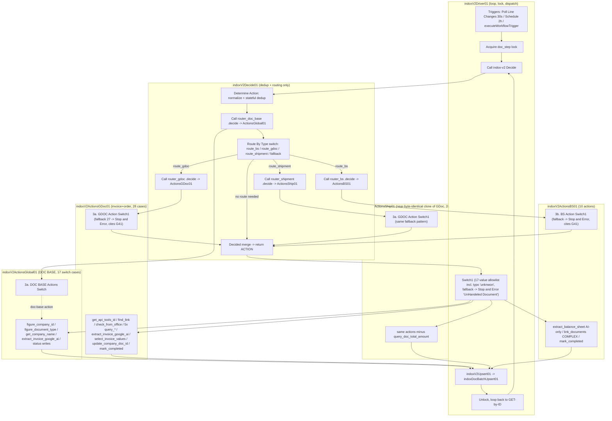
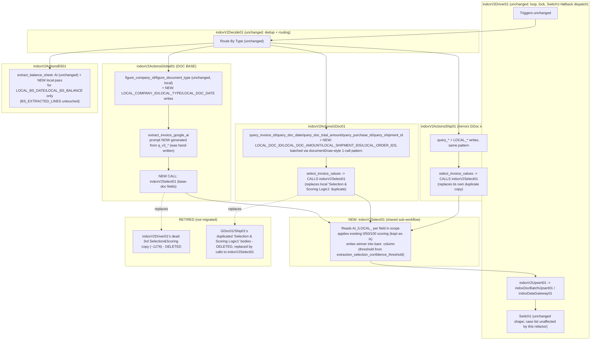

# INDOX state machine — action-flow change surface

**Status: near-final. Read-only research, all six state-machine files, the full 66-workflow inventory,
the Python service, DDL, settings, gates, CI, fixtures, and apitools confirmed by direct read. One
webapp-detail item remains open, tracked in §6. Everything below is cited to a live `file:line` or a
live query result run against `supabase-db-shlomo-laptop`/`n8n-postgres-shlomo-laptop` (the local dev
stack, per `ai/context/EXTRACTION-REFACTOR-PLAN.md` §0.1 — not hacohen-vps).**

**Scope boundary (do not duplicate).** `ai/context/EXTRACTION-REFACTOR-PLAN.md` owns the extraction
design: the `AI_*`/`LOCAL_*`/`SELECTED_*`/`SELECTION_*` column ledger, the two-phase
base-doc/per-type extraction shape, the settings toggles (`extraction_ai_enabled`,
`extraction_local_enabled`, `extraction_model`, `extraction_selection_confidence_threshold`), the BS
per-line design, and the `q_v3_*` single-source-of-truth query definitions. This document cites that
plan rather than re-deriving it, and covers the two things it explicitly does not: **the action-flow /
state-machine shape itself**, and **the complete cross-cutting impact inventory** — every n8n
workflow, DDL object, webapp column-use, settings row, gate, and fixture that a rename or an
action-flow change touches.

---

## 0. Corrections and load-bearing facts established during this scan

- **G41 (`switch-fallback-lint.py`) is GREEN today**, confirmed by running it directly
  (`python3 scripts/refactor/switch-fallback-lint.py` → `G41 PASS — 4 rules-mode switch(es) all
  declare a fallbackOutput, and 4 decide/switch pair(s) have full case coverage.`). The task brief's
  "8 silent-drop gaps were found and fixed today" is the fix this gate now protects: 4 switches were
  missing `fallbackOutput` (check A) and 3 of those pipelines were also missing at least one real case
  (check B) — `indoxV2ActionsGlobal01.json`'s `3a. DOC BASE Actions Switch` was dropping
  `extract_invoice_google_ai` (+ 4 more per the gate's own docstring), `indoxV2ActionsBS01.json` was
  dropping `no_action_unhandled_state`, and both `indoxV2ActionsGDoc01.json`/`indoxV2ActionsShip01.json`
  were dropping `no_action_already_completed`. **Confirmed live today**, both GDoc01 and Ship01 now
  carry `no_action_already_completed` as a real, wired case (GDoc01.json:596-598, Ship01.json:596-598)
  and every rules-mode switch has a real `fallbackOutput` wired to a `stopAndError` node whose message
  cites "(G41)" by name. **This is the baseline the refactor must not regress below** — see §3.
- **G42 was RETIRED 2026-08-07** — it mandated `indoxDataGateway01`, a workflow an agent lane
  invented, the owner rejected, that never executed, and that is now disarmed; a gate that can never
  go green trains readers to skim the failures. See `scripts/refactor/GATES.md`, "Two gates
  retired". The measurement below still describes the real spread of direct Postgres writers and is
  kept for that reason — but note the honest re-count against the REAL writer
  (`indoxApiSupabase01`) is ~20 production workflows / ~35 nodes touching `incoming_documents`, not
  the headline: 9 test/fixture workflows carry 59% of the nodes, and `syncLedgerApi01` owns the
  ledger family by design. Historical text follows.
  ~~**G42 (`direct-db-write-lint.py`) is RED today, by design**~~ (was documented KNOWN FAILING in
  `scripts/refactor/GATES.md`). Live run: `G42 FAIL — 25 workflow(s) other than
  indoxDataGateway01.json still write Postgres directly (120 offending node(s) total, of 66 workflows
  checked)`. None of `indoxV2Driver01`/`Decide01`/`ActionsGlobal01`/`ActionsGDoc01`/`ActionsShip01`/
  `ActionsBS01` are in that list — **the state machine itself writes no Postgres directly**; it calls
  `indoxV2Upsert01` → `indoxDocBatchUpsert01` (see §2). The 25 flagged files are gateways
  (`indoxApiSupabase01`), reset/admin tools, test fixtures, and the `JQExV3*` config-query family — not
  the action-flow machine. Full list in §2's inventory table.
- **The shipment lane has already been physically forked out of GDoc, live, today** — this postdates
  `ai/context/indox-v2.1-state-machine-plan.md` (2026-07-05, which still describes shipment as sharing
  `router_gdoc`) and `ai/context/release-lockin-plan.md` (2026-07-07, which explicitly **deferred** the
  physical fork). Confirmed by direct read of `indoxV2Decide01.json`: `Route By Type` (a switch,
  `indoxV2Decide01.json:35-118`) has four outputs — `route_bs`, `route_gdoc`, `route_shipment`, and a
  fallback (`options.fallbackOutput:"extra"`, `indoxV2Decide01.json:106-108`) that goes straight to
  `Decided` (meaning a DOC-BASE-only action skips per-type routing entirely). `Call router_shipment
  (decide)` (`indoxV2Decide01.json:300-323`) calls workflow id `indoxV2ActionsShip01` — a real, separate
  4,690-line file, not a shared call into GDoc. **`indoxV2ActionsGDoc01.json` and
  `indoxV2ActionsShip01.json` are today near-byte-identical clones** (106 nodes each, same connections
  graph, same node IDs) — confirmed by a full-file diff (agent research, §1). This matters for
  sequencing: `ai/context/INDOX-SCALE-ARCHITECTURE-FINAL.md` T20 already proposes merging them back into
  one parameterized workflow — a **different, currently-unscheduled** initiative that this refactor
  should be aware of but is not asked to execute (flagged in §4).
- **`ORDER` is not physically forked** — `orderDecide(doc)` in both GDoc01 and Ship01's decide code is
  literally `return invoiceDecide(doc);` (GDoc01.json:3192, Ship01.json:3192) — orders run the full
  invoice flow today. `router_order` remains a named-but-undone item in
  `indox-v2.1-state-machine-plan.md`/`release-lockin-plan.md`'s deferred list, out of scope for this
  refactor unless the owner says otherwise.
- **The 50-action registry in `ai/context/indox-state-machine-v2.md`** (dated 2026-07-02) is the best
  available prior documentation of the action set, but it predates the shipment fork and the G41 fix —
  treated below as a *starting point*, corrected against live file reads, not copied verbatim.
- **All six state-machine files have now been read directly, in full, by dedicated research passes.**
  §1 below is corrected against those reads, not the provisional tables from the first draft. Two
  corrections to the task brief itself, both confirmed by direct read:
  - **`indoxV2Driver01.json`'s `Switch1` allowlist has 17 entries, not 18** (counted twice against the
    live array, `indoxV2Driver01.json:263`), and **the "typo" is `update_status_unknwon_company`**
    ("unknwon" for "unknown") — **not** a warehouse-spelling issue. This is not a local slip: the
    identical misspelling is the actual, consistently-used action string across the whole system,
    reproduced in `indoxV2Driver01.json:1183` (its own test-fixture generator),
    `indoxV2ActionsGlobal01.json`, `indoxV2DocBaseTest01.json`, `indoxV2ActionsShip01.json`,
    `indoxV2ActionsGDoc01.json`, `indoxDocBatchUpsert01.json`, `indoxV2QueryTotalAmt01.json`,
    `indoxV2DecideTest01.json`, and fixtures (confirmed by repo-wide grep). **Do not silently "fix" this
    spelling as part of the refactor** — it is the literal string every layer agrees on; correcting it
    in only some files reintroduces exactly the class of drift this whole effort is meant to close.
    Flag it to the owner as a separate, explicit rename if wanted, never a silent typo fix.
  - **`indoxV2Driver01.json`'s `Switch1` DOES have a correctly-wired `fallbackOutput`** — confirmed
    `"options": {"fallbackOutput": "extra"}` (`indoxV2Driver01.json:375-377`), routing to node
    `Stop and Error` with `errorMessage: "UnHandeled Document"` (`indoxV2Driver01.json:684-696`). This
    is the **good** pattern G41 wants everywhere, matching `INDOX-TARGET-ARCHITECTURE-2026-08-05.md:160`'s
    characterization.
- **A major, previously-undocumented finding from the direct Driver01 read: two dead/orphaned
  code regions, beyond the one already known.** The task brief's "3 divergent copies of the selection-
  scoring logic (2 live, 1 dead in Driver01)" undercounts what's actually in this file:
  1. `Selection & Scoring Logic` (`indoxV2Driver01.json:1276`) — confirmed **fully disconnected**, zero
     inbound AND zero outbound wiring anywhere in the file (stronger than "test-fixture only" — it
     cannot be reached even via the test harness as currently wired).
  2. A **second, independently-implemented copy**, `Selection & Scoring Logic2`
     (`indoxV2Driver01.json:5556-5566`, larger, Hebrew-commented, different scoring rules from #1 —
     binary 0/50/100 with an `idMismatch`/`dataMismatch`/`allFourConfirmed`/"Trusted Supplier Override"
     shape) sits inside a **~2,400-line invoice/shipment-linking sub-block**
     (`indoxV2Driver01.json:~3198-5566`: `Action: Link Shipments`, `Search Existing Shipment`,
     `Create New Shipment Row`, `Update Existing — Link to Invoice`, `Collect Unique Invoice IDs`,
     `Mark Invoice Completed`, etc.) whose entry node (`Action: Link Shipments`) has **no inbound
     connection anywhere in this file** — meaning this entire large sub-block is either (a) dead code
     left over from before the GDoc/Ship physical fork moved this logic into
     `action_extract_shipment_ids` (§1.1), or (b) called from a workflow outside this file's own
     `connections` graph (UNVERIFIED — would need a repo-wide grep for an `executeWorkflow` node
     targeting `indoxV2Driver01` with a payload shaped to enter mid-graph, which n8n does not support
     natively, making (a) the more likely explanation). **This means the task brief's count of "2 live
     copies" of the selection-scoring logic should be treated as the two confirmed-live copies in
     GDoc01/Ship01 (§1.1) — the Driver01 file actually contains two additional, independently-dead
     copies, not one.** Flagged as a free cleanup opportunity, not a required part of this refactor,
     but worth doing in the same pass since it removes ~2,400 lines of unreachable code from the file
     every future reader of this state machine has to scroll past.
  3. A related smaller finding: `Selection & Scoring Logic2`'s trigger cluster, `Loop Over Items39`, also
     has no inbound connection except a self-loop — same disconnected-cluster shape.

---

## 1. The action-flow change map

### 1.1 Today's action set, by lane (all six state-machine files confirmed by direct, full read)

#### DOC BASE lane — `indoxV2ActionsGlobal01.json` ("indox-v2 Actions — DOC BASE")

**Confirmed live by full read.** The "Decide DOC BASE Action" code node
(`indoxV2ActionsGlobal01.json:1197-1203`, jsCode at :1199) contains four functions:
`docBaseDecide(doc, dup)` (double/pause/company/old-date guards), `unknownTypeAction(doc)`
(type-classification + AI-extraction fallback), `resolveDocType(type)` (a *different* concern —
returns `gdoc`/`shipment`/`bs_doc`/`unknown` for `DOC_TYPE`, not `ACTION` — consumed by
`indoxV2Driver01.json`'s `Switch1`, not this file's own switch), and the outer dispatcher
`docBaseRouterDecide(doc)` which calls the other three and adds its own direct guards
(`no_action_delete_row`, `no_action_max_iterations`, `mark_max_iterations`) plus the three
`__route_gdoc__`/`__route_shipment__`/`__route_bs__` markers.

**"3a. DOC BASE Actions Switch"** (`indoxV2ActionsGlobal01.json:340-432`), `parameters.rules.rules`
— 17 cases (index : `value2` = `outputKey`):

`0:update_status_double · 1:figure_company_id · 2:update_status_missing_company ·
3:no_action_awaiting_company_id · 4:get_company_name · 5:update_status_unknwon_company (sic) ·
6:no_action_awaiting_company_name · 7:figure_document_type · 8:update_status_missing_type ·
9:update_status_old_doc · 10:mark_max_iterations · 11:no_action_max_iterations · 12:no_action_double ·
13:no_action_old_date · 14:no_action_paused · 15:no_action_unknown_document_type ·
16:extract_invoice_google_ai` — plus dummy case/`fallbackOutput` **17** (`__unhandled_action__` /
"Unhandled ACTION - Error"), wired to **"Stop and Error - Unhandled DOC BASE ACTION"**
(`indoxV2ActionsGlobal01.json:1436-1448`), message cites "(G41)" by name — the live fix artifact.

**Coverage cross-reference, reconciled** (this required combining evidence across three files —
recorded here since no single file's own read settles it): `docBaseRouterDecide` can also emit
`no_action_delete_row`, `__route_gdoc__`, `__route_shipment__`, `__route_bs__` — **none of these 4
literals is a case in this file's own switch.** Taken in isolation this looks like a 4-literal G41-style
gap (and a background research agent flagged it exactly that way, correctly, from this file alone). It
is **not actually a live bug**, resolved by cross-file evidence:
- `__route_gdoc__`/`__route_shipment__`/`__route_bs__` are consumed by `indoxV2Decide01.json`'s
  `Route By Type` switch (confirmed by direct read of that file: `indoxV2Decide01.json:47,69,91` check
  `$json.ACTION` against exactly these 3 literals) — they are never meant to reach this file's own
  execute-mode switch; they are the **decide-mode return value** that the orchestrator routes on
  *before* calling any lane's execute mode.
- `no_action_delete_row` **is** one of `indoxV2Driver01.json:263`'s own 17-entry `Switch1` allowlist
  (case 16 there) — it is consumed directly by the Driver's dispatch, terminal, without ever needing to
  re-enter `indoxV2ActionsGlobal01` in execute mode.
- **G41's own `DECIDE_SWITCH_PAIRS` entry for this file is deliberately scoped to only
  `["docBaseDecide", "unknownTypeAction"]`** (`scripts/refactor/switch-fallback-lint.py:79-81`) —
  it does **not** check `docBaseRouterDecide`'s own directly-returned literals at all, by design (per
  that script's own comment about `resolveDocType`'s unrelated returns needing scoping-out). This means
  **G41 passing does not certify full coverage of `docBaseRouterDecide`'s outer dispatch layer** — it
  only certifies the two inner functions. The reconciliation above is the only thing that closes that
  gap, and it closes cleanly. **Recommendation for this refactor: if `indoxV2Select01` (§1.3) or any
  other new sub-workflow call is added to this file, verify by the same cross-file method (not by
  trusting G41 alone) that its return values are consumed somewhere, since G41's scoping has this known
  blind spot.**

**Action → effect table:**

| action_id | class | effect / STATUS |
|---|---|---|
| `update_status_double` | COMPLEX | "Action: Handle Doubles" → `STATUS='DOUBLE'`, `DOUBLE_LINE_CONTEXT` (write node misleadingly named "…STATUS MISSING_COMPANY_ID (DOC BASE)1", :1124-1172) |
| `figure_company_id` | SINGLE_EFFECT | → `indoxV2FigureCompanyId01` (:36) + `indoxV2UploadApiTools01` (thumbnail, :121) → `COMPANY_ID`, `COMPANY_NAME`, `STATUS`(IN_PROGRESS/API_TOOLS_FAILED), `FIGURE_COMPANY_COMPLETED`, `THUMBNAIL`, `THUMBNAIL_COMPLETED` |
| `update_status_missing_company` | STATUS_WRITE | `STATUS=MISSING_COMPANY_ID` (:875) |
| `no_action_awaiting_company_id` | NO_ACTION | terminal noOp |
| `get_company_name` | SINGLE_EFFECT | → `indoxSettings01` (:437, "Companies" node) → `COMPANY_NAME`, `COMPANY_NAME_COMPLETED` (:1089) |
| `update_status_unknwon_company` (sic, systemic spelling — see §0) | STATUS_WRITE | `STATUS=UNKNOWN_COMPANY` (:832) |
| `no_action_awaiting_company_name` | NO_ACTION | terminal noOp |
| `figure_document_type` | SINGLE_EFFECT | → `indoxV2FigureDocType01` (:635) → `TYPE`, `STATUS`, `FIGURE_TYPE_COMPLETED` |
| `update_status_missing_type` | STATUS_WRITE | `STATUS=MISSING_TYPE` (:1046) |
| `update_status_old_doc` | STATUS_WRITE | `IS_OLD='TRUE'`, `STATUS='OLD'` (:783,789 — write node misnamed "…COMPLETED3") |
| `mark_max_iterations` | STATUS_WRITE | `STATUS=MAX_ITERATIONS`, `ITERATION_COUNT`, `ERROR` (:734) |
| `no_action_max_iterations` | NO_ACTION | terminal noOp |
| `no_action_double` / `no_action_old_date` / `no_action_paused` / `no_action_unknown_document_type` | NO_ACTION | terminal noOps |
| `extract_invoice_google_ai` | SINGLE_EFFECT | httpRequest POST `http://n8n:5678/webhook/invoice_extractor` (:1322-1350, **a webhook call, not an `executeWorkflow` reference to `indoxV2ExtractInvoiceGemini01`** — UNVERIFIED from this file alone whether that webhook is that workflow's trigger, but consistent with the extraction plan's citation) → `AI_COMPANY_ID/DOC_ID/DOC_DATE/DOC_AMOUNT/SHIPMENT_IDS/ORDER_IDS/TYPE`, `AI_EXTRACTION_COMPLETED=true` (:1351-1435) — **this is the case G41 found missing from the switch and that is now fixed live** (§0), guarded by `doc.API_TOOLS_ID && !doc.AI_EXTRACTION_COMPLETED` in `unknownTypeAction` |

**Confirmed: no selection/scoring logic exists in this file at all** — `grep -in "score\|select"`
returns exactly one hit (the field name `doc.SELECTED_DOC_DATE`, read only as an input to the old-date
check, not a scoring computation). This matters directly for the target design (§1.3): wiring
`indoxV2Select01` into the base-doc step is a **genuinely new caller relationship**, not a
consolidation of something already here.

**`executeWorkflowTrigger` entry** ("When Called", `indoxV2ActionsGlobal01.json:707-714`):
`inputSource: "passthrough"` — no declared field schema, so G39's "field missing from a declared
schema" failure mode does not apply to this entry point itself (it would apply to any *inner*
`executeWorkflow` call in this file using `defineBelow` mapping, e.g. "Figure Document COMPANY_ID"
which declares only `ID/API_TOOLS_ID/LINK/SOURCE_ID/NAME` — any other field sent to that specific
sub-call is dropped by that node's own schema).

**Confirmed: no Postgres node.** All writes route through `indoxV2Upsert01` (executeWorkflow, "Upsert
(central)", :1177).

#### GDoc lane (invoice + order) — `indoxV2ActionsGDoc01.json` ("indox-v2 Actions — GDoc")
#### Shipment lane — `indoxV2ActionsShip01.json` ("indox-v2 Actions — Shipment")

**Confirmed live by full read (background research agent, this session).** Both files: 106 nodes,
identical connections graph, identical node IDs; the only functional differences are the decide
function's `DOC_TYPE` tail and the `stopAndError` node's error-message string.

**The paired switch, both files, node name `"3a. GDOC Action Switch1"`** (Ship01 keeps the "GDOC" name
— a leftover from the clone, GDoc01.json:610 / Ship01.json:610). Full `parameters.rules.rules` array
(GDoc01.json:490-603 / Ship01.json:490-603), 28 cases in order:

`update_name` · `restart_gdoc` · `no_action_awaiting_company_id` · `no_action_awating_doc_id`
**(typo: "awating" — missing an "i", live in the case literal itself)** · `get_short_doc_id` ·
`find_link` · `update_status_missing_link` · `no_action_link_not_found` · `get_api_tools_id` ·
`update_status_api_tools_failed` · `no_action_api_tools_failed` · `check_from_office` ·
`query_doc_date` · `no_action_doc_date_missing` · `query_doc_total_amount` ·
`no_action_doc_total_amount_missing` · `query_shipment_id` · `update_status_missing_shipment` ·
`query_purchase_id` · `extract_invoice_google_ai` · `action_extract_shipment_ids` (outputKey renamed
`extract_shipment_ids`) · `select_invoice_values` · `action_priority_sync` (outputKey renamed
`priority_sync`) · `mark_completed` · `query_invoice_id` · `update_company_doc_id` ·
`no_action_already_completed` · `__unhandled_action__` (fallback, output 27).

`parameters.options.fallbackOutput: 27` (GDoc01.json:606 / Ship01.json:606) routes both an explicit
`__unhandled_action__` value AND anything unmatched to output 27 →
**`Stop and Error - Unhandled ACTION`** (GDoc01.json:3255-3267 / Ship01.json:3255-3267), whose message
literally names the file, the switch node, and cites "(G41)" — this is the live artifact of the fix.

Every literal the decide functions (`gdocDecide`/`shipmentDecide`/`orderDecide`/`gdocHead`/`gdocTail`,
all in the "Decide GDoc/Shipment Action" code node, GDoc01.json:3192 / Ship01.json:3192) can return has
a matching case — **confirmed zero gap today**. 7 switch cases have no producing literal in either
decide function today (`no_action_awaiting_company_id`, `no_action_awating_doc_id`,
`update_status_api_tools_failed`, `no_action_api_tools_failed`, `no_action_doc_date_missing`,
`no_action_doc_total_amount_missing`, `update_status_missing_shipment`) — dead/vestigial, harmless,
flagged for whoever next prunes dead code, not part of this refactor's required change set.

**GDoc/Ship action → effect table** (identical line numbers in both files):

| action | effect (sub-workflow / node) | writes |
|---|---|---|
| `get_api_tools_id` | `indoxV2UploadApiTools01` (:912) | `API_TOOLS_ID` |
| `find_link` | `indoxV2SearchFile01` (:765) / `indoxV2SearchWarehouse01` (:1577) | `LINK`, `SEARCH_IN_DRIVE_COMPLETED` |
| `check_from_office` | settings + `indoxV2SearchWarehouse01` (:1577/1623) | `FROM_OFFICE`, `FROM_OFFICE_CHECK` |
| `query_invoice_id` | `indoxV2QueryInvoiceId01` (:1237, node misleadingly named "Call 'Query DOCUMENT_DATE'1") | `COMPANY_DOC_ID` (two write sites, :2126 and :2874 — see §5) |
| `query_doc_date` | `indoxV2QueryDocDate01` (:265) | `DOC_DATE` |
| `query_doc_total_amount` | `indoxV2QueryTotalAmt01` (:126) — **GDoc only, Ship01's `shipmentDecide` never emits this action** | `DOC_TOTAL_AMOUNT` (:2710) |
| `query_purchase_id` | `indoxV2QueryPurchaseId01` (:966) | `PURCHASE_ID` |
| `query_shipment_id` | `indoxV2QueryShipmentId01` (:1044) | `SHIPMENT_DOC_ID` |
| `extract_invoice_google_ai` | HTTP POST `webhook/invoice_extractor` (:3112-3138, AI Gemini) | `AI_COMPANY_ID/TYPE/DOC_ID/DOC_DATE/DOC_AMOUNT/SHIPMENT_IDS/ORDER_IDS` |
| `action_extract_shipment_ids` | `indoxV2SearchWarehouse01` + `indoxApiRouter01` GET_ALL match (:1577/3157) | new/linked SHIPMENT rows |
| `select_invoice_values` | `Selection & Scoring Logic1` (:674, **byte-identical between the two files, confirmed by diff**) | `SELECTED_*`/`SELECTION_*` (7+5 columns — see `EXTRACTION-REFACTOR-PLAN.md` §1.1 row 10, §2.4) |
| `action_priority_sync` | HTTP POST to external Priority ERP (`msh.macomp.vip`, :864-893) | `PRIORITY_SYNC_COMPLETED` |
| `mark_completed` | — | `STATUS=COMPLETED` |
| `update_company_doc_id` | — | `COMPANY_DOC_ID` (second write site, :2939) |
| `no_action_already_completed` | terminal, no-op | — |

STATUS values written in these two files (identical): `IN_PROGRESS` (on `restart_gdoc` and on
`find_link` success), `MISSING_LINK` (on `update_status_missing_link`, and reused on a new-shipment
placeholder row), `API_TOOLS_FAILED` (dead case), `MISSING_SHIPMENT` (dead case, written by a
misleadingly-named node "…STATUS COMPLETED1"), `COMPLETED` (on `mark_completed`). Two node-naming
inconsistencies exist that are worth knowing about before anyone edits nearby code:
"Build: … - STATUS COMPLETED1" (:1713) actually writes `MISSING_SHIPMENT`, and "Build: Mark Invoice
Completed1" (:2288) actually writes `IN_PROGRESS`.

#### BS lane — `indoxV2ActionsBS01.json` ("indox-v2 Actions — BS")

**Confirmed live by full read.** "Decide BS Action" (`indoxV2ActionsBS01.json:1277-1289`, jsCode
:1279) — one function, `bsDecide(doc)`, **10 distinct literals**, all present as real switch cases
(full coverage, confirmed — matches the G41-fixed claim): `update_status_missing_company` ·
`no_action_awaiting_company_id` · `restart_balance_sheet` · `extract_balance_sheet` ·
`update_status_extraction_failed` (emitted from two guard branches) · `no_action_extraction_failed`
(emitted from two guard branches) · `link_documents` · `mark_completed` · `no_action_already_completed`
· `no_action_unhandled_state` (final fallback).

**"3b. BS Action Switch1"** (`indoxV2ActionsBS01.json:357-421`), 10 real cases (index :`value2`) —
`0:update_status_missing_company · 1:no_action_awaiting_company_id · 2:restart_balance_sheet ·
3:extract_balance_sheet · 4:update_status_extraction_failed · 5:no_action_extraction_failed ·
6:link_documents · 7:mark_completed · 8:no_action_already_completed · 9:no_action_unhandled_state` —
plus dummy case/`fallbackOutput` **10** wired to **"Stop and Error - Unhandled BS ACTION"**
(:1343-1354), message cites "(G41)". **`no_action_unhandled_state` (case 9) is a real, wired noOp
handler** ("No Action: Unhandled State (BS)", :1332-1342) — distinct from and separate to the dummy
fallback case 10 that goes to `stopAndError`. This confirms G41's fix precisely: the case that used to
be dropped now has an actual handler, not merely a loud failure.

**Action → effect table:**

| action | effect | writes |
|---|---|---|
| `extract_balance_sheet` | httpRequest POST `http://n8n:5678/webhook/bs_ex_2_dev` (:1174-1205, batched 5-concurrent) — **no `executeWorkflow` reference to a named `indoxV2ExtractBalanceSheet01` workflow found in this file; no local/apitools extraction step precedes it** (confirmed, matches `EXTRACTION-REFACTOR-PLAN.md` row 9 exactly) | on success: `BS_EXTRACTED_LINES`, `BS_LINK_DOCUMENTS_COMPLETED=false`, `BS_EXTRACTION_VERIFIED`, **`TOTAL_AMOUNT`** (bare column, :584 — not `DOC_TOTAL_AMOUNT`; this is the BS lane's own pre-existing use of the *target* consolidated name), `BS_EXTRACTED_LINES_COMPLETED=true`, `STATUS='IN_PROGRESS'`, `DOC_DATE` |
| `link_documents` | COMPLEX — `indoxApiRouter01` GET_ALL lookup (:1223) + local key-match, spawns/links per-line INVOICE rows | per spawned line: `LINKED_BS`, `BS_LINE_AMOUNT`, `BS_LINE_DATE`, `BS_LINE_NOTE`, `NAME`, `TYPE='INVOICE'`, **`COMPANY_DOC_ID`** (:760, `=String($json['BS_EXTRACTED_LINES.data.lines'].id)` — a **fifth** independent `COMPANY_DOC_ID` writer, §5), `COMPANY_ID`, `SOURCE_TYPE='BALANCE_SHEET'`, `SOURCE_ID`, `STATUS='IN_PROGRESS'`, `SHORT_DOC_ID` |
| `mark_completed` | — | `STATUS='COMPLETED'` (:1122) |
| `restart_balance_sheet` | — | resets `BS_EXTRACTED_LINES`/`BS_LINK_DOCUMENTS_COMPLETED`/`BS_EXTRACTION_VERIFIED`/`TOTAL_AMOUNT`/`BS_EXTRACTED_LINES_COMPLETED` to empty, `BS_EXTRACTION_USE_CACHE=false`, `STATUS='IN_PROGRESS'` (:969) |

**Confirmed: no selection/scoring logic** (`grep -in "score\|select"` returns zero matches) and **no
Postgres node** in this file, matching G42.

`executeWorkflowTrigger` entry ("When Called", `indoxV2ActionsBS01.json:540-547`): same
`inputSource:"passthrough"` shape as Global01 — no declared field schema at the entry point.

#### Driver — `indoxV2Driver01.json` ("Incoming Documents v2")

**Confirmed live by full read.** `Switch1` (`indoxV2Driver01.json:249-387`), `n8n-nodes-base.switch`
typeVersion 3.3, `parameters.rules.values` has **5 branches**. Branch 1 ("DOC BASE Actions",
`renameOutput:true`) matches on `[...].includes($json.ACTION)` — an array-literal allowlist
(`indoxV2Driver01.json:263`) with **17 entries, not 18**:

`update_status_missing_company · no_action_awaiting_company_id · get_company_name ·
update_status_unknwon_company (THE TYPO — "unknwon" for "unknown") · no_action_awaiting_company_name ·
update_status_missing_type · figure_document_type · update_status_double · figure_company_id ·
update_status_old_doc · mark_max_iterations · no_action_max_iterations · no_action_double ·
no_action_paused · no_action_old_date · no_action_delete_row · no_action_unknown_document_type`.

**The typo is `update_status_unknwon_company`, confirmed the same systemic string documented in §0 —
do not silently correct it.** Branches 2-5 match on `$json.DOC_TYPE` (not `ACTION`):
`DOC_TYPE=="gdoc"`→"G Doc Actions", `DOC_TYPE=="bs_doc"`→"BS Doc Actions",
`DOC_TYPE=="empty_row"`→"empty_row" (routes to "Skip empty_row (sheets legacy)"),
`DOC_TYPE=="shipment"`→"Shipment Doc Actions". **`parameters.options.fallbackOutput: "extra"`
(:375-377), confirmed wired to node `Stop and Error`, `errorMessage: "UnHandeled Document"`
(:684-696)** — the correct, G41-compliant pattern, matching
`ai/context/INDOX-TARGET-ARCHITECTURE-2026-08-05.md:160`'s characterization exactly. The five branch
outputs route to `Call indox-v2 Actions — DOC BASE/GDoc/BS/Shipment` respectively (confirmed via the
`connections` object).

Driver-level facts confirmed by direct read:
- Two-call-per-hop shape confirmed: `Call indox-v2 Decide` (unlocked, `executeWorkflow` →
  `indoxV2Decide01`, waitForSubWorkflow) returns an `ACTION`, THEN the driver acquires a `processLock01`
  Redis lock (`Check LOCKED`/`Join LOCKED`/`If NOT LOCKED`, :61-187) before dispatching through
  `Switch1` in execute mode — matching `indox-v2.1-state-machine-plan.md`'s "FINAL separation" section.
- `COMPANY_DOC_ID`/`DOC_TOTAL_AMOUNT`/`FROM_OFFICE` each appear as declared trigger-schema fields in
  **four separate places** inside this one file (`indoxV2Driver01.json:2510/2537/2690`,
  `:3466/3493/3646`, `:4167/4194/4347`, `:4884/4911/5064`) — each a `resourceMapper`-style field list
  belonging to a different `executeWorkflow`/Postgres-lookup call in the driver's shipment-linking
  side-flow (`Search Existing Shipment`, `Create New Shipment Row`, `Update Existing — Link`, `Mark
  Invoice Completed`). **This means a rename of any of these three columns has FOUR independent
  declaration sites inside Driver01 alone** that must all be updated together or the field silently
  vanishes from that specific call's payload — see §5. **Confirmed by the full read**: the complete
  passthrough column set at these four sites (deduplicated) is `ACTION_LOG, AI_COMPANY_ID,
  AI_DOC_AMOUNT, AI_DOC_DATE, AI_DOC_ID, AI_EXTRACTION_COMPLETED, AI_ORDER_IDS, AI_SHIPMENT_IDS,
  AI_TYPE, API_TOOLS_ID, API_TOOLS_ID_COMPLETED, BS_EXTRACTED_LINES(+_COMPLETED),
  BS_EXTRACTION_USE_CACHE, BS_EXTRACTION_VERIFIED, BS_LINE_AMOUNT/DATE/NOTE,
  BS_LINK_DOCUMENTS_COMPLETED, COMPANY_DOC_ID, COMPANY_ID, COMPANY_NAME(+_COMPLETED), DOC_DATE(+_COMPLETED),
  DOC_TOTAL_AMOUNT(+_COMPLETED), DOUBLE_LINE_CONTEXT, EMPTY, ERROR, EX_INVOICE_ID, EX_IS_BS(+_COMPLETED),
  FIGURE_COMPANY_COMPLETED, FIGURE_TYPE_COMPLETED, FROM_OFFICE, FROM_OFFICE_CHECK, HASH, ID, INVOICE_ID
  (+_COMPLETED), IS_OLD, LINK, LINKED_BS, NAME, PRIORITY_SYNC_COMPLETED, PRIORITY_SYNC_COUNT,
  PURCHASE_ID(+_COMPLETED), SEARCH_IN_DRIVE_COMPLETED, SELECTED_*(6 fields), SELECTION_*(5 fields),
  SHIPMENT_DOC_ID, SHIPMENT_ID_COMPLETED, SHORT_DOC_ID, SIZE, SOURCE_ID, SOURCE_LINK, SOURCE_TYPE,
  STATUS, TIMESTAMP, TOTAL_AMOUNT, TYPE` — the authoritative field list to check against on any rename
  touching this file.
- **Confirmed: no `FROM_WAREHOUSE` string exists anywhere in this file today.** Every warehouse-related
  reference reads `FROM_OFFICE`/`FROM_OFFICE_CHECK` — the node *name* `"If From Waerhouse1"`
  (:459-491, itself misspelled "Waerhouse") checks `$('Action: Query Shipment ID').item.json.FROM_OFFICE`,
  a reference to a node (`Action: Query Shipment ID`) **that does not exist anywhere in this file's own
  node list** — a second, separate dangling reference, unrelated to G38's workflow-id scope (G38 only
  checks `executeWorkflow`/`errorWorkflow` targets, not intra-workflow `$('Node').item` references) —
  UNVERIFIED whether this is live drift or a stale reference; flagged for the owner, not fixed here.
- **Two dead/orphaned sub-graphs confirmed** (§0): `Selection & Scoring Logic` (:1276, zero connections
  in or out) and the ~2,400-line invoice/shipment-linking sub-block containing `Selection & Scoring
  Logic2` (:5556-5566), whose entry node `Action: Link Shipments` has no inbound connection anywhere in
  this file.
- **The 3 "No Action" placeholder nodes named in the task brief** (`indoxV2Driver01.json:8-40`, "No
  Action: Shipment ID Missing1"/"Purchase ID Missing1"/"Allready COMPLETED") are **confirmed fully
  orphaned** — zero inbound and zero outbound connections anywhere in the file (grepped both by
  connection-target pattern and by node-name substring). The actual production "no action" path is
  `Map NO ACTION` (:189-198) → `If COMPLETED` (:897-928) — and `If COMPLETED` **itself has no outgoing
  connection**, so in practice every "no action" document just terminates there today, undifferentiated
  by which specific no-action reason applied.
- **The locked-document safety branch is disabled and dead-ends.** `Call 'Snooze Incoming Document'`
  (workflow id `bdchh5urW9lBzudZ`) and `Process Blocked Error` (`stopAndError`) are both
  `disabled: true`, and `Process Blocked Error` has no outgoing connection even if re-enabled — a
  locked document currently just silently drops out of the flow rather than being explicitly snoozed or
  erroring loudly. Confirmed live (§2.3): `bdchh5urW9lBzudZ` also has zero rows in `workflow_entity`
  per `AUDIT-FINDINGS-2026-08-05.md` H7 — the target does not even exist, so re-enabling this node as-is
  would fail immediately.
- **`If USE ACTION LINE` (:719-751) references a non-existent `Companies` node** — its condition
  (`$('Companies').first().json.indox_execution_mode`) always throws (no node named `Companies` exists
  in this file) and falls into a `catch` that returns `true`, meaning this file's "parallel-actions vs
  all-in-one" execution-mode branch is **effectively hardcoded to parallel-actions today**, regardless
  of the live `indox_execution_mode` setting value. Not something this refactor needs to fix, but
  relevant if anyone assumes the setting is actually being read.

### 1.2 Mermaid — today's action flow (BASE lane always first, then per-type)

### 1.3 Target action-flow map — named per the owner's design

**The base lane and per-type lane structure stays.** What changes: the AI extraction steps move
*into* the two process-doc steps (base-doc, per-type), each of which becomes "do BOTH AI and local,
write `AI_VAL`+`LOCAL_VAL`", followed by one shared selection step that writes plain `VAL`.

| Change | Action(s) affected | Where |
|---|---|---|
| **ADDED**: local extraction folded into the base-doc step | `figure_company_id`/`figure_document_type` (already local) gain sibling writes `LOCAL_COMPANY_ID`/`LOCAL_TYPE`/`LOCAL_DOC_DATE` (per `EXTRACTION-REFACTOR-PLAN.md` §3 Phase 2) | `indoxV2ActionsGlobal01` |
| **UNCHANGED (in this phase)**: `extract_invoice_google_ai` stays a distinct action, but its prompt is generated from the `q_v3_*` query definitions instead of hand-duplicated text (`EXTRACTION-REFACTOR-PLAN.md` §3 Phase 4) | `extract_invoice_google_ai` | `indoxV2ActionsGlobal01` |
| **ADDED**: local per-type extraction batched into one call, writing `LOCAL_DOC_ID`/`LOCAL_DOC_AMOUNT`/`LOCAL_SHIPMENT_IDS`/`LOCAL_ORDER_IDS` alongside today's `query_invoice_id`/`query_doc_total_amount`/`query_shipment_id`/`query_purchase_id` | 4 of the 5 `query_*` actions | `indoxV2ActionsGDoc01`, `indoxV2ActionsShip01` (identically, per their clone relationship) |
| **REMOVED → replaced**: `select_invoice_values`'s handler (`Selection & Scoring Logic1`, duplicated verbatim in both files) is retired in favor of one shared sub-workflow `indoxV2Select01`, called from BOTH the base-doc step and the per-type step (per `EXTRACTION-REFACTOR-PLAN.md` §2.3/§3 Phase 5) | `select_invoice_values` (action name can stay; its *handler* changes) | `indoxV2ActionsGDoc01`, `indoxV2ActionsShip01`, and a **new** call from `indoxV2ActionsGlobal01`'s base-doc step (base-doc fields need selection too, which they don't get today) |
| **REMOVED**: the third, dead `Selection & Scoring Logic` copy in `indoxV2Driver01.json` (~line 1276, confirmed test-fixture-only — see §2) is deleted, not migrated | none (already dead) | `indoxV2Driver01.json` |
| **UNCHANGED**: `no_action_already_completed`, `mark_completed`, `update_company_doc_id`, `find_link`, `check_from_office`, `get_api_tools_id`, `action_extract_shipment_ids`, `action_priority_sync` — none of these touch extraction columns | — | GDoc01/Ship01 |
| **BS: ADDED** local extraction for the two summary scalars only (`LOCAL_BS_DATE`/`LOCAL_BS_BALANCE`) — `BS_EXTRACTED_LINES` (the per-line list) is explicitly OUT of scope per `EXTRACTION-REFACTOR-PLAN.md` §2.2 | `extract_balance_sheet` | `indoxV2ActionsBS01` |
| **Column rename ripple** (not an action-flow change per se, but every action that writes `COMPANY_DOC_ID`, `DOC_TOTAL_AMOUNT`, or `FROM_OFFICE` needs its write-node's field name updated) | `update_company_doc_id`, `query_invoice_id`, `query_doc_total_amount`, `check_from_office`, plus BS's line-spawn writer | `indoxV2ActionsGDoc01`, `indoxV2ActionsShip01`, `indoxV2ActionsBS01`, `indoxV2Driver01` (×4 sites), `indoxDataGateway01`, `indoxDocBatchUpsert01` — full enumeration in §5 |
| **Settings-driven toggles** (new capability, not a new action) — `extraction_ai_enabled`, `extraction_local_enabled`, `extraction_model`, `extraction_selection_confidence_threshold` gate behavior inside existing actions, they don't add new ACTION values to any switch | `extract_invoice_google_ai`, `extract_balance_sheet`, `select_invoice_values`/`indoxV2Select01` | `indoxV2ActionsGlobal01`, `indoxV2ActionsBS01`, new `indoxV2Select01` |

**No action is proposed for removal from any switch's case list by the target design** — the design is
additive at the action-name level (new `LOCAL_*` writes happen inside existing actions' handler nodes,
and one new shared selection sub-workflow replaces two duplicated handler bodies without renaming the
action). The state machine's shape (base lane → per-type lane, one ACTION per driver loop) is
explicitly preserved per the owner's brief. **The one real new node-graph work per lane**: base-doc
step's local-extraction addition (new Query* calls inside `indoxV2ActionsGlobal01`, which today has
none — see `EXTRACTION-REFACTOR-PLAN.md` §1.1 rows 1-2 for what already exists there to extend), and
wiring `indoxV2Select01` as a **new caller relationship** from `indoxV2ActionsGlobal01` (which does not
call any selection logic today — confirmed no `SELECTED_*`/`SELECTION_*` match in that file, pending
final confirmation by the in-flight Global01 agent).

### 1.4 Mermaid — target action flow

---

## 2. The complete change inventory

### 2.1 All 66 n8n workflows (`apps/indox/blueprint/n8n/`), confirmed by direct read + live grep

**Summary: 24 UNTOUCHED · 12 TOUCHED-indirectly · 30 TOUCHED-directly.**
`platform-base/n8n/workflows/*.json` (4 files: `ciHelloWebhook01`, `errorHandler01`,
`glitchtipReporter01`, `processLock01`) — none reference the INDOX document pipeline by content;
**`processLock01` is however the lock primitive `indoxV2Driver01.json`'s "Check LOCKED" node calls**
(§1.1) — structurally load-bearing for the state machine's locking, even though it carries no
document-shaped columns itself.

| File | Role | State-machine link | STATUS/ACTION | Refactor columns | Direct PG write | Verdict |
|---|---|---|---|---|---|---|
| `IndoxInjectDemo01.json` | Demo-data injector | not calling/called | none | none | none (via `indoxApiRouter01`) | UNTOUCHED |
| `IndoxResetFull01.json` | Full stack reset | not calling/called | none | none | Yes (n8n execution table) | UNTOUCHED |
| `IndoxResetGml001.json` | Gmail-sync reset | not calling/called | none | none | Yes (own registry) | UNTOUCHED |
| `JQExV3BS00000001.json` / `Base000001` / `Invoice001` / `Order00001` / `Ship000001` | Orphaned config-driven extraction prototypes (5) | **0 hits** in any of the 6 state-machine files (confirmed) | none | none | Yes, `Load V3 Config` reads `public.settings`, not `incoming_documents` | UNTOUCHED (orphaned) |
| `JQExV3RunBS00001` / `RunBase001` / `RunInv0001` / `RunShip001` | Webhook wrappers for the above (4) | not calling/called | none | none | none | UNTOUCHED |
| `SyncApi0000000001.json` | Drive/Gmail sync registry API | not calling/called | own `STATUS`/`ACTION` (sync-registry table, disjoint from `incoming_documents`) | none | Yes (own table) | UNTOUCHED |
| `SyncProcBS000001.json` | Drive-BS sync processor | calls `indoxDocBatchUpsert01` (:231) | `STATUS`×3 | `FROM_OFFICE`/`FROM_OFFICE_CHECK` writer (:472-482) | none direct (via gateway) | **TOUCHED-directly** |
| `SyncProcGDoc0001.json` | Drive-GDoc sync processor | calls `indoxProcessDocument01` (:309) **and** `indoxDocBatchUpsert01` (:665) | `STATUS`×3, `ACTION`×3 | `FROM_OFFICE`/`FROM_OFFICE_CHECK` writer (:914-924), `COMPANY_DOC_ID`/`DOC_TOTAL_AMOUNT` (:678,733,758) | none direct | **TOUCHED-directly** |
| `SyncScanUnit0001.json` / `SyncScanner00001.json` / `SyncSource000001.json` | Sync scan/scanner/source workers (3) | not calling/called | none | none | 2 of 3 write own tables | UNTOUCHED |
| `indoxApiRouter01.json` | Central HTTP-shaped dispatcher | sits on the write path of every Actions*/Driver01 call, but calls neither directly | `STATUS` as a route-selector value (:61) | none literal | none direct (dispatches) | TOUCHED-indirectly |
| `indoxApiSupabase01.json` | Generic autoMap Postgres layer + **the 30s poller and 6h stale-row reaper** | calls `indoxV2Driver01` indirectly per-row (reconciliation) | reads/writes `STATUS`, `NEXT_RETRY_AT` (only real consumer, "Get Changed Docs" :520), `REQUIRED_ACTION` (`Terminalize Stalled` :606) | generic passthrough | Yes — 11 Postgres nodes (`PG Upsert`/`Get`/`Get All`/`Delete`/etc.) | TOUCHED-indirectly — **this file, not the state machine itself, is where `NEXT_RETRY_AT` would need its first-ever writer if that column is ever activated (§ new finding below)** |
| `indoxDataGateway01.json` | New single-writer gateway (Phase-3-built, **not yet wired**, G42 known-failing) | calls `indoxIdentity01` | `REQUIRED_ACTION`, `ACTION_LOG` in trigger schema | declares `FROM_OFFICE`/`FROM_OFFICE_CHECK` (:79,82) + most others | none (the one exempted writer) | **TOUCHED-directly** — **NOT in G39's `UPSERT_TARGETS`, see §3 correction** |
| `indoxDocBatchUpsert01.json` | **The live/actual write gateway today** | called by Gmail downloaders, Driver01×4, Sync* processors, Upsert01 | `STATUS`×24, `REQUIRED_ACTION`×~20 | heaviest file for `FROM_OFFICE`(:11,191,325,330,483+), `COMPANY_DOC_ID`/`DOC_TOTAL_AMOUNT`(:225,64) | none direct | **TOUCHED-directly** — carries the uncommitted THUMBNAIL/CONNECTION/RETRY_COUNT/NEXT_RETRY_AT fix (extraction plan §0.4); **the one file G39 actually checks** |
| `indoxDocGet01.json` | Generic single-document reader | calls `indoxApiRouter01` | none | none | none | TOUCHED-indirectly (structural hop only) |
| `indoxGmailActionProcessor01.json` / `indoxGmailActionsScanner01.json` | Gmail label/action processing (2) | not calling/called | none | none | none | UNTOUCHED |
| `indoxGmailBSDownloader01.json` | Gmail BS attachment downloader | calls `indoxDocBatchUpsert01` (:441) | `STATUS`×2 | `FROM_OFFICE`/`FROM_OFFICE_CHECK` writer (:689-699) | none direct | **TOUCHED-directly** |
| `indoxGmailDocDownloader01.json` | Gmail doc attachment downloader | calls `indoxProcessDocument01` (:414) **and** `indoxDocBatchUpsert01` (:942) | `STATUS`×3 | `FROM_OFFICE`/`FROM_OFFICE_CHECK` writer (:1190-1200) | none direct | **TOUCHED-directly** |
| `indoxGmailLinkDownloader01.json` | Gmail link-document downloader | calls `indoxProcessDocument01` (:349) **and** `indoxDocBatchUpsert01` (:447) | `STATUS`×3, `REQUIRED_ACTION`(:653) | `FROM_OFFICE`/`FROM_OFFICE_CHECK` writer (:697-707); one of the 3 divergent `SHORT_DOC_ID` formulas (extraction plan §4.2) | none direct | **TOUCHED-directly** |
| `indoxHealth00001.json` | Health check | not calling/called | none | none | none | UNTOUCHED |
| `indoxIdentity01.json` | Single identity function (dedup/`SHORT_DOC_ID`) | called by `indoxDataGateway01` only | reads `candidates[].STATUS` | none | none (pure function) | TOUCHED-indirectly |
| `indoxProcessDocument01.json` | Older Gmail-ingestion lane | calls `indoxV2FigureCompanyId01` — **not reachable from Decide01** (confirmed) | none | none literal (returns local fields to caller) | none | TOUCHED-indirectly — reuses `indoxV2FigureCompanyId01`, which Phase 2 modifies |
| `indoxSettings01.json` | Settings/cache workflow | calls `indoxApiRouter01` | none | reads `SELECTION_CERTAINTY` (`KW Config` node, feeds `trusted_suppliers`) | Yes — `KW Config` node | **TOUCHED-directly** — hosts the new settings toggles; carries the uncommitted cache-invalidation webhook fix |
| `indoxV2ActionsBS01.json` | **State machine — BS lane** | called by `indoxV2Driver01`, `indoxV2Decide01` | `STATUS`×7, `ACTION_LOG`×many | writes feeding future `AI_BS_*`/`TOTAL_AMOUNT`; `COMPANY_DOC_ID` writer (:760) | none direct | **TOUCHED-directly** |
| `indoxV2ActionsGDoc01.json` | **State machine — GDoc lane** | called by `indoxV2Driver01`, `indoxV2Decide01`; calls all 5 `Query*`, `SearchFile01`, `UploadApiTools01`, `SearchWarehouse01`, `Upsert01`×4 | `STATUS`×7 | duplicated `Selection & Scoring Logic1`, `FROM_OFFICE` writer, `COMPANY_DOC_ID`(×2), `DOC_TOTAL_AMOUNT` | none direct | **TOUCHED-directly** (heaviest single-file impact) |
| `indoxV2ActionsGlobal01.json` | **State machine — DOC BASE lane** | called by `indoxV2Driver01`, `indoxV2Decide01`, `indoxV2DocBaseTest01`×4; calls `FigureCompanyId01`, `UploadApiTools01`, `Settings01`, `FigureDocType01`, `Upsert01` | `STATUS`×8, `ACTION_LOG`×many | writes all 7 `AI_*` fields, `COMPANY_ID`, `TYPE` | none direct | **TOUCHED-directly** |
| `indoxV2ActionsShip01.json` | **State machine — Shipment lane** | called by `indoxV2Driver01`, `indoxV2Decide01`; mirrors GDoc01's sub-calls exactly | `STATUS`×7 | duplicated Selection&Scoring copy, `FROM_OFFICE` writer, `DOC_TOTAL_AMOUNT`, `COMPANY_DOC_ID`(×2) | none direct | **TOUCHED-directly** |
| `indoxV2BSTest01.json` | BS E2E test | dynamically targets `ActionsBS01`/`Decide01`; calls `indoxV2TestFixtures01` | hardcodes ~9 action-name literals + STATUS values | hardcodes `COMPANY_DOC_ID`, `BS_EXTRACTED_LINES`, `BS_EXTRACTION_VERIFIED`, `BS_LINK_DOCUMENTS_COMPLETED`, `BS_LINE_*` | Yes (6 seed/verify/cleanup nodes) | **TOUCHED-directly** |
| `indoxV2Decide01.json` | **State machine — the router itself** | called by `indoxV2Driver01`, `indoxV2DecideTest01`; calls all 4 lane workflows | reads `$json.ACTION`×3 (routing) | reads `COMPANY_DOC_ID` | none | **TOUCHED-directly** (core routing logic) |
| `indoxV2DecideTest01.json` | Unit test of `determineAction` | calls `indoxV2Decide01` directly | **~45** hardcoded action-name literals covering the full decision table, asserts `item.json.ACTION` | hardcodes `FROM_OFFICE_CHECK`, `COMPANY_DOC_ID`, `DOC_TOTAL_AMOUNT`, `SELECTION_COMPLETED`, `AI_EXTRACTION_COMPLETED`, `SHORT_DOC_ID` | none | **TOUCHED-directly** — the single fixture most exposed to BOTH the action-flow rename and the column rename simultaneously |
| `indoxV2DocBaseTest01.json` | DOC BASE E2E test | calls `indoxV2ActionsGlobal01`×4; `indoxApiRouter01`×6 | `ACTION`×2, `STATUS` (via generic calls) | 2 hits | Yes (4 seed/verify nodes) | **TOUCHED-directly** |
| `indoxV2Driver01.json` | **State machine — top-level orchestrator** | calls `Decide01`, all 4 lane workflows, `DocGet01`×2, `ApiRouter01`, `DocBatchUpsert01`×4; called by `indoxV2PipelineTest01`, `indoxApiSupabase01` | `STATUS`×9, `ACTION`×21, **plus a distinct `ACTION_LINE`/`ACTION_LINES` batch mechanism — different from Decide01's routing field, see §0** | 245 hits (heaviest file) — the 2 orphaned Selection&Scoring copies (§0), `FROM_OFFICE`/`FROM_OFFICE_CHECK` (×5 sites) | Yes (9 execution-bookkeeping hits, not document-table writes) | **TOUCHED-directly** (most central file) |
| `indoxV2ExtractBalanceSheet01.json` | AI-only BS extractor (Gemini) | called via webhook, not `executeWorkflow`; calls `indoxSettings01` | none | feeds future `AI_BS_*`/`TOTAL_AMOUNT` | Yes (2 `KVStorage` cache nodes) | **TOUCHED-directly** (hardcoded model names, settings-toggle target) |
| `indoxV2ExtractInvoiceGemini01.json` | Base-lane AI extractor (Gemini) | called via webhook; writes return to `ActionsGlobal01` | none | writer of all 7 `AI_*` fields (prompt :813-835, model :861-892) | Yes (2 `KVStorage` cache nodes) | **TOUCHED-directly** |
| `indoxV2FigureCompanyId01.json` | Local company-ID extraction | called by `ActionsGlobal01` **and** `indoxProcessDocument01` (Gmail lane) | none | **Phase 2 explicit target** — add `LOCAL_COMPANY_ID` sourced from `settings.q_v3_company` | none | **TOUCHED-directly** |
| `indoxV2FigureDocType01.json` | Local doc-type classifier | called by `ActionsGlobal01` | none | **Phase 2 target** for `LOCAL_TYPE` | none | **TOUCHED-directly** |
| `indoxV2GDocTest01.json` | GDoc E2E test | dynamically targets `ActionsGDoc01`/`Decide01`/`ApiRouter01`; calls `indoxV2TestFixtures01` | hardcodes ~17 action-name literals incl. **`update_company_doc_id`** (names the field being consolidated into `DOC_ID`) | hardcodes full `AI_*` cache fixture | Yes (11 seed/verify/cleanup nodes) | **TOUCHED-directly** |
| `indoxV2PipelineTest01.json` | Full-pipeline E2E test | calls `indoxV2Driver01` directly; `ApiRouter01`×5 | hardcodes 6 STATUS outcomes (MISSING_COMPANY_ID, UNKNOWN_COMPANY, MISSING_TYPE, OLD, DOUBLE, PAUSE) | none beyond STATUS/field names | Yes (9 seed/verify nodes) | **TOUCHED-directly** (drives Driver01 end-to-end) |
| `indoxV2QueryDocDate01.json` / `QueryInvoiceId01` / `QueryPurchaseId01` / `QueryShipmentId01` / `QueryTotalAmt01` | Local field extractors (5) | called by both `ActionsGDoc01` and `ActionsShip01` | none | each is a §1.3 Phase 4 target for its own `LOCAL_*` field; `QueryInvoiceId01`=`COMPANY_DOC_ID` writer, `QueryTotalAmt01`=`DOC_TOTAL_AMOUNT` writer | none | **TOUCHED-directly** (all 5) |
| `indoxV2SearchFile01.json` | Drive file search | called by `ActionsGDoc01`/`ActionsShip01` | none | none (zero column-literal hits) | none | TOUCHED-indirectly (structural hop) |
| `indoxV2SearchWarehouse01.json` | Warehouse-scan search | called by `ActionsGDoc01`/`ActionsShip01` | none | none literal in this file — the actual `FROM_OFFICE` write happens in the caller | none | TOUCHED-indirectly — this **is** the search behind `check_from_office`, cited in `indox-state-machine-v2.md:110`, but doesn't itself hold the literal column name |
| `indoxV2TestFixtures01.json` | Shared fixture-seeding infra | called by `GDocTest01`/`BSTest01` | none | 3 hits | Yes (3 seed nodes) | **TOUCHED-directly** (shared by suites that exercise the state machine) |
| `indoxV2UploadApiTools01.json` | Generic OCR/upload wrapper | called by nearly every extraction sub-workflow | none | none (zero column-literal hits) | none | TOUCHED-indirectly — throughput-consolidation target (extraction plan §5), no column names hardcoded |
| `indoxV2Upsert01.json` | Central upsert chokepoint | called by all 3 Actions lanes ×4 each; calls `indoxDocBatchUpsert01` | passthrough | passthrough — every extraction column flows through here | none direct | **TOUCHED-directly** (structural chokepoint) |
| `mailOrgTest00001.json` | Mail-organizer test (unrelated feature) | not calling/called | none | none | Yes (own tables) | UNTOUCHED |
| `sv3Inject3x001.json` | Sync-v3 registry injector | calls `indoxSettings01`, `indoxApiRouter01` | none | none | none | UNTOUCHED |
| `syncLedgerApi01.json` | Sync ledger API | not calling/called | none | none | Yes (14 nodes, own ledger table — the sync-layer claim mechanism, distinct from extraction locking) | UNTOUCHED |
| `syncV3Deliver0001.json` | Sync-v3 document delivery into the pipeline | calls `indoxApiRouter01`×3 | sets initial `STATUS` on newly-delivered rows | none | none direct | TOUCHED-indirectly (hands documents into the pipeline with an initial STATUS, upstream of everything else) |
| `syncV3FullTest01.json` | Sync-v3 full E2E test | calls `indoxApiRouter01`×3 | raw SQL reads/writes `STATUS`/`REQUIRED_ACTION`/`ACTION_LOG` directly, bypassing the gateway | none literal | Yes (14 nodes) | TOUCHED-indirectly |
| `syncV3KernelTest01.json` | Sync-v3 kernel test | calls `indoxApiRouter01`×5 | `ACTION`×4 — **the unrelated `processLock01` lock parameter (`check_and_lock`/`lock`/`unlock`), not Decide01's routing field** | none | Yes (3 nodes) | UNTOUCHED — false-positive risk on a naive grep |
| `syncV3Main0001.json` | Sync-v3 reconcile | calls `indoxApiRouter01` | `ACTION`×3 — same lock/unlock parameter, confirmed not the Decide01 field | none | none flagged | UNTOUCHED |
| `syncV3SourcesTest01.json` | Sync-v3 sources E2E test | calls `indoxSettings01`×4 | none | verifies `COMPANY_DOC_ID` on synced documents | Yes (17 nodes) | TOUCHED-indirectly |
| `syncV3Unit0001.json` | Sync-v3 source unit worker | calls `indoxSettings01` | none | none | none | UNTOUCHED |
| `tVzFMkz18pCsXRyw.json` | "INDOX Reset - Drive Sync" | not calling/called | none | none | Yes (own tables) | UNTOUCHED |

**Two false-positive traps confirmed for anyone grepping "ACTION" during this refactor** (both flagged
directly by the inventory agent, worth repeating verbatim since a mechanical script would walk into
both): (1) `indoxV2Driver01.json`'s `ACTION_LINE`/`ACTION_LINES` is a **Gmail batch-processing**
mechanism (lines 531,535,764,855,990,1687,1995-2006,2148, node `Map ACTION_LINE`), structurally
unrelated to `indoxV2Decide01`'s single-value `ACTION` routing field (`indoxV2Decide01.json:47,69,91`).
(2) `syncV3Main0001.json`, `syncV3KernelTest01.json`, and `indoxDocBatchUpsert01.json` use the literal
string `"ACTION"` for **`processLock01`'s lock/unlock parameter** (`check_and_lock`/`lock`/`unlock`) —
a pre-existing, completely different mechanism.

### 2.2 Confirmed structural facts (established, cited, not re-derived above)

- **State machine files (6) touch no Postgres directly** (§0, G42 confirms — none of
  Driver01/Decide01/ActionsGlobal01/ActionsGDoc01/ActionsShip01/ActionsBS01 appear in G42's 25-file
  finding list). They persist exclusively through `executeWorkflow` calls to `indoxV2Upsert01` (4 call
  sites per GDoc01/Ship01: `:2190-2203, :2300-2313, :2579-2592, :3091-3104`) → `indoxDocBatchUpsert01`
  (the confirmed-live write path today, per `EXTRACTION-REFACTOR-PLAN.md` §4.1) or, once Phase 4 of the
  separately-tracked gateway rewire lands, `indoxDataGateway01`.
- **`indoxProcessDocument01`** (the Gmail-ingestion lane, per `EXTRACTION-REFACTOR-PLAN.md` §0.2) is
  **not** part of this state machine and is called only by `indoxGmailDocDownloader01`,
  `indoxGmailLinkDownloader01`, `SyncProcGDoc0001` — confirmed by that plan's research, cited not
  re-derived. It is local-only (zero AI), a separate 7-hop serial chain. **This refactor's action-flow
  changes do not touch it** unless the owner explicitly extends scope there.
- **`JQExV3*` family** (`JQExV3Base000001`, `Invoice001`, `Order00001`, `Ship000001`, `BS00000001` +
  4 `Run*` wrappers) is config-driven and **not wired into the state machine at all** — confirmed by
  grepping every one of these ids across all 6 state-machine files individually: **0 hits in every
  one**. Cross-checked against G42's direct-write findings, which DO flag `JQExV3Base000001.json`,
  `JQExV3BS00000001.json`, `JQExV3Invoice001.json`, `JQExV3Order00001.json`, `JQExV3Ship000001.json`
  each for one `Load V3 Config` Postgres node — these are the config-loader nodes for the *unwired*
  prototype, not the live pipeline. The target design's "AI driven from the local JSON query
  definition" **reuses these `q_v3_*` settings rows as the source of truth** (per
  `EXTRACTION-REFACTOR-PLAN.md` §1.3-1.4) but does not require wiring the `JQExV3*` workflow files
  themselves into the state machine — the state machine's own `Query*01` workflows read the same
  settings rows directly.

### 2.3 `apps/indox/app/incoming_documents/api/__init__.py` (5,668 lines, fully read) —
### and a THIRD, previously-uncited direct writer of `incoming_documents`

**The Python BFF never itself decides "what action runs next."** That logic lives entirely in n8n
(§1). The Python service only reads `STATUS` for display/grouping (`:503,525,558,1177,2013`) — with
one major exception:

**`PATCH /repos/<repo>/documents/<doc_id>` (`api/__init__.py:4055-4101`) and
`PUT /repos/<repo>/documents` (`:3451`) are a genuinely separate, third write path into
`incoming_documents` — not `indoxDocBatchUpsert01`, not `indoxDataGateway01`.** For the live
`incoming-documents-main` repo (`backend:"supabase"` per `apps/indox/storage/incoming_documents/repos.json:4`),
these routes call `SupabaseRepo.batch_update`/`batch_create`
(`apps/indox/app/incoming_documents/backends/supabase.py:259-296`), which issue a **direct PostgREST
upsert**. Two properties make this the single highest-risk writer in the whole system for a rename:
- **Never enumerated by G42** — that gate scans only `apps/*/blueprint/n8n/*.json`; this is Python.
- **Unfiltered by any column allow-list.** `core/diff.py::compute_diff` does not restrict incoming
  fields to a known-columns list — unknown fields just default to STRING type coercion. A caller can
  PATCH any column that exists in the live DB, with no schema gate in the way — the *opposite* failure
  mode from G39 (which silently drops undeclared fields): here, nothing is dropped, anything is
  silently **accepted**.
- **Confirmed load-bearing in production today.** `DocumentDetailPage.tsx:130-143` (`retryPipeline()`)
  is the operator-facing "Retry" button — it calls `api.patchDocument(repo, id, {STATUS:
  'ACTION_RESTART'})`. That STATUS value is then read on the very next decide pass by both
  `indoxV2ActionsGDoc01.json:3192`'s `gdocHead()` (`if (doc.STATUS === 'ACTION_RESTART') return
  'restart_gdoc';`) and `indoxV2ActionsGlobal01.json`'s `docBaseDecide`. **This is a real, working
  write into the state machine that entirely bypasses both n8n gateways** — and
  `DocumentDetailPage.tsx:88-105`'s generic `save()` means *any* field shown in the UI's edit map can
  be PATCHed this way, not just STATUS.

**Recommendation, folded into §4**: this write path needs the same "who's allowed to write what"
analysis `INDOX-UNIFIED-N8N-SPEC.md` §1 gives the n8n gateways, or an explicit declared exception (an
operator Retry control plausibly should stay able to write STATUS out-of-band) — but as of today it is
**invisible to every gate that reasons about "single writer,"** and a column rename must account for it
as a fourth independent site alongside the three n8n-side writers already tracked in §4.1's blast-radius
tables (the earlier "65 direct writers" framing undercounts by exactly this one).

**Also newly confirmed, action-flow-specific facts (not covered by the extraction plan, which was
scoped to extraction columns):**
- **`NEXT_RETRY_AT` has literally zero writer nodes anywhere in the blueprint tree** — a stronger
  finding than "dropped by the trigger schema" (`EXTRACTION-REFACTOR-PLAN.md` §0.4/§2.7's framing).
  Its one real consumer, `indoxApiSupabase01.json:520` ("Get Changed Docs", the 30-second poller:
  `... and ("NEXT_RETRY_AT" is null or "NEXT_RETRY_AT" <= now()) order by updated_at asc limit 40`),
  is vacuously always-true today because nothing ever sets the column to non-null. **If this refactor
  (or any future one) wants working retry/backoff, the producer node has to be built from scratch in
  `indoxApiSupabase01.json` or wherever the retry-scheduling action lives — a G39 schema fix alone
  would not activate it.**
- **`RETRY_COUNT` is likewise never assigned anywhere** — declared (`schema.sql:211`, integer default
  0) and present in every gateway's schema, but no node increments it. `ITERATION_COUNT` (the field
  that actually IS live) is **not itself the source of truth for `MAX_ITERATIONS`** — it's recomputed
  fresh every decide pass by regex-counting 13-digit epoch-ms timestamps embedded in the `ACTION_LOG`
  text column (`(ACTION_LOG.match(/\d{13}/g)||[]).length`, `indoxV2ActionsGlobal01.json:1199`), then
  written back for observability only.
- **`MAX_ITERATIONS` is a STATUS *value*, not a column** — confirmed absent from `schema.sql`, present
  only as a string in the Python API's `_FAILURE_MAP`/`_DASH_STATUS_GROUP` dicts and in the decide
  code's `STATUS==='MAX_ITERATIONS'` guard.
- **Two distinct "lock"-shaped mechanisms exist, at different layers — do not conflate them.**
  (1) `indoxV2Driver01.json`'s "Check LOCKED" node calls `processLock01` (a Redis-backed, per-document
  `doc_step` lock, TTL 10min per `indox-v2.1-state-machine-plan.md`) — this is the Driver's own
  in-flight-execution guard. (2) `indoxApiSupabase01.json`'s "Terminalize Stalled" node (same workflow
  as the 30s poller) is a **separate, advisory** stale-row reaper: `update incoming_documents set
  STATUS='NEEDS_REVIEW', REQUIRED_ACTION=... where STATUS='IN_PROGRESS' and updated_at < now() -
  interval '45 minutes' and (NEXT_RETRY_AT is null or NEXT_RETRY_AT <= now())` — STATUS+`updated_at`
  age, not a real DB lock. Neither is `sync_ledger.claimed_at` (`schema.sql:273`), which is a **third**,
  unrelated claim mechanism belonging to the sync/delivery layer (drive/gmail ingestion dedup), not
  extraction/action-flow. Three different "is this document currently being worked on" signals, three
  different subsystems — a refactor that touches locking semantics needs to know which one it's
  changing.
- **`ACTION_LOG` is the real audit/iteration substrate** — every action node appends
  `', <action-name>, ' + $now + ', ' + $execution.id` to this text column (dozens of nodes across all
  4 lane files) — this is what `ITERATION_COUNT` derives from, and what an operator/debugger actually
  reads to reconstruct a document's history, since `NEXT_RETRY_AT`/`RETRY_COUNT` do not work.
- **`REQUIRED_ACTION` is a human-readable free-text annotation, not the machine-routing field**
  (confirmed distinct from `ACTION` — e.g. `"Unable to figure COMPANY_ID.. wrong_input"`,
  `indoxDocBatchUpsert01.json:532`; `"[auto-terminalized: stalled IN_PROGRESS >45min]"`,
  `indoxApiSupabase01.json:606`) — what `_FAILURE_MAP`/`DocumentDetailPage.tsx:235` display as
  "פעולה נדרשת."
- **`priority_sync` (lowercase) is a confirmed-live column NOT declared in `schema.sql` at all** —
  distinct from the `EXTRACTION-REFACTOR-PLAN.md` §0.4 THUMBNAIL/CONNECTION/RETRY_COUNT/NEXT_RETRY_AT
  class (those ARE in `schema.sql`, just missing from one gateway's `jsonExample`).
  `scripts/refactor/gen-gateway-trigger-schema.py:107-108`'s own docstring documents, from a live
  `--live` psql cross-check on 2026-08-05, that the live table has `priority_sync boolean` and
  `schema.sql` does not — a fresh install from `schema.sql` would lack the column entirely, breaking
  `core/diff.py::_apply_priority_sync` (adds `{"priority_sync": True}` on every STATUS/REQUIRED_ACTION
  PATCH, including the Retry button above) and `indoxV2ActionsGDoc01.json`'s
  `"Build: Batch Update - priority_sync"` node. **Recommend fixing this in the same Phase-0-class pass
  as the already-known §0.4 fixes**, before this refactor adds any more schema.

### 2.4 DDL — `apps/indox/blueprint/fixtures/schema.sql` (full read, 538 lines)

State-machine/action-flow columns, confirmed line:type: `STATUS`(:33, TEXT), `REQUIRED_ACTION`(:61,
TEXT), `ACTION_LOG`(:205, TEXT), `ERROR`(:207, TEXT), `ITERATION_COUNT`(:209, integer),
`RETRY_COUNT`(:211, integer default 0), `NEXT_RETRY_AT`(:213, timestamptz),
`FIGURE_TYPE_COMPLETED`(:115), `FIGURE_COMPANY_COMPLETED`(:117), `AI_EXTRACTION_COMPLETED`(:135),
`CONNECTION`(:413), `THUMBNAIL`/`THUMBNAIL_COMPLETED`(:225,227), `SYNC_NAME`(:215). **Confirmed: no
`ACTION` column, no `ACTION_LINE`/`ACTION_LINES` column, no `MAX_ITERATIONS` column, no lock column
exist in `schema.sql`** — matches §2.3's finding that `ACTION` is transient (never persisted) and
`MAX_ITERATIONS`/locking are STATUS-values/Redis-and-advisory mechanisms, not columns.

Triggers/views/indexes on `incoming_documents` — **only `schema.sql` itself defines any**, confirmed
by a repo-wide grep for `create (trigger|view|index)`: `trg_incdoc_touch` (:195-198, `before update`
touching `updated_at`), `uq_incdoc_hash` (:318-319, unique index on `HASH` where non-null/non-empty/
non-`'unknown'`), `incdoc_connection_platform_idx` (:415-416, index on `(CONNECTION, SOURCE_ID)`). **No
views exist on this table anywhere in the repo.**

### 2.5 Settings rows relevant to action flow

Confirmed in `apps/indox/blueprint/fixtures/settings.json`: `activePrioritySync`("false"),
`indox_execution_mode`("parallel-actions"), `max_actions_per_doc`("50"), `OldDocumentMonthsBack`
("1200" — note: 100 years, effectively disabling the OLD-doc cutoff; the code's own hardcoded fallback
of 24 months only applies if the setting is unset, which it is not). `default-upload-folder` is not
seeded (lazily provisioned). **No `MAX_ITERATIONS`, batch-size, or schedule-interval setting exists
anywhere** — schedule intervals are hardcoded in n8n `scheduleTrigger` nodes (`indoxApiSupabase01.json`'s
"Poll Line Changes" at 30s, "Keepalive" at 6h). `max_actions_per_doc` is read via
`Number(__CFG().max_actions_per_doc) || 50` inside `docBaseRouterDecide`
(`indoxV2ActionsGlobal01.json:1199`) and gates `mark_max_iterations` once the `ACTION_LOG`-derived
iteration count (§2.3) meets or exceeds it. `activePrioritySync` is read identically (and duplicated,
same class as the Selection&Scoring duplication) in both `indoxV2ActionsGDoc01.json:3192` and
`indoxV2ActionsShip01.json`'s `gdocTail()`.
`SettingsPage.tsx:22-24,39-122`'s `EditableSetting`/`isBoolish` renders any boolish-valued editable key
as a toggle automatically — confirmed, matches `EXTRACTION-REFACTOR-PLAN.md` §2.5's citation, `editable_keys`
flows from `sorted(_EDITABLE_SETTINGS_KEYS)` (`api/__init__.py:5316`).

### 2.6 Gates — confirmed by direct script read

- **G38** (`dangling-workflow-ref-lint.py`, 216 lines) — checks `settings.errorWorkflow` and every
  `executeWorkflow` node's `workflowId` against every blueprint file's own `id` — fully
  self-referential, no hardcoded workflow-id map, skips expression-resolved targets and
  `disabled:true` nodes.
- **G39** (`trigger-schema-drift-lint.py`, 250 lines) — **`UPSERT_TARGETS` is a single-entry dict,
  checking only `indoxDocBatchUpsert01.json` against `schema.sql`** (`:63-66`). **Correction to this
  document's earlier §4.3 verification step** (which, following `EXTRACTION-REFACTOR-PLAN.md` §3
  Phase 1, said "G39 green for both gateway files"): **as currently coded, G39 does not check
  `indoxDataGateway01` at all.** That gateway's only protection is its own runtime `KNOWN_FIELDS` check
  inside its "Validate & Normalize" Code node — not a static CI gate. If this refactor wants static CI
  coverage on both gateways, `UPSERT_TARGETS` needs a second entry for `indoxDataGateway01.json` (its
  trigger uses `workflowInputs.values` mode, which the parser already supports).
- **G41/G42** — text confirmed matching GATES.md verbatim, both KNOWN FAILING as of 2026-08-05 (G41 now
  actually PASSING per this session's live run, §0 — the GATES.md text describing it as failing
  predates today's fix).
- **G44** (`dead-activation-lint.py`, 149 lines) — pure structural check (`active:true` requires a real
  trigger node), no hardcoded workflow list. `indoxApiSupabase01.json` (`active:true`) legitimately
  passes it — it owns real trigger nodes (the 30s poller + 6h keepalive + an `executeWorkflowTrigger`).

### 2.7 `.github/workflows/ci-verify.yml` (full read, 470 lines)

Two jobs: `verify` (full-stack bring-up + screenshots) and `platform-invariants` (all G-gates, no
stack). **`incoming-documents` is in `LANE_EXCLUDE` (:64)** — the full-stack `verify` job does **not**
start the INDOX app or screenshot its UI at all (verified separately by `indox-e2e.yml`, referenced in
a comment at :127-128 but not itself present in this file). All ~40 gates in `platform-invariants` run
regardless of that exclusion.

What needs updating for each of the four change classes asked about:

| Change class | CI steps affected | Why |
|---|---|---|
| (a) Action names change | G41 (`:317-318`) | Checks every decide-function literal has a matching switch case |
| (b) Columns renamed | G39 (`:298-299`, but **only covers `indoxDocBatchUpsert01`**, §2.6); `gen-gateway-trigger-schema.py --check` is **not wired into `ci-verify.yml` at all** (grepped, absent) — **a real CI gap**: a rename could pass G39 while `indoxDataGateway01` silently drifts, with nothing in CI catching it |
| (c) New workflows added | G38 (`:291-292`), G44 (`:344-345`), G9/layering (`:197-198` if outside `apps/`) | Dangling refs, dead activation, layering |
| (d) Switch1/decide switches change shape | G41 (`:317-318`) primarily; G19 (`:385-386`) if a sub-workflow call's input shape also changes | G41 is explicitly the coverage gate |

**No gate checks the Python API's `_DASH_STATUS_GROUP`/`_FAILURE_MAP` dicts (§2.3) against either
`schema.sql` or the n8n workflows' literal STATUS strings** — confirmed by scanning the full CI file;
only `compile-lint.py` (G12, syntax-only) touches that Python file at all. A STATUS rename would need
to update these two hand-maintained dicts with no gate to catch a miss — same unpoliced-drift risk
class as `_EDITABLE_SETTINGS_KEYS` (`EXTRACTION-REFACTOR-PLAN.md` §4.5).

### 2.8 Fixtures — `apps/indox/blueprint/fixtures/*` (all files confirmed)

`schema.sql` (§2.4). `settings.json` (§2.5). `ai-extraction-cache.json` (extraction-cache seed, no
action-flow relevance). `field_defs.json` (apitools query-definition seed — extraction-value concern,
out of this document's scope). `tag_rules.json` (gmail label-engine seed; its STATUS-looking matches
are the unrelated `"VALIDATION STATUS"`/`"VALIDATION ERRORS"` columns of a different table,
`schema.sql:333,335` — a false-positive trap for a naive grep). **`fixture_INVOICE.json` is directly
relevant** — its `pipeline.pre_router.steps_before_dispatch` documents the exact guard order
`normalize_and_dateformat → adopt_ai_type → no_action_delete_row → max_iterations → duplicate → pause
→ figure_company_id → get_company_name → old_date`, matching what's confirmed live in
`indoxV2ActionsGlobal01.json` — an existing, human-authored "oracle" of the decide logic this refactor
must keep matching. `apps/indox/blueprint/fixtures/types/fixture_SHIPMENT.json:251-252` also carries a
`FROM_OFFICE_CHECK` guard, confirming the fixture layer is touched by that rename too.

### 2.9 `apps/apitools` — confirmed zero action-flow awareness

Grepped `apps/apitools/src/api/__init__.py`, `ocr_api.py`, `ocr_core/ocr_json_query.py` for `STATUS`,
`ACTION`, `RETRY_COUNT`, `NEXT_RETRY_AT`, `REQUIRED_ACTION`, `incoming_documents`: **zero references to
`incoming_documents` or any of the state-machine columns anywhere in these three files.** The only
`STATUS` hits are HTTP health-check payload keys (unrelated); the only `action` hits are the OCR query
engine's own verb vocabulary (`"find after"`/`"find option"`/etc., extraction-value concern already
covered by `EXTRACTION-REFACTOR-PLAN.md` §1.4-1.5). **apitools has nothing to change for the
action-flow side of this refactor** — its change surface is entirely the extraction-value contract the
other plan already owns.

---

## 3. The switch/fallback audit — every switch whose cases change, and its fallback

| Switch node | File | Rules-mode? | `fallbackOutput` today | Routes to | Cases affected by this refactor |
|---|---|---|---|---|---|
| `3a. DOC BASE Actions Switch` | `indoxV2ActionsGlobal01.json` | Yes, 17 cases (`:340-432`) | `17` → `__unhandled_action__` (:415,421) | `Stop and Error - Unhandled DOC BASE ACTION` (:1436-1448), message cites "(G41)" | Unaffected — no new case names; `docBaseRouterDecide`'s 3 `__route_*` markers + `no_action_delete_row` are, by design, never meant to reach this switch (consumed upstream by `Decide01`/`Driver01`'s own switch — §1.1's reconciliation) |
| `3a. GDOC Action Switch1` | `indoxV2ActionsGDoc01.json` | Yes, 28 cases (`:490-603`) | `27` → `__unhandled_action__` (:606) | `Stop and Error - Unhandled ACTION` (:3255-3267), message cites "(G41)" | Unaffected — `select_invoice_values`'s *handler* changes (now calls `indoxV2Select01`), the case literal does not |
| `3a. GDOC Action Switch1` | `indoxV2ActionsShip01.json` | Yes, 28 cases (`:490-603`, identical to GDoc01) | `27` → `__unhandled_action__` (:606) | `Stop and Error - Unhandled ACTION` (:3255-3267) | Same as GDoc01, mirrored (near-byte-identical clone) |
| `3b. BS Action Switch1` | `indoxV2ActionsBS01.json` | Yes, 10 cases (`:357-421`) | `10` → `__unhandled_action__` (:404,410) | `Stop and Error - Unhandled BS ACTION` (:1343-1354), message cites "(G41)"; case 9 (`no_action_unhandled_state`) is separately a REAL wired noOp handler (:1332-1342), not the dummy fallback — confirms the G41 fix precisely | `extract_balance_sheet`'s handler gains a local-extraction pass for the two summary scalars; case literal unaffected |
| `Switch1` | `indoxV2Driver01.json` | Conditions-mode, **17-value allowlist (not 18)** (`:263`) + 4 DOC_TYPE branches | `"extra"` (:375-377) → `Stop and Error` "UnHandeled Document" (:684-696) | Confirmed correct pattern | No new entries needed — the refactor does not add or remove action names, only what happens inside existing action handlers. **Note the typo `update_status_unknwon_company` at :263 must be preserved exactly** (§0/§1.1) |
| `Route By Type` | `indoxV2Decide01.json` | Conditions-mode switch (`n8n-nodes-base.switch`, values-mode with 3 named conditions) | `options.fallbackOutput:"extra"` (`indoxV2Decide01.json:106-108`), routes straight to `Decided` merge | Not an error path — a legitimate "no per-type routing needed" case, confirmed by direct read | Unaffected |

**Verdict**: the target design, as specified, adds **zero new ACTION values** to any switch's case
list — it changes what happens *inside* several existing actions' handler node-graphs (new Query*/AI
calls, a new shared-sub-workflow call for selection) and *deletes* two duplicated handler bodies (kept
as calls to the same action name, `select_invoice_values`, now delegating to `indoxV2Select01`). This
means **the switch/fallback surface this refactor must protect is exactly the one G41 already
protects today** — no switch needs a new case, so the primary regression risk is not "a new action
falls through a switch" but **"the new `indoxV2Select01` sub-workflow call itself silently drops a
field"** if its own `executeWorkflowTrigger` input schema is hand-maintained rather than generated
(the exact G39 failure mode) — flagged as the one *new* gate-relevant surface this refactor
introduces, not something existing gates already cover. **Recommendation**: `indoxV2Select01`'s trigger
schema should be added to G39's `UPSERT_TARGETS`-equivalent check set at creation time, not
after-the-fact.

---

## 4. Sequencing and blast radius

### 4.1 The column-rename blast radius — every independent declaration site (the highest-value section)

**Method**: live grep across every `apps/indox/blueprint/n8n/*.json` for each column name, narrowed to
Set-node field assignments (`"name": "<COL>"`) and trigger-schema field declarations
(`"id": "<COL>"`), which are the two patterns that constitute an independent "this workflow knows this
field exists" site — each one is a place a rename must be applied, and each one silently accepts (and
then drops) the *old* name forever if missed, exactly as `NEXT_RETRY_AT` did.

#### `COMPANY_DOC_ID` (+ bare `INVOICE_ID`) → `DOC_ID` consolidation

Files referencing `COMPANY_DOC_ID` at all (grep, file-level): `SyncProcBS000001.json`,
`SyncProcGDoc0001.json`, `indoxApiSupabase01.json`, `indoxDataGateway01.json`,
`indoxDocBatchUpsert01.json`, `indoxGmailBSDownloader01.json`, `indoxGmailDocDownloader01.json`,
`indoxGmailLinkDownloader01.json`, `indoxV2ActionsBS01.json`, `indoxV2ActionsGDoc01.json`,
`indoxV2ActionsShip01.json`, `indoxV2BSTest01.json`, `indoxV2Decide01.json`,
`indoxV2DecideTest01.json`, `indoxV2Driver01.json`, `indoxV2ExtractInvoiceGemini01.json`,
`indoxV2GDocTest01.json`, `indoxV2QueryShipmentId01.json`, `syncV3SourcesTest01.json` — **19 files**.

Independent **write** sites (Set-node field assignments, each one an independent place the rename must
land):

| File:line | Node (where identifiable) | Notes |
|---|---|---|
| `indoxDataGateway01.json:28` | trigger schema field declaration | The new gateway's declared-field list — must be regenerated via `scripts/refactor/gen-gateway-trigger-schema.py --apply` after `schema.sql` changes (per `EXTRACTION-REFACTOR-PLAN.md` §3 Phase 1) |
| `indoxDocBatchUpsert01.json:225` | trigger schema field declaration | **The actually-live write gateway's schema** — per `EXTRACTION-REFACTOR-PLAN.md` §4.1, this file is NOT covered by the generator and must be hand-edited; this is the single highest-risk site for a repeat of the `NEXT_RETRY_AT` bug |
| `indoxV2ActionsBS01.json:760` | BS line-spawn writer | `COMPANY_DOC_ID: String($json['BS_EXTRACTED_LINES.data.lines'].id)` — a **fifth** independent writer beyond the four below, confirmed by direct read this session |
| `indoxV2ActionsGDoc01.json:2126` | writer inside a "Build: Batch Update" Set node (pre-`Selection & Scoring` node) | |
| `indoxV2ActionsGDoc01.json:2874` | writer inside `Build: Batch Update - Selection & Score` (:2853) | The selection step's own bare-column write |
| `indoxV2ActionsShip01.json:2126` | mirrors GDoc01 (near-byte-identical clone) | |
| `indoxV2ActionsShip01.json:2874` | mirrors GDoc01 | |
| `indoxV2ActionsGDoc01.json:3192` / `indoxV2ActionsShip01.json:3192` | inside the decide function's `update_company_doc_id` resolver, `doc.COMPANY_DOC_ID = doc.INVOICE_ID \|\| doc.AI_DOC_ID` / `= resolvedId` | In-memory assignment on the item before the Set-node write above persists it — must be updated in lockstep with the Set nodes or the decide function and the writer disagree on field name |
| `indoxV2Driver01.json:2510`, `:3466`, `:4167`, `:4884` | **four separate** `resourceMapper`-style field-list declarations (each belonging to a different call in the driver's shipment-linking side-flow — `Search Existing Shipment`/`Create New Shipment Row`/`Update Existing — Link`/`Mark Invoice Completed`, per `indox-v2.1-state-machine-plan.md`'s anti-regression checklist) | **Four independent sites in ONE file** — the single largest concentration of risk for this rename; each is paired with `DOC_TOTAL_AMOUNT` and `FROM_OFFICE` at the same offsets (see below) |
| `indoxV2ExtractInvoiceGemini01.json:1148` | AI extraction default, `COMPANY_DOC_ID: ""` | Feeds `AI_DOC_ID` per `EXTRACTION-REFACTOR-PLAN.md` — this is the extraction plan's concern (cited, not re-scoped here), but the field-name string itself must still track the rename if the AI response shape mirrors the bare column name |
| `indoxV2QueryShipmentId01.json:144,896` | **read-only**, not a writer — `if ([null,undefined,"","unkown"].includes($json.COMPANY_DOC_ID)==false) { ...validation_value: String($json.COMPANY_DOC_ID).slice?.(-5) ... }`, used to build a "don't re-match the already-known doc id's last 5 chars" exclusion filter on the shipment-id query | Confirmed by direct read — a read site, not a write site; still needs updating on rename (the field name in this expression) but carries no data-loss risk of its own |
| `indoxGmailBSDownloader01.json:506`, `indoxGmailDocDownloader01.json:1009`, `indoxGmailLinkDownloader01.json:516` | trigger-schema `"id"` declarations, the Gmail-ingestion lane's *own, independent* copy of the field list | **Out of the state-machine's 6 files, but a real, independent writer surface** — the Gmail lane (`indoxProcessDocument01`'s callers) declares this field separately and would silently drop a renamed field on its own upsert call unless updated in the same change |
| `SyncProcBS000001.json:305-306`, `SyncProcGDoc0001.json:678,733-734` | sync-layer field declarations/mapping | Upstream of the state machine; the sync processors map source-system fields into `COMPANY_DOC_ID` before a document ever reaches Decide01 |
| `indoxApiSupabase01.json:242` (`jsCode`, `logicalMatch`/dedup index builder) | comment-documented dedup logic reading `r.COMPANY_ID`/`r.COMPANY_DOC_ID` | This is **identity/dedup logic**, not a display write — a rename here that misses this site breaks duplicate detection silently, a different failure mode than a dropped field (a *false* non-duplicate, or vice versa) |
| Test fixtures (`indoxV2BSTest01.json`, `indoxV2DecideTest01.json`, `indoxV2GDocTest01.json`, `syncV3SourcesTest01.json`) | seed/assertion data using the field name literally | Every one of these breaks silently-passing (asserting against a field that no longer exists returns `undefined`, which several existing tests already had to guard against per `indox-v2.1-state-machine-plan.md`'s "postgres column case" gotcha note) unless updated in the same change |

Bare `INVOICE_ID` (the other member of the pair the extraction plan flagged as an open question, §6.1
of that plan — **this scan resolves it**: it is NOT dead): write sites confirmed at
`indoxDataGateway01.json:142`, `indoxV2ActionsGDoc01.json:1875`, `indoxV2ActionsShip01.json:1875` (a
**third**, separate Set-node write from the `COMPANY_DOC_ID` ones above — same action's handler writes
both `COMPANY_DOC_ID` at :2126/2874 AND a bare `INVOICE_ID` at :1875, meaning **these are not
duplicate names for the same value in practice today — they are two columns written by the same
handler, at different points in its execution, and a `DOC_ID` consolidation must decide which write
site is authoritative and remove the other, not just rename both to the same target** — this is a
correction to the extraction plan's open question, worth relaying to that plan's owner).

#### `DOC_TOTAL_AMOUNT` (+ bare `TOTAL_AMOUNT`) → `TOTAL_AMOUNT` consolidation

Files: `SyncProcGDoc0001.json`, `indoxDataGateway01.json`, `indoxDocBatchUpsert01.json`,
`indoxGmailBSDownloader01.json`, `indoxGmailDocDownloader01.json`, `indoxGmailLinkDownloader01.json`,
`indoxV2ActionsGDoc01.json`, `indoxV2ActionsShip01.json`, `indoxV2DecideTest01.json`,
`indoxV2Driver01.json`, `indoxV2ExtractInvoiceGemini01.json` — **11 files**.

Write sites: `indoxV2ActionsGDoc01.json:2710` / `indoxV2ActionsShip01.json:2710` (the
`query_doc_total_amount` action's writer — **GDoc only in practice, since Ship01's `shipmentDecide`
never emits this action**, per §1.1 — meaning Ship01's copy of this write node is currently dead code,
worth flagging for cleanup alongside the rename, not required by it). Bare `TOTAL_AMOUNT` write sites:
`indoxDataGateway01.json:67`, `indoxDocBatchUpsert01.json:310`, `indoxV2ActionsBS01.json:583` **and**
`:956` (two separate write sites in the BS lane alone). Trigger-schema declarations at
`indoxV2Driver01.json:2537`, `:3493`, `:4194`, `:4911` (the same four side-flow call sites as
`COMPANY_DOC_ID` above — confirms these four sites always declare the same trio of fields together,
i.e. **one edit to each of the four blocks covers all three renamed columns at once**, not three
separate edits ×4).

#### `FROM_OFFICE` → `FROM_WAREHOUSE` (owner's spelling override applied; flagged that the brief's own
text said "WHEARHOUSE", corrected per instructions)

Files: `SyncProcBS000001.json`, `SyncProcGDoc0001.json`, `indoxDataGateway01.json`,
`indoxDocBatchUpsert01.json`, `indoxGmailBSDownloader01.json`, `indoxGmailDocDownloader01.json`,
`indoxGmailLinkDownloader01.json`, `indoxV2ActionsGDoc01.json`, `indoxV2ActionsShip01.json`,
`indoxV2DecideTest01.json`, `indoxV2Driver01.json` — **11 files**, plus the same four
`indoxV2Driver01.json` side-flow sites (`:2690`, `:3646`, `:4347`, `:5064`).

**A genuine naming-collision hazard, confirmed by direct read, unrelated to the rename's own
mechanics but load-bearing for anyone executing it**: `apps/indox/app/incoming_documents/api/__init__.py:482`
contains `"PAUSE": "attention", "FROM_OFFICE": "attention", "NEEDS_REVIEW": "attention",` — this is a
**STATUS-value-to-UI-category map**, where the literal string `"FROM_OFFICE"` is being used as if it
were a possible `STATUS` enum value (category "attention"), a completely different namespace from the
`FROM_OFFICE` **column** this refactor renames. `apps/indox/app/webapp/src/pages/DashboardPage.tsx:20`
has the matching `FROM_OFFICE: 'מהמשרד'` Hebrew label for that same STATUS-category legend. **Do not
rename this STATUS-value occurrence** — it is orthogonal to the column rename and renaming it would be
a scope error introduced by pattern-matching on the string `FROM_OFFICE` too broadly. Confirmed
independently by the Python-service research pass (§2.3): `_DASH_STATUS_GROUP`/`_FAILURE_MAP` are two
separate hand-maintained dicts, both still carrying `FROM_OFFICE` as a live grouped STATUS value, with
no gate policing either against `schema.sql` or the n8n workflows' literal STATUS strings — exactly the
kind of same-string-different-meaning trap a mechanical rename script would walk into.

Column-flow specifics already confirmed by GDoc01/Ship01's full read (§1.1): `FROM_OFFICE` and
`FROM_OFFICE_CHECK` are two distinct columns (`indoxV2ActionsGDoc01.json:2954-2988`/Ship01 identical);
a third, unrelated identifier `FROMWAREHOUSE` (no underscore) already exists as a *Priority-ERP payload
field name*, not a table column (`Map Request` node, GDoc01.json:434-436 — `={{ $json.FROM_OFFICE ==
true ? 'Y' : "" }}` — reads the FROM_OFFICE column to build this unrelated outbound field); and a
fourth, `WarehouseScansSourceFolder`/`WAREHOUSE_FOLDER`, is a **settings key name**, not a column
(`indoxV2ActionsGDoc01.json:1436-1447`). **Four distinct identifiers share the word "warehouse"/"office"
in this pipeline; only the table column `FROM_OFFICE`/`FROM_OFFICE_CHECK` is in scope for this rename**
— the other three should be left alone unless the owner explicitly extends scope.

### 4.2 What breaks if a column is renamed but a workflow still writes the old name — concretely

Per `EXTRACTION-REFACTOR-PLAN.md` §4.1 and G39's own docstring: `executeWorkflowTrigger`'s declared
input schema is an allow-list — **a field the caller sends that isn't in the schema is silently
dropped before the sub-workflow body ever runs.** Applied to this rename:

1. If `indoxDocBatchUpsert01.json`'s schema (`:225`/`:310`/`:325` for the three columns) is updated to
   the new names but a caller (e.g. one of `indoxV2Driver01.json`'s four side-flow call sites) still
   sends the *old* name — the old-named value is silently dropped (never reaches the row), and the
   *new*-named column stays null forever on every document that flows through that specific call site,
   **indistinguishable from "the rename script forgot this file" until someone notices a specific
   column is unexpectedly empty on a subset of rows** — exactly `NEXT_RETRY_AT`'s failure signature,
   reproduced per-writer instead of system-wide.
2. If the reverse happens (a writer is updated to the new name but `indoxDocBatchUpsert01.json`'s
   schema still declares only the old name), the *new*-named value is dropped instead — same silent
   failure, opposite direction.
3. **The identity/dedup logic** (`indoxApiSupabase01.json:242`) is a third failure mode, not a dropped
   write: if this file's `logicalMatch()`/dedup-index builder is missed, `COMPANY_DOC_ID`-keyed dedup
   silently stops matching real duplicates (using a column that no longer holds current data) — this
   produces *false* `DOUBLE` misses or new false-duplicate collisions, not an empty column, so it would
   not even show up in a "count of nulls" check the way the other two modes would.
4. **A fourth failure mode, worse than the first three because no gate can see it at all**: the Python
   BFF's `PATCH /repos/<repo>/documents/<doc_id>`/`PUT /repos/<repo>/documents` routes (§2.3) write
   directly to PostgREST, bypassing both n8n gateways entirely, with **no column allow-list** (the
   opposite of G39's failure mode — nothing here is ever silently dropped, anything sent is silently
   *accepted*). This path is confirmed load-bearing (the operator "Retry" button writes
   `STATUS='ACTION_RESTART'` through it). A rename here is not a "missed writer" risk in the usual
   sense — it's a "this path was never in scope for any gate to check" risk. **Confirmed (§6):
   `DocumentDetailPage.tsx`'s `IDENTITY_FIELDS`(:22)/`SOURCE_FIELDS`(:24) explicitly group
   `COMPANY_DOC_ID` and `FROM_OFFICE`/`FROM_OFFICE_CHECK` into the rendered, editable field grid — its
   generic `save()` (:88-105) builds a PATCH payload from whatever the operator edits in that grid, so
   these two columns are directly editable through this fourth write path today, by field name, from
   the UI.** This is a fifth-plus independent site, on top of the 19/11/11 n8n files already counted
   below — and unlike those, it carries no `executeWorkflowTrigger` schema at all to regenerate, so a
   rename here is purely "does the webapp's field-name string match the current DB column," with
   nothing mechanical to lean on.
5. **Given 65-of-66-workflows write Postgres directly (§0 for the caveat on exactly which subset is
   direct vs transitive), a fourth confirmed direct-write path in the Python BFF (#4 above), and this
   rename touches 19/11/11 files respectively for the three columns**,
   the practical mitigation is the same one `EXTRACTION-REFACTOR-PLAN.md` §3 already prescribes for the
   extraction columns: **additive-first**. Add the new column name alongside the old (dual-write), let
   every writer above migrate to the new name on its own schedule, confirm via a live
   `information_schema.columns` + `count(new_col) vs count(old_col)` comparison that nothing is
   silently dropping the new name, THEN drop the old column — never a same-PR rename across all 19+
   files at once, because a single missed writer in that set is not an error, it is a silent null.

### 4.3 Sequencing recommendation (folds the action-flow changes into `EXTRACTION-REFACTOR-PLAN.md`'s
existing 6-phase plan rather than inventing a parallel one)

| Phase | Action-flow-specific additions to that plan | Safe to land early? |
|---|---|---|
| 0 (prereqs) | Same as extraction plan — commit the uncommitted `indoxDocBatchUpsert01`/`indoxSettings01` fixes first | Yes |
| 1 (additive schema) | Add `DOC_ID`/`TOTAL_AMOUNT`(new)/`FROM_WAREHOUSE` as **new** columns dual-written alongside `COMPANY_DOC_ID`/`INVOICE_ID`/`DOC_TOTAL_AMOUNT`/`TOTAL_AMOUNT`(old)/`FROM_OFFICE` — do not drop anything yet | Yes |
| 2 (base-doc local wiring) | No action-flow change beyond what the extraction plan already specifies | Yes |
| — (new, this document) | Build `indoxV2Select01` and wire it as a **new caller** from `indoxV2ActionsGlobal01` (base-doc fields currently get no selection step at all — a genuine gap, not just a consolidation) — additive, no existing caller removed yet | Yes, once the shared sub-workflow exists and is unit-verified against the two duplicated bodies it replaces |
| — (new, this document) | Point `indoxV2ActionsGDoc01`/`Ship01`'s `select_invoice_values` handler at `indoxV2Select01` instead of their own inline `Selection & Scoring Logic1` — **breaking**, must be done in both files in the same change (they are clones; doing one and not the other reintroduces the exact "3 divergent copies" defect this refactor is meant to close, just at 2 copies instead of 3) | Coordinate — same-PR for both files |
| 3 (shadow/compare) | Extend the shadow-compare harness to also diff `indoxV2Select01`'s output against the two duplicated bodies' historical output on the same real documents, before cutting either GDoc01 or Ship01 over | Gate, not a phase |
| — (this document) | Column renames (`COMPANY_DOC_ID`→`DOC_ID`, `DOC_TOTAL_AMOUNT`→`TOTAL_AMOUNT`, `FROM_OFFICE`→`FROM_WAREHOUSE`): dual-write window across all identified writers (§4.1), **the four `indoxV2Driver01.json` side-flow sites and `indoxDocBatchUpsert01.json`'s hand-maintained schema are the highest-risk single points** — verify each independently before considering the rename "done" anywhere | Breaking; needs the dual-write window, sequenced any time after Phase 1's additive columns exist, independent of the selection-sub-workflow work |
| 5 (cutover) | Same as extraction plan; `indoxV2Select01` starts writing the bare `<F>` columns as the sole authoritative writer | Breaking, coordinate |
| 6 (drop old) | Drop `COMPANY_DOC_ID`/old `DOC_TOTAL_AMOUNT`/old `FROM_OFFICE`, the retired `SELECTED_*`/`SELECTION_*` columns, AND delete the two now-dead duplicated `Selection & Scoring Logic1` bodies in GDoc01/Ship01 + BOTH orphaned copies in `indoxV2Driver01.json` (`Selection & Scoring Logic` :1276 and `Selection & Scoring Logic2` :5556, plus — as a separate, explicitly-flagged decision, not bundled silently — the ~2,400-line disconnected sub-block around it, §0 item 2) | High-risk for the columns, low-risk/free for the dead-code deletions (already unreachable); same `pg_dump` mitigation as the extraction plan specifies for the column drops |

---

## 5. Verification per change

| Change | Proves it worked | Proves nothing regressed |
|---|---|---|
| Base-doc gains local extraction | `LOCAL_COMPANY_ID`/`LOCAL_TYPE`/`LOCAL_DOC_DATE` populated on new documents | Values equal the bare `COMPANY_ID`/`TYPE`/`DOC_DATE` already written by the same action (should be a no-op in value, only in provenance — per extraction plan §3 Phase 2) |
| `indoxV2Select01` built + wired from base-doc | Base-doc fields (previously never selected) now get a `SELECTION_DEBUG`/equivalent audit record | `python3 scripts/refactor/switch-fallback-lint.py` stays green (no new switch touched); a sample of base-doc documents shows identical final `COMPANY_ID`/`TYPE` to pre-change |
| `indoxV2Select01` replaces GDoc01/Ship01's duplicated logic | Same scoring output (0/50/100, `SELECTION_SOURCE` value) as today's duplicated `Selection & Scoring Logic1` on a real-document sample, for BOTH files in the same run (they must agree with each other now, which they already do today since they're byte-identical — the bar is "still identical after the swap," not "newly identical") | `Stop and Error - Unhandled ACTION` node's execution count stays at zero post-change (confirms the switch case for `select_invoice_values` still routes correctly to the new handler) |
| Column rename, per writer (§4.1) | `information_schema.columns` shows the new name; a live document flowing through that specific writer populates the new column | `count(old_column) stays frozen` (no new writes land on the old name) **while** `count(new_column)` grows at the expected per-writer rate; `scripts/refactor/trigger-schema-drift-lint.py` (G39) green for every gateway file touched |
| Column rename, dedup logic (`indoxApiSupabase01.json:242`) | A planted duplicate document (same `COMPANY_ID`+new-named doc-id field) is still caught as `DOUBLE` post-rename | A planted *non*-duplicate with a coincidentally-matching *old*-named leftover value is NOT falsely flagged `DOUBLE` |
| Driver01's 4 side-flow schema sites | Each of the 4 sites independently: send a document through that specific side-flow (shipment search/create/update/mark-complete) and confirm the renamed field lands on the row, not just 1-of-4 | The other 3 side-flows, unexercised by that specific test document, still show non-null values for the fields they DO touch (confirms the edit to one block didn't accidentally clobber a sibling block — these are 4 separate JSON blocks, not a shared reference) |
| Driver01 `Switch1` unchanged | No new case added; existing 18-value list + typo (once identified) either stays as-is or is fixed as a separate, explicitly-called-out hygiene change, not silently bundled into this refactor | `Stop and Error` "UnHandeled Document" execution count stays at its pre-change baseline (no new document classes started falling through) |
| `SELECTED_*`/`SELECTION_*` retirement (cited from extraction plan, cross-checked here against action-flow) | Backfill query (`EXTRACTION-REFACTOR-PLAN.md` §3 Phase 5) shows 0 rows where bare column is null and `SELECTED_*` counterpart is non-null, before the `DROP COLUMN` | `SELECT count(*) FROM information_schema.columns WHERE column_name IN (...)` returns 0 for every dropped name; G39/G42 stay green |
| Overall: extraction correctness (owner's own bar) | The new path (local+AI+select) produces the same values as the old path on the same documents — reuses the existing dataset-scored harness per `EXTRACTION-REFACTOR-PLAN.md` §3 Phase 3, extended with an AI-side run mode | Regression = any per-field accuracy drop vs. the harness's already-measured baseline, gated before Phase 4/5 proceed (existing gate, cited not reinvented) |

---

## 6. Webapp STATUS/ACTION column usage — confirmed by direct read (closes the last open item)

All six state-machine files, the full 66-workflow inventory, the Python service, the DDL, the
settings, the gates, CI, the fixtures, and apitools have been confirmed by direct read (§1, §2). This
section closes the remaining item by reading the webapp files directly.

**`apps/indox/app/webapp/src/api.ts`** — `DOCUMENT_STATUS_VALUES` (:116-119), the canonical UI-side
STATUS enum, shared by the browser grid's inline editor and the detail page's status control
(comment at :111-115 states this explicitly, "the two never drift"): **11 values** —
`COMPLETED, DOUBLE, MISSING_COMPANY_ID, MISSING_TYPE, MISSING_LINK, ACTION_RESTART, UNKNOWN_COMPANY,
OLD, EXTRACTION_FAILED, MAX_ITERATIONS, PAUSE`. **A real, confirmed gap**: this list does **not**
include `IN_PROGRESS`, `API_TOOLS_FAILED`, or `MISSING_SHIPMENT` — all three are real, actively-written
STATUS values confirmed live in §1.1's GDoc01/Ship01/Global01 tables (`IN_PROGRESS` in particular is
written on nearly every successful action). This degrades gracefully rather than breaking —
`DocumentDetailPage.tsx:38-62`'s STATUS editor "falls back to plain text-edit" for any value outside
the enum (comment at :43) — but it means an operator's STATUS dropdown never shows these three
in-flight/failure states as selectable options, and `documentStatusKind()` (`api.ts:123-129`) buckets
any STATUS not explicitly matched into the generic `'warn'` pill color, including `IN_PROGRESS` (the
single most common live value). **Any STATUS rename must update this list, or a renamed value silently
falls out of the enum-backed dropdown the same way `IN_PROGRESS` already does today** — this list has
no gate checking it against the n8n workflows' literal STATUS strings, same unpoliced-drift class as
the Python API's `_DASH_STATUS_GROUP`/`_FAILURE_MAP` (§2.3).

**`apps/indox/app/webapp/src/pages/DocumentBrowserPage.tsx`** — `STATUS` and `REQUIRED_ACTION` both
appear in `DEFAULT_VISIBLE` (:19-20) and `SEARCH_COLS` (:24-25) — displayed, searchable columns by
default. `:38-62` builds the STATUS inline-enum editor (`isStatus = u === 'STATUS'`, using
`DOCUMENT_STATUS_VALUES` from `api.ts`, falling back to plain text-edit for unrecognized values).
`:395` reads a `STATUS` filter facet for the browser's filter UI.

**`apps/indox/app/webapp/src/pages/DocumentDetailPage.tsx`** — `STATE_FIELDS` (:23) = `{REQUIRED_ACTION,
ERROR, ACTION_LOG, RETRY_COUNT, ITERATION_COUNT, NEXT_RETRY_AT}`, grouped together with `STATUS` itself
into one dedicated section, "עיבוד ומצב" / "processing and state" (:28). `:108-138` implements the
STATUS `<select>` control (optimistic update, rollback on rejection) and `retryPipeline()` — the
operator "Retry" button, `PATCH {STATUS: 'ACTION_RESTART'}` (:130-135), with an explicit code comment
(:126-129) stating this reuses the generic PATCH endpoint rather than a dedicated retry endpoint —
"STATUS column IS the retry signal," confirming §2.3's third-writer finding is not incidental but a
deliberate design choice on the UI side. `:173,182,186` read/display `STATUS` elsewhere on the page.
`:205` is the Retry button itself (`title="STATUS → ACTION_RESTART"`). `:235,237,238` display
`REQUIRED_ACTION`, `RETRY_COUNT ?? ITERATION_COUNT`, and `NEXT_RETRY_AT` respectively — the last one
via `fmtMaybeDate(row.NEXT_RETRY_AT)`, which (per §2.3's finding that this column is never written by
any node) will render its "no date" fallback on every single row today, permanently.

**`apps/indox/app/webapp/src/components/BinaTable.tsx`** — confirmed **zero matches** for
`STATUS`/`ACTION_LOG`/`REQUIRED_ACTION`/`RETRY_COUNT`/`NEXT_RETRY_AT` (grepped directly). It is a
generic table-rendering component with no hardcoded column awareness — matches the extraction plan's
finding for the AI/SELECTED-prefixed columns, and now confirmed true for the action-flow columns too.

**Correction to how this compares against `EXTRACTION-REFACTOR-PLAN.md` §1.6/§2.6**: that scan was
correctly scoped to `AI_*`/`SELECTED_*`/`SELECTION_*`/`EX_*`/`FIGURE_*` and correctly found
`DocumentBrowserPage.tsx`/`BinaTable.tsx` had zero matches *for those prefixes*. **For the action-flow
column set specifically, the UI footprint is real and larger**: `DocumentBrowserPage.tsx` displays and
searches `STATUS`/`REQUIRED_ACTION` by default, and `DocumentDetailPage.tsx` gives `STATUS` its own
dedicated write control (the Retry button) plus a 6-field dedicated display section. A STATUS or
`REQUIRED_ACTION` rename has a materially different (larger) blast radius on this webapp than an
`AI_*`/`SELECTED_*` rename does — do not extend that other document's "UI impact is minimal" framing to
the action-flow columns; they are a different, larger surface, fully enumerated above.
