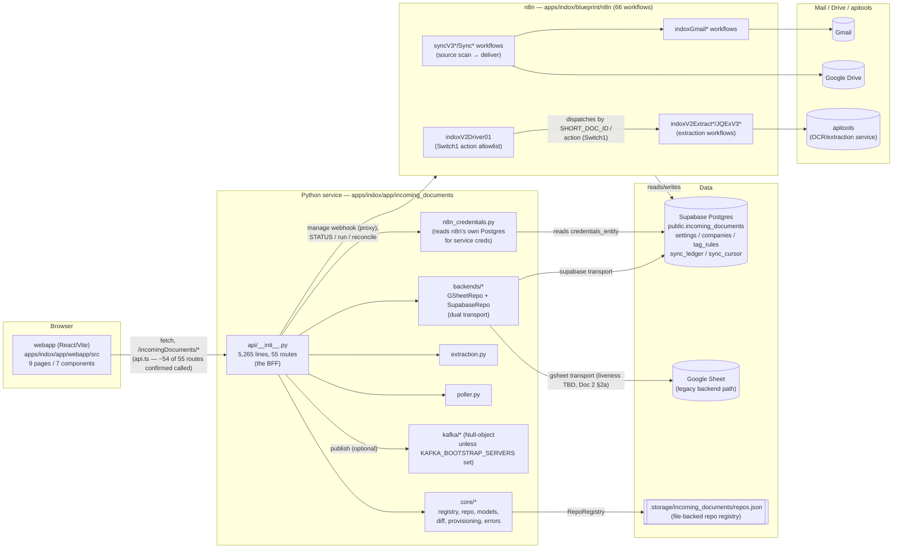
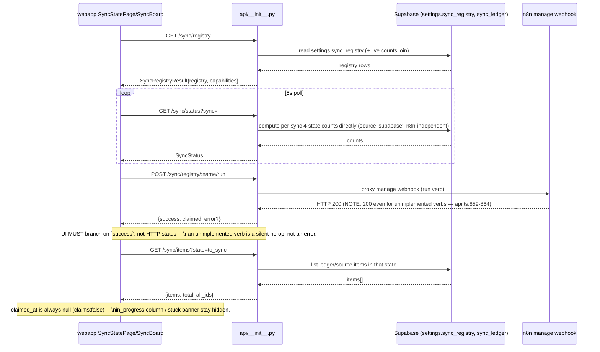
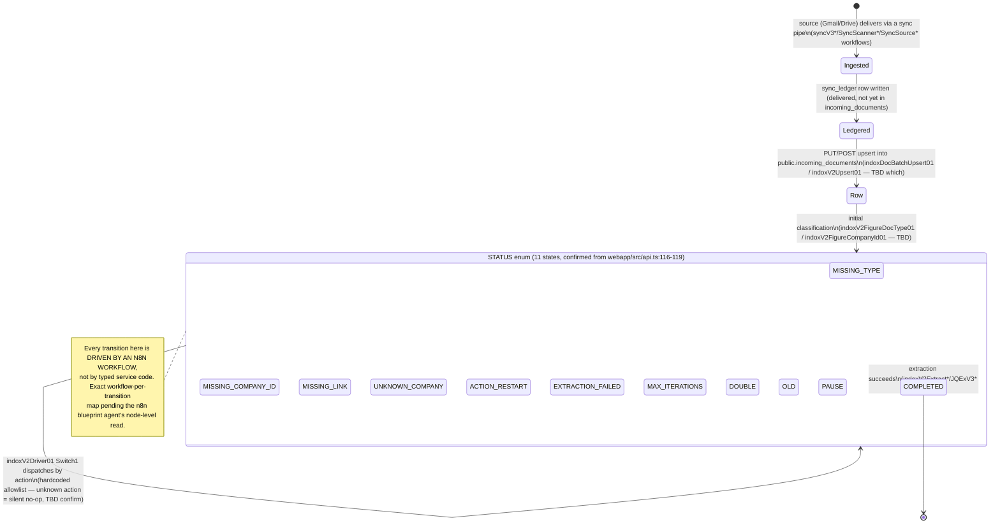
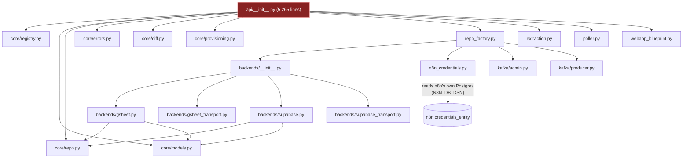

# INDOX Codebase Map — 2026-08-05

Status: **COMPLETE.** Built from direct reads/greps of the live tree plus five parallel research
agents (god-module audit, caller-mapping, n8n blueprint/DB audit, data-layer audit, remaining-module
map), all returned and folded in, plus live queries against the running Supabase and n8n Postgres
instances. Every factual claim below carries a file:line citation or an exact query result. Anywhere
evidence was insufficient to reach a verdict, that is stated explicitly as UNVERIFIED with what would
settle it — none remain outstanding as of this revision.

Scope note: this document covers the **codebase** — what exists, what calls what, what's dead, what's
duplicated. Runtime/target design (incremental sync, claim/lease, identity, read path, observability)
is `ai/context/INDOX-TARGET-ARCHITECTURE-2026-08-05.md`, owned by a concurrent agent — not duplicated
here.

## 0. Scale (measured)

| Tree | Files | Lines | Notes |
|---|---:|---:|---|
| `apps/indox/app/incoming_documents` | 171 | 72,232 | Python service. `api/__init__.py` alone: 5,265 lines / 252,254 bytes, 55 routes |
| `apps/indox/blueprint/n8n` | 66 | 87,405 | confirmed: `ls \| wc -l` = 66, `wc -l *.json` total = 87,405. 2.8 MB |
| `apps/indox/app/webapp/src` | 20 | 11,695 | confirmed via `find`+`wc -l` (task said 10,980; current is 11,695 — webapp changed since the prior scan, or a different file filter). 9 pages, 7 components — **confirmed**: DashboardPage, DocumentBrowserPage, DocumentDetailPage, ExtractionDocPage, ExtractionPage, SettingsPage, SyncBoard, SyncStatePage, TestsPage (9); BinaTable, DataGrid, DocumentViewer, EngineView, ExtractionQueries, InstanceSwitcher, RunProgress (7) |
| `apps/indox/blueprint/fixtures` | 18 | 4,812 | confirmed file count matches (18); line count differs from task's 3,910 (current tree grew — includes `schema.sql`, `tools/shadow_diff.py`, two `REFACTOR/ROUTERS` .md design docs, not just fixture JSON) |
| `apps/indox/hooks` | 19 (confirmed by module-map agent, not 24) | ≈3,235 (agent's sum; my direct `wc -l` got 2,118 for 20 listed entries — the two counts disagree with each other too, likely different globs over extensionless scripts) | **Confirmed discrepancy from the task's "24 files, 1,969 lines."** Both my own direct count and the module-map agent's independent count land at 19 files, not 24 — the 24/1,969 figure in the task brief does not match the live tree by either method. All 19 are reachable via `bbox`'s generic `app_verbs()`/`run_app_hooks` file-discovery dispatcher (confirmed by the agent reading `bbox:313-322,768-777`) — **none are orphaned**, several also have dedicated top-level verbs (`bbox indox demo/reset/sync/test`) or lifecycle wiring (`onboard` via `run_app_hooks onboard`, `extract-gate` via `app.json:health.probe.exec`). None import the Python `incoming_documents` package — pure ops/CLI layer against n8n+Postgres directly. |

Additional trees found during this scan, not in the task's original scale table:
- `apps/indox/app/incoming_documents/backends/` — 4 files (`gsheet.py`, `gsheet_transport.py`, `supabase.py`, `supabase_transport.py`) — the dual-transport layer. See §2 and Doc 2 §2a.
- `apps/indox/app/incoming_documents/core/` — 8 files, 1,265 lines (models, registry, repo, errors, diff, provisioning, types).
- `apps/indox/app/incoming_documents/kafka/` — 4 files, 534 lines (admin/producer/consumer — see LIVE-or-stub check in §2).
- `apps/indox/app/incoming_documents/context-collection/` — **not live code**: a frozen Phase-1 planning snapshot (`README.md` self-describes as "context required for phases 2-6 of the migration plan", referencing `../plan.txt`). Contains an OLDER generation of n8n workflow exports (`incoming-documents-0.1.6_xWM5NQjGxl0qAhHg.json`, `batch-upsert_...`, etc. — pre-rename, pre-V2 naming) plus a 39,582-row GSheet CSV export. This is the **third n8n workflow generation** found in this repo (see §3 era table).
- `apps/indox/app/incoming_documents/tests/` — 2,291 lines of pytest.
- `legacy/n8n/indox-sheets-era/` — 5 JSON files: `indoxApiSheets01.json`, `indoxDocCreate01.json`, `indoxDocUploader01.json`, `indoxSetupWF001.json`, `logger01.json`. A second, later-named legacy generation (post `0.1.6`, pre-V2 `indoxV2*`/`sync*` naming) explicitly parked under `legacy/`.
- `digital-office/sim/apps/indox/` — an offline mock/fork of the webapp used by the design-workbench simulator (`digital-office/`, per root `CLAUDE.md`: "dev-only, never shipped, never run by CI"). Not a caller of the real API in production; a UI fork with its own fetch mocks. Do not confuse with `apps/indox/app/webapp`.

**n8n-workflow "eras" found (3 generations in-repo):**
1. `apps/indox/app/incoming_documents/context-collection/n8n-workflows/` — Phase-1 planning snapshot of `Incoming Documents 0.1.6` (GSheet era), frozen for migration-plan reference only.
2. `legacy/n8n/indox-sheets-era/` — 5 files, explicitly parked as legacy GSheet-era.
3. `apps/indox/blueprint/n8n/` — 66 files, current V2/V3 (`indoxV2*`, `sync*`, `JQExV3*`) generation — **the one this task's §1c/§2a is about.**

## 1a. Complete API surface (55 routes / 54 distinct view functions)

`[VERIFIED — full route table below from the api/__init__.py audit agent + my own webapp/api.ts cross-check. n8n/hooks/other-app caller confirmation still pending the caller-mapping agent (marked "?" in the Called-by column until it returns).]`

**Structural finding first: there is no per-route auth/guard decorator anywhere in `api/__init__.py`.**
The audit agent grepped for `require_auth|login_required|before_request|check_auth` across the whole
file — zero hits. The only identity surface is `GET /auth/me`, which just echoes Authentik ForwardAuth
headers (`X-authentik-username/email/groups`) set upstream by Traefik. Access control for all 55
routes is enforced entirely at the reverse-proxy layer, not in this module — worth carrying into Doc 2
as a note (not a cleanup target per se, since it may be intentional given the ForwardAuth architecture,
but it means the module split in §2c must not assume any route is protected by anything the split
itself could accidentally remove).

### Full route table, by resource group

Legend for **Called by webapp**: cross-checked directly against every method in the `api` object of
`apps/indox/app/webapp/src/api.ts` (the BFF's hand-maintained typed client, self-described as mirroring
the OpenAPI spec). ✅ = confirmed webapp method exists and hits this exact path/method. ❌ = no webapp
method found for this path. n8n/hooks/other-app columns are `?` pending the caller-mapping agent.

**Health / meta**
| Method | Path | api/__init__.py:line | Purpose | Reads | Writes | Webapp caller |
|---|---|---:|---|---|---|:---:|
| GET | `/health` | 2841 | Liveness probe | repo registry | — | ❌ (infra probe, not app-called) |
| GET | `/openapi.json` | 5252 | Hand-rolled OpenAPI spec | in-memory dict | — | ❌ (referenced only in api.ts's header comment as the spec source, never fetched at runtime) |
| GET | `/auth/me` | 5231 | Surface Authentik identity headers | request headers | — | ✅ `authMe()` |

**Repos (registry CRUD)**
| Method | Path | Line | Purpose | Reads | Writes | Webapp |
|---|---|---:|---|---|---|:---:|
| GET | `/repos` | 2850 | List registered repos | registry file | — | ✅ `listRepos()` |
| GET | `/repos/<repo>` | 2861 | Get one repo config | registry file | — | ✅ `getRepo()` |
| POST | `/repos` | 2868 | Provision a new repo | env `SUPABASE_STUDIO_URL` | registry file + `provision_repo()` (Supabase table/schema, Kafka topic) | ✅ `createRepo()` |
| DELETE | `/repos/<repo>` | 2898 | Delete repo from registry | — | registry file | ✅ `deleteRepo()` |
| PATCH | `/repos/<repo>` | 2903 | Patch scalar repo fields | registry file | registry file | ✅ `patchRepo()` |
| GET | `/repos/<repo>/stats` | 3352 | Row count + columns + Kafka flag | `repo_obj.count()`/`fetch_all()`, 30s cache | cache dict only | ✅ `repoStats()` |

**Documents CRUD / upload**
| Method | Path | Line | Purpose | Reads | Writes | Webapp |
|---|---|---:|---|---|---|:---:|
| PUT | `/repos/<repo>/documents` | 3032 | Batch upsert | `fetch_by_ids`, `fetch_by_match_rules` | `batch_update/batch_create`, Kafka `ROW_CHANGED`/`ROW_CREATED` | ✅ `upsertRows()` |
| POST/PUT | `/documents` | 3040 | Convenience active-repo upsert | same, scoped to active instance | same | ❌ **no webapp method calls the scope-free `/documents` path — candidate dead/unused route, pending n8n/hooks check** |
| POST | `/documents/upload`, `/repos/<repo>/documents/upload` | 3053/3054 | Upload a file via the Drive app | Drive `/api/folders`, `settings` | Drive `/api/folders` (create), `/upload`, `settings` upsert | ❌ **no webapp method found for either alias — candidate dead/unused, pending n8n/hooks check (this looks like a Drive-app-initiated upload, not webapp-initiated, so a non-webapp caller is plausible — do not delete on this evidence alone)** |
| POST | `/documents/thumbnail` | 3147 | n8n state-machine THUMBNAIL step | apitools `/pdfToJpeg`, Drive `/api/folders` | Drive `/upload` | ❌ **route's own purpose ("n8n state-machine THUMBNAIL step") implies n8n is the caller, not webapp — expect confirmation from the n8n agent, not a dead-route flag** |
| POST | `/repos/<repo>/documents/query` | 3212 | Paginated batch GET | `repo_obj.query(q)` | — | ✅ `queryDocuments()` |
| POST | `/repos/<repo>/documents/month-index` | 3267 | Server-side date-bucket aggregate (built specifically to route around the PGRST truncation bug, see §5) | `_paged_select` (supabase) / `fetch_all` (gsheet) | — | ✅ `monthIndex()` |
| GET | `/repos/<repo>/documents/<id>` | 3634 | Get single document | `fetch_by_ids` | — | ✅ `getDocument()` |
| PATCH | `/repos/<repo>/documents/<id>` | 3644 | Patch single document — **the only status-transition path** | `fetch_by_ids` | `batch_update/batch_create`, Kafka events | ✅ `patchDocument()` |
| GET | `/repos/<repo>/documents/<id>/history` | 3693 | Kafka event history for one row | Kafka consumer `.history()` | — | ✅ `documentHistory()` |
| GET | `/repos/<repo>/kafka/tail` | 3705 | SSE live event tail | Kafka consumer `.tail()` (stream) | — | ❌ **no webapp method — candidate dead/unused route. Notable: this is the only route that assumes Kafka is actually configured (all other Kafka use is Null-object-gated); if Kafka is off (`KAFKA_BOOTSTRAP_SERVERS` unset), this route's behavior with a `NullKafkaProducer`/consumer is UNVERIFIED** |
| POST | `/repos/<repo>/sync` | 3738 | Legacy poll→diff→publish (gsheet-era) | gsheet via `repo_obj`/`_sync_repo_once` | Kafka events, snapshot files on disk | ✅ `syncRepo()` — **but note the route's own description is "legacy (gsheet-era)"; the webapp calling it doesn't prove the gsheet path is exercised in practice, only that the route itself is reachable. See Doc 2 §2a Target 5.** |

**Instances / accounts**
| Method | Path | Line | Purpose | Reads | Writes | Webapp |
|---|---|---:|---|---|---|:---:|
| GET | `/accounts` | 3458 | List INDOX instances + active one | registry, `settings.sync_registry` count, config-table counts | — | ✅ `listInstances()` |
| POST | `/account/select` | 3473 | Make an instance active | registry | `active_instance.json` (atomic) | ✅ `selectInstance()` |
| POST | `/account/add` | 3483 | Provision a new instance | body | registry, Supabase table, `active_instance.json` | ✅ `addInstance()` |
| POST | `/account/remove` | 3539 | De-register instance (table NOT dropped) | registry | registry, `active_instance.json` | ✅ `removeInstance()` |
| GET | `/account/detail` | 3562 | Full detail panel for active instance | `settings`, `companies`, `tag_rules` | — | ✅ `instanceDetail()` |

**Sync — read/state**
| Method | Path | Line | Purpose | Reads | Writes | Webapp |
|---|---|---:|---|---|---|:---:|
| GET | `/sync/status` | 3768 | Proxy-style STATUS; live counts opt-in | `settings.sync_registry`; opt-in Drive/Gmail + `sync_ledger` | in-memory 3s cache | ✅ `getSyncStatus()` |
| GET | `/sync/registry` | 3846 | Registry + live enrichment | `settings`, Drive/Gmail, `sync_ledger` (opt-in) | — | ✅ `getSyncRegistry()` |
| GET | `/sync/inventory` | 3875 | At-source vs in-INDOX backlog per pipe | `settings.sync_registry`, doc table, Drive/Gmail, connections | — | ✅ `getSyncInventory()` — webapp's own comment: "NEW endpoint... MUST expect a 404 while it is not yet deployed" |
| GET | `/sync/runs` | 4212 | Live run progress | `sync_pipe_state` table | — | ✅ `syncRuns()` |
| GET | `/sync/engine` | 4278 | Engine topology + live ledger + last exec per pipe | `engine-manifest.json`, `settings.sync_registry`, `sync_ledger` (paged) | — | ✅ `syncEngine()` |
| GET | `/sync/origin` | 4364 | Resolve "open original" URL | platform connections | — | ✅ `resolveSyncOrigin()` |
| GET | `/sync/reconcile` | 4385 | Ledger-vs-source divergence report | `settings.sync_registry`, `sync_ledger`, Drive/Gmail | — | ✅ `reconcileSync()` |

**Sync — registry CRUD**
| Method | Path | Line | Purpose | Reads | Writes | Webapp |
|---|---|---:|---|---|---|:---:|
| POST | `/sync/registry` | 4027 | Create a pipe entry | `settings.sync_registry` | upsert; Drive folder creation | ✅ `createSyncEntry()` |
| PATCH | `/sync/registry/<name>` | 4062 | Shallow-merge edit (incl. pause) | `settings.sync_registry`, `sync_ledger` (rename-safety) | upsert; possible Drive folder creation | ✅ `patchSyncEntry()` |
| DELETE | `/sync/registry/<name>` | 4104 | Remove pipe config (source untouched) | `settings.sync_registry`, `sync_ledger` (identity check) | `settings.sync_registry` | ✅ `deleteSyncEntry()` |

**Sync — run/items (write-the-source engine)**
| Method | Path | Line | Purpose | Reads | Writes | Webapp |
|---|---|---:|---|---|---|:---:|
| POST | `/sync/registry/<name>/run` | 4414 | Trigger SCAN for one pipe | `settings.sync_registry` | `last_run*`, n8n manage webhook call | ✅ `runSyncEntry()` — webapp comment documents the webhook's 200-for-unimplemented-verb hazard |
| POST | `/sync/run` | 4449 | SCAN every runnable pipe | `settings.sync_registry` | per-pipe writes, n8n webhook calls | ✅ `runAllSyncs()` |
| GET | `/sync/items` | 4528 | LIST(sync,state) — the board's core read | `settings.sync_registry`, Drive/Gmail, doc table, `sync_ledger` | — | ✅ `listSyncItems()` |
| POST | `/sync/items/move` | 4584 | CLAIM/ADVANCE — writes the source | `settings.sync_registry`, Drive/Gmail state, `sync_ledger` | Drive move / Gmail label swap; n8n RELEASE webhook (deletes ledger row) | ✅ `moveSyncItems()` |
| POST | `/sync/items/apply-fallback-type` | 4648 | Classify-by-location + requeue | `settings.sync_registry` | doc table `TYPE` column, then same as move | ✅ `applyFallbackType()` |

**Connections**
| Method | Path | Line | Purpose | Reads | Writes | Webapp |
|---|---|---:|---|---|---|:---:|
| GET | `/connections` | 4704 | List Drive/Mail connections | Drive+Mail `/connections` | — | ✅ `listConnections()` |
| GET | `/connections/<id>/locations` | 4731 | Browse labels/folders | Mail `/labels`+`/search` or Drive `/api/folders` | — | ✅ `listLocations()` |
| POST | `/connections/<id>/locations` | 4777 | Create a label or folder | — | Mail `/labels/create` or Drive `/api/folders` POST | ✅ `createLocation()` |

**Config (settings / companies / tag_rules)**
| Method | Path | Line | Purpose | Reads | Writes | Webapp |
|---|---|---:|---|---|---|:---:|
| GET | `/config/settings` | 4828 | All `settings` rows | `settings`, **limit 2000, NOT paged** — see §5A | — | ✅ `getConfigSettings()` |
| GET | `/config/companies` | 4855 | All `companies` rows | `companies` via `_paged_select` (correctly paged) | — | ✅ `getConfigCompanies()` |
| GET | `/config/tag_rules` | 4866 | All `tag_rules` rows | `tag_rules`, **limit 2000, NOT paged** — see §5A | — | ✅ `getConfigTagRules()` |
| PUT | `/config/settings/<key>` | 4880 | Upsert one allowlisted key | `_EDITABLE_SETTINGS_KEYS` | `settings` upsert; n8n cache-invalidate webhook | ✅ `putConfigSetting()` |
| PATCH | `/config/<table>/<id>` | 4926 | Inline-edit one `companies` cell | existence check | `companies` update | ✅ `patchConfigRow()` |
| POST | `/config/<table>` | 4964 | Add a `companies` row | — | `companies` insert | ✅ `addConfigRow()` |
| DELETE | `/config/<table>/<id>` | 4986 | Delete a `companies` row | — | `companies` delete | ✅ `deleteConfigRow()` |

**Tests (n8n E2E suite runner)**
| Method | Path | Line | Purpose | Reads | Writes | Webapp |
|---|---|---:|---|---|---|:---:|
| GET | `/tests/suites` | 5011 | List suites + last-run summary | n8n `/healthz`, in-memory | — | ✅ `listTestSuites()` |
| POST | `/tests/run` | 5045 | Start a suite/group/all run (bg thread) | — | in-memory; fires n8n lane webhooks | ✅ `startTestRun()` |
| GET | `/tests/run/<id>` | 5089 | Poll live run progress | in-memory | — | ✅ `getTestRun()` |

**Dashboard**
| Method | Path | Line | Purpose | Reads | Writes | Webapp |
|---|---|---:|---|---|---|:---:|
| GET | `/dashboard/stats` | 5103 | Ops dashboard aggregate | doc table via `_paged_select` (fully paged) | — | ✅ `dashboardStats()` |

**Extraction** — routes registered from a separate module (`..extraction`, imported at
`api/__init__.py:5257`), not physically inside `api/__init__.py` itself; all 15 confirmed called by
webapp in §"Extraction" of the original evidence pass (`getExtractionDataset`, `startExtractionRun`,
`getExtractionRun`, `cancelExtractionRun`, `rerunExtractionDoc`, `uploadExtractionDoc`,
`getExtractionQueries`, `putExtractionQuery`, `listExtractionRuns`, `getExtractionRunFull`,
`deleteExtractionRun`, `getExtractionDocHistory`, `extractionFileUrl`, `extractionDrawUrl`,
`extractionTokensUrl`).

### Route-count reconciliation

54 distinct view functions handle the 55 route/method combos (`/documents/upload` and
`/repos/<repo>/documents/upload` share one function) inside `api/__init__.py` itself, **plus** the
extraction routes registered from `extraction.py` externally — so "55 routes" in the task's framing
spans two files, not one.

### Caller-mapping agent results — FINAL dead-route verdict (confirmed, all 55 routes)

The caller-mapping agent searched webapp, the `digital-office/sim/apps/indox` fork (confirmed
**mocked/non-production** — its `fetch` is intercepted by `digital-office/sim/mocks/incoming.js` and
never reaches the real server, so it's evidence of UI intent, not a production caller), all 66 n8n
blueprints, `hooks/`, `scripts/`, `.ci-cd/indox-e2e` (found to contain only run artifacts, no test
source), and the pytest suite. Route mount prefix confirmed: `INCOMING_DOCS_API_PREFIX` env, default
`/incomingDocuments` (`api/__init__.py:2833`).

**Confirmed DEAD (zero callers found anywhere — webapp, sim, n8n, hooks, scripts, or tests):**
| Route | Notes |
|---|---|
| `POST/PUT /documents` (`active_repo_documents`) | Convenience scope-free alias of the repo-scoped upsert; nothing uses the convenience form. |
| `POST /documents/upload` | Zero references anywhere, including hooks/Drive-adjacent scripts. |
| `POST /repos/<repo>/documents/upload` | Same handler as above, alternate path — also zero references. |

**Implemented, unit-tested, but NO production caller (webapp nor n8n) — live-but-unused:**
| Route | Notes |
|---|---|
| `GET /health` (blueprint-level) | Only `tests/integration/api/test_documents_routes.py:82` and `tests/unit/test_blueprint_skeleton.py:30` call it. Distinct from an unrelated app-level `/health` in `app/main.py:85` which IS a real liveness probe — this blueprint-level one is redundant with that. |
| `GET /repos/<repo>/kafka/tail` (SSE) | Fully implemented and tested (`test_facade_routes.py:237-238,266`), documented as a planned feature in `IMPLEMENTATION-PLAN.md:330,416`, but **no `EventSource`/`fetch` call exists anywhere in `webapp/src` or the sim fork** — built ahead of its UI, never wired up. |
| `GET /openapi.json` | Only `test_facade_routes.py:62-64` (`test_openapi_spec_lists_all_routes`) calls it for real. The webapp's doc comment (`api.ts:2`) references it as the conceptual spec source but never fetches it at runtime — no generated-client workflow actually consumes it. |

**Confirmed LIVE via n8n (resolves the earlier "candidate dead" flag from the audit-agent pass):**
| Route | Caller |
|---|---|
| `POST /documents/thumbnail` | `apps/indox/blueprint/n8n/indoxV2GenerateThumbnail01.json:168` — hardcoded URL `http://incoming-documents:8080/incomingDocuments/documents/thumbnail`, invoked from the `generate_thumbnail` action in `indoxV2ActionsGlobal01`. Also referenced (documentation only, not called) in `webapp/src/pages/DocumentDetailPage.tsx:165`. |

**Every other route (50 of 55)**: confirmed called by the webapp (`api.ts`) and mirrored in the sim
fork's mocked client — see the full table above.

### Architecturally significant: n8n mostly bypasses the Flask API entirely

The caller-mapping agent's single most important structural finding, stated directly: **of the 66 n8n
blueprints, only ONE file (`indoxV2GenerateThumbnail01.json`) makes an actual HTTP call into the Flask
REST API.** Every other n8n workflow that touches indox data — `IndoxInjectDemo01`, `indoxSettings01`,
`IndoxResetGml001`, `mailOrgTest00001`, `syncV3FullTest01`, `SyncApi0000000001`, `sv3Inject3x001`,
`syncV3SourcesTest01`, `tVzFMkz18pCsXRyw`, and (by implication) the rest of the production sync/action
workflows — **goes directly to Postgres** (raw SQL, or an `INLINE_ACTION`/`TABLE_GET`/`TABLE_UPSERT`
node pattern against `public.settings`/`companies`/`tag_rules`/`sync_pipe_state`), or through n8n's own
`/webhook/indox-manage` endpoint, which the Flask API in turn calls out to (not the reverse).

**This means the Python API's carefully-built accessor discipline — `_normalise_entry`'s vocabulary
repair on every `sync_registry` write, `_paged_select`'s truncation-safe reads, `_validate_sync_entry`'s
validation, the `_EDITABLE_SETTINGS_KEYS` allowlist on `/config/settings` — protects only the fraction
of writes that happen to route through the Flask layer.** Any n8n workflow writing `settings` or
`sync_pipe_state` directly via raw SQL bypasses every one of those safeguards. This is a stronger,
more concrete version of the task's "two sources of truth" framing: it is not just that n8n and Python
separately *encode rules* about the same documents — n8n workflows and the Flask API **both hold write
access to the same tables, through different code paths, with no shared validation layer.** This is the
single most load-bearing fact for Doc 2's Python-vs-n8n split argument (see Doc 2, spine section) and
sharply narrows what "consolidate the two backends" can mean: even a perfect Python-side refactor
leaves this bypass untouched unless n8n's direct-Postgres writes are also brought under one accessor.

---

Prior partial evidence gathered directly from `apps/indox/app/webapp/src/api.ts` (the BFF's own typed
client — every method in the `api` object there is a confirmed webapp caller of the matching route).
This webapp file is the single biggest source of "who calls it" evidence: it is a **hand-maintained
mirror of the OpenAPI spec** (`api.ts` line 2: "Designed to mirror the OpenAPI spec served at
`/incomingDocuments/openapi.json`"), and essentially every one of the ~55 backend routes has a
corresponding typed method here — meaning **the webapp is the primary/majority caller of this API**,
not n8n. This reframes the "unused route" question: a route with no webapp method AND no n8n caller is
the real dead-route candidate; a route the webapp calls is presumptively live (the webapp is the
Indox admin/ops console, actively used).

Routes confirmed called by the webapp (`apps/indox/app/webapp/src/api.ts`, line refs to the `call<T>()`
site):
- `GET /auth/me` (713)
- `GET /accounts` (716-717), `POST /account/select` (718-722), `POST /account/add` (723-727),
  `POST /account/remove` (728-732), `GET /account/detail` (733)
- `GET /repos` (735), `GET /repos/:name` (736), `POST /repos` (737-741), `DELETE /repos/:name` (742-743),
  `PATCH /repos/:name` (745-749), `GET /repos/:name/stats` (751)
- `PUT /repos/:repo/documents` (753-757) — bulk upsert
- `POST /repos/:repo/documents/query` (759-763) — grid-aware query (mode: single/by_ids/filter/all)
- `POST /repos/:repo/documents/month-index` (777-786) — server-side date-bucket aggregate; doc
  comment explains it exists specifically to work around the `_paged_select` truncation bug (see §1b)
- `GET /repos/:repo/documents/:id` (788-789)
- `PATCH /repos/:repo/documents/:id` (791-795) — **the only status-transition endpoint**: comment at
  api.ts:111-115 states the `STATUS` enum is edited "via the existing `PATCH .../documents/<id>`
  endpoint like any other field; there is no separate status-transition endpoint."
- `GET /repos/:repo/documents/:id/history` (797-800)
- `POST /repos/:repo/sync` (804-808)
- `GET /sync/status` (814-817), `GET /sync/registry` (819), `GET /sync/inventory` (832-839, optional/404-tolerant — "NEW endpoint... MUST expect a 404... while it is not yet deployed")
- `POST /sync/registry` (844-848, create), `PATCH /sync/registry/:name` (849-853), `DELETE /sync/registry/:name` (854-858)
- `POST /sync/registry/:name/run` (865-869), `POST /sync/run` (871-879, run-all)
- `GET /sync/runs` (890-893), `GET /sync/engine` (895), `GET /sync/reconcile` (896-899)
- `GET /sync/items` (900-913), `GET /sync/origin` (914-920)
- `POST /sync/items/move` (926-930), `POST /sync/items/apply-fallback-type` (932-936)
- `GET /connections` (937), `GET /connections/:id/locations` (938-941), `POST /connections/:id/locations` (942-946)
- `GET /config/settings` (951), `GET /config/companies` (953), `GET /config/tag_rules` (955),
  `PUT /config/settings/:key` (957-961), `PATCH /config/:table/:id` (964-968),
  `POST /config/:table` (971-975), `DELETE /config/:table/:id` (978-982)
- `GET /dashboard/stats` (988)
- `GET /tests/suites` (990), `POST /tests/run` (992-996), `GET /tests/run/:id` (998-999)
- `GET /extraction/dataset` (1005), `POST /extraction/run` (1007-1011),
  `GET /extraction/run/:id` (1013-1014), `POST /extraction/run/:id/cancel` (1016-1019),
  `POST /extraction/rerun/:docId` (1021-1024), `POST /extraction/upload` (1026-1043),
  `GET /extraction/queries` (1045-1046), `PUT /extraction/queries/:key` (1049-1053),
  `GET /extraction/runs` (1057), `GET /extraction/runs/:id` (1059-1060),
  `DELETE /extraction/runs/:id` (1062-1065), `GET /extraction/history/:docId` (1067-1068),
  `GET /extraction/file/:type/:name` (1071-1074, direct URL not fetch), `GET /extraction/draw/:type/:name` (1075-1079, direct URL),
  `GET /extraction/tokens/:type/:name` (1081-1084, direct URL)

That is **~54 distinct methods** already accounted for as webapp-called. This leaves at most ~1 of the
55 backend routes with no webapp caller — **full route table with method/path/purpose/reads-writes,
n8n+hooks+other-app callers, and the final unused-route verdict is pending the api/__init__.py audit
agent and the caller-mapping agent.** Will be filled in below once both return.

Notable defects already self-documented in `api.ts` comments (primary source, not inference):
- **`_paged_select` truncation bug** (api.ts:765-776, on `monthIndex`): client-side paging that
  compared "returned row count" against the CLIENT's requested `limit` undercounts, because it never
  compares against **PostgREST's own silent `db-max-rows` clamp** — "the client-side loop stopped
  after the FIRST page every time." This is the general pattern behind the task's
  `PGRST_DB_MAX_ROWS=1000` defect class (Doc 2 §2b). `monthIndex` exists specifically to route around
  it server-side.
- **`claims: false` capability flag** (api.ts:240-263): "nothing in the pipeline ever claims an item:
  `claimed_at` is always null, `stuck` is always false... The surfaces built on a claim... are
  therefore permanently zero" — and the UI **hides** them rather than showing a permanently-empty
  state. This is a real, live, self-acknowledged gap between what the schema/API models (`claimed_at`,
  a claim/lease state) and what actually happens.
- **`runSyncEntry` silent no-op** (api.ts:859-864): "the manage webhook answers HTTP 200 for a verb it
  does not implement, so the only way to know a run happened is to read the `success` flag." An n8n
  webhook responding 200-with-no-effect for unimplemented actions is exactly the failure mode the
  coordinator flagged re: `Switch1`'s allowlist (see §3).
- **`ApiError` message-discard bug** (api.ts:632-646) — already fixed, kept as a comment/lesson: the
  error envelope's human `message` was being thrown away in favor of `API 400`, so a real operator
  message ("sync 'drive-bs' is paused") was replaced with a useless status code at every call site.

## 1b. Module map — Python

Directly verified file inventory (`apps/indox/app/incoming_documents/`):

| File | Lines | Responsibility (from docstring/read) |
|---|---:|---|
| `api/__init__.py` | 5,265 | **God module.** All 55 Flask routes + all BFF orchestration helpers, single file, no sibling `.py` files in `api/`. Full breakdown below. |
| `extraction.py` | 984 | Extraction pipeline glue (OCR/apitools calls, scoring against ground truth) — backs the `/extraction/*` routes and `webapp/src/pages/Extraction*Page.tsx`. |
| `poller.py` | 245 | Polling logic — likely backs `/repos/:repo/sync` and/or a background scheduler. |
| `repo_factory.py` | 217 | Maps a `RepoConfig.backend` (`"gsheet"` \| `"supabase"`) to a concrete `DocumentRepo`. Credential resolution order (read directly, lines 1-217): (1) injected/test, (2) n8n-stored credential via `N8N_DB_DSN`+`N8N_ENCRYPTION_KEY` + a per-backend lookup-name env var (`GSHEET_CREDS_EMAIL`/`SUPABASE_CREDS_NAME`), (3) legacy env vars directly on the transport (`GOOGLE_SERVICE_ACCOUNT_JSON`, `SUPABASE_BASE_URL`+key). **This is the dual-backend selection point** — both `gsheet` and `supabase` are live code paths here, gated purely by `RepoConfig.backend`, not by a feature flag or deprecation marker. See Doc 2 §2a for the liveness verdict once the "is any repo actually configured with `backend: gsheet` today" check lands from the module-map agent. |
| `n8n_credentials.py` | 165 | Reads n8n's own Postgres (`credentials_entity`) via `N8N_DB_DSN` + decrypts with `N8N_ENCRYPTION_KEY` to source credentials for the Python service — i.e., the Python service treats n8n's DB as its credential store rather than having its own. Notable coupling: Python app is not independently deployable without n8n's DB reachable. |
| `webapp_blueprint.py` | 92 | Flask blueprint wiring for serving the webapp static build. |
| `core/__init__.py` | 80 | package exports |
| `core/models.py` | 256 | `RepoConfig`, pydantic models (matches `webapp/src/api.ts`'s `RepoConfig` interface almost field-for-field — `backend: 'gsheet'\|'supabase'`, `gsheet{}`/`supabase{}` sub-configs, `priority_sync_columns`, `poll_interval_seconds`). |
| `core/registry.py` | 204 | `RepoRegistry` — **the config source of truth for repos** (not the sync registry). Read directly in full: on-disk JSON file (`INCOMING_DOCS_REPO_REGISTRY` env, default `.storage/incoming_documents/repos.json`), mtime+size-stamped hot-reload cache, atomic temp-file+`os.replace` writes, thread-safe via `RLock`. This is a **file-backed** registry — distinct from the "sync registry" (`settings.sync_registry`, a DB-backed JSON blob referenced throughout `api.ts` as `SyncRegistryEntry[]`/`getSyncRegistry()`). **Two different things are both called "registry" in this codebase** — repo registry (file, `core/registry.py`) vs sync registry (DB row, read/written through `api/__init__.py` `/sync/registry*` routes). Confirms the task's "one config source of truth for the registry" ask needs to first disambiguate which registry; see Doc 2 §2b. |
| `core/repo.py` | 150 | `DocumentRepo` abstract interface — what `GSheetRepo`/`SupabaseRepo` implement. |
| `core/errors.py` | 83 | Error taxonomy (`RepoNotFound`, `RepoAlreadyExists`, `ValidationError`, `NotImplementedYet`) — matches `api.ts`'s documented error envelope (`{success, error, message, details}`, machine `error` code + human `message`). |
| `core/diff.py` | 202 | Row diff logic — likely backs upsert's created/updated/skipped classification (`UpsertResult` in api.ts). |
| `core/provisioning.py` | 137 | New-repo provisioning (backs `POST /repos`, and possibly `/account/add`). |
| `core/types.py` | 153 | Shared type defs. |
| `backends/__init__.py` | 29 | Re-exports `GSheetRepo`, `SupabaseRepo`, both transport pairs. |
| `backends/gsheet.py` | 482 | `GSheetRepo` — header cache, A1 range math, provisioning, full-scan query engine. **CONFIRMED PARTIALLY-LIVE, not dead**: see Doc 2 §2a Target 5 — code is reachable/tested but the live registry is pinned to supabase-only. |
| `backends/gsheet_transport.py` | 445 | `GSheetTransport` Protocol + `FakeGSheetTransport` + `GoogleApiTransport` (lazy `googleapiclient` import). |
| `backends/supabase.py` | 296 | `SupabaseRepo` — upsert/select, composite match-rule fetch, provisioning DDL orchestration. **The only backend in the live production registry** (`storage/incoming_documents/repos.json:3`: one repo, `"backend":"supabase"`, `"gsheet":null`). Contains its own unguarded pagination foot-gun — see §pagination below. |
| `backends/supabase_transport.py` | 923 | `SupabaseTransport` Protocol + `FakeSupabaseTransport` + `HttpxSupabaseTransport`; also the tenancy guard (`_require_instance_filter`/`_require_instance_rows`) for `settings`/`companies`/`tag_rules`. |

**Gsheet backend — final verdict (module-map agent, direct citations):** two of this repo's own architecture docs already say this in plain language — `ai/context/indox-final-architecture-2026-08-04.md:101-102`: *"backends/supabase*.py — the live backend (gsheet*.py retained but unreachable; backend: supabase is pinned)."* and `ai/context/retired-code-and-workflows.md:123-126`: *"2026-08-04 — Google Sheets is fully legacy... `INDOX_DATA_BACKEND` toggle was removed from `platform-base/n8n/hooks/push`, `.env.ex`, `scripts/ci-env.sh`, `scripts/automations-reset.py` — so nothing can point a deployment [at gsheet]."* Yet the code is not guarded: `repo_factory.py:169-177` will happily construct a real `GoogleApiTransport`-backed `GSheetRepo` if any `RepoConfig.backend=="gsheet"` is ever registered, the webapp's `InstanceSwitcher.tsx:347-351` still offers `<option value="gsheet">Google Sheets (גיליון)</option>` in the new-instance form, and `tests/integration/gsheet/test_gsheet_repo.py` (289 lines) passes today. **Verdict: PARTIALLY-LIVE — reachable via code and UI, zero production usage, not blocked by a feature flag.** See Doc 2 §2a/Target 5 for the consolidation call.
| `kafka/{admin,producer,consumer}.py` | 128/183/187 | `KafkaAdmin`/`KafkaProducer` + Null-object fallbacks. `repo_factory.py:203-217` confirms these are **conditionally live**: `default_kafka_producer()`/`default_kafka_admin()` return `Null*` implementations unless `KAFKA_BOOTSTRAP_SERVERS` is set in env — i.e., Kafka is an optional/pluggable event-publish path, not core to the request path. `UpsertResult.stats.events_published` in api.ts (line 141) suggests events ARE published somewhere in the upsert path; whether that's Kafka, the diff/history log, or something else is pending the audit agent. |
| `context-collection/` | n/a (docs+data, not code) | Not live — see §0. |
| `tests/` | 2,291 | pytest suite. |

### `api/__init__.py` internal structure — helper catalog

The file has two layers: **module-level functions** (lines 45-2812, shared across all routes) and
**closures defined inside `create_blueprint`** (lines 2814-5265, route-adjacent helpers). Full catalog
(name — lines — purpose — callers) is large (~75 functions); the ones the task specifically asked
about, verified directly:

| Name | Lines | What it does | Called by |
|---|---:|---|---|
| `_collect_items` | 2018-2066 | Every item of every (or one) registered pipe, states filtered; bounded concurrent fan-out (max 4 pipes) | `sync_status`, `_enrich_registry`, `sync_items` route |
| `_entry_items` | 1880-1984 | Every item of ONE pipe in requested states, reconciled against the claim ledger | `_collect_items`, `_move_items` |
| `_enrich_registry` | 2212-2269 | Config + live counts/failures/connection-health per registry entry | `sync_registry` route (`GET /sync/registry`) |
| `_inventory_entry` | 2641-2763 | One registry entry's full inventory summary (at_source/in_indox/remaining/done) | `sync_inventory` route |
| `_inventory_drive` / `_inventory_drive_done` / `_inventory_gmail` | 2424-2465 / 2491-2534 / 2537-2638 | Per-source-type raw counts feeding `_inventory_entry` | `_inventory_entry` |
| `_gmail_messages` | 1746-1772 | LIST for one gmail-pipe state (label-key→name resolve, then `/search`) | `_entry_items`, `_reconcile_entry`, `_inventory_gmail` |
| `_drive_snapshot` | 1606-1679 | Folder-id→live-files map for a pipe's declared connection; bounded concurrent fan-out (max 4 workers); cached per (instance,connection,folder) | `_entry_items`, `_reconcile_entry`, `_move_items` |
| `_paged_select` | 420-447 | **The** PostgREST pager (1000-row page, stop on short chunk) — the fix for the truncation-bug class (see below) | `_docs_by_source`, `_claimed_ids`, `_ledger_rows`, `_indox_match_index`, `sync_engine`, `month_index`, `config_companies`, `dashboard_stats` — 8 call sites use it correctly |

~65 more helpers exist beyond this table (full list obtained by the audit agent, condensed here for
space); notable ones not named in the task: `_scope`/`_tenant`/`_instance` (per-request tenant-scoping
trio, used by nearly every route), `_read_sync_registry`/`_write_sync_registry` (the sync-registry's
actual accessor pair — see registry finding below), `_move_items` (shared CLAIM/ADVANCE engine for both
`/sync/items/move` and `/sync/items/apply-fallback-type`), `_LEGAL_MOVES` (the state-machine's legal
transition table, module-level constant at lines 924-929).

### Proposed module seams (for the Doc 2 §2c split)

| Seam | Proposed module | Routes | Approx. lines | Depends on |
|---|---|---|---:|---|
| A. Core/scope infra | `_scope.py` | none directly | ~500 | none — foundation for all others |
| B. Repos/documents CRUD | `documents.py` | `/repos*`, `/documents*`, upload, thumbnail | ~700 | A; Drive/apitools services |
| C. Instances/accounts | `accounts.py` | `/accounts`, `/account/*` | ~300 | A; shares config-table reads with F (see circular-risk below) |
| D. Sync registry (config) | `sync_registry.py` | `/sync/registry*` CRUD, `/sync/status` | ~700 | A; E for live counts (circular-risk) |
| E. Ingestion/inventory (drive+gmail) | `sync_ingest.py` | `/sync/items*`, `/sync/inventory`, `/sync/reconcile`, `/sync/engine`, `/sync/origin`, `/sync/run*`, `/connections*` | ~1,700 (largest seam) | A; D (must read the registry through D, not re-read `settings` itself); Drive/Mail platform services |
| F. Config tables | `config.py` | `/config/*` | ~200 | A; shares settings/companies/tag_rules reads with C |
| G. Tests runner | `tests.py` | `/tests/*` | ~450 | A only — fully self-contained |
| H. Dashboard | `dashboard.py` | `/dashboard/stats` | ~130 | A only |
| I. Health/OpenAPI/Auth | `meta.py` | `/health`, `/openapi.json`, `/auth/me` | ~270 | A |
| J. Legacy repo-sync/Kafka | `legacy_sync.py` | `/repos/<repo>/sync`, `/kafka/tail`, `/documents/<id>/history` | ~90 | A; Kafka objects |

**Three circular-dependency risks identified**, all evidence-based (not hypothetical), all directly
relevant to how the split in Doc 2 §2c must be sequenced:
1. **D ↔ E**: `_enrich_registry` (helper feeding D's `GET /sync/registry`) needs the SAME registry
   read E's ingestion helpers use. If split naively, E must depend on D's registry-read function rather
   than re-reading `settings` directly, or a config write in D silently stops being visible to E.
2. **C ↔ F**: both `_global_config_counts` (C) and the `/config/*` routes (F) read
   `settings`/`companies`/`tag_rules` with the **identical unpaged-limit-2000 pattern** (§ pagination
   below) — a shared `_config_reads.py` avoids C importing F's write-guard logic just to get a count.
3. **B ↔ E**: `_move_items` (E) writes the same `scope.doc_table` that B's upsert functions own — E
   calls `transport.update` directly (`__init__.py:4690-4692`) rather than going through B's diff
   engine. Document-table write authority is implicit today, split across two seams.

### Pagination / silent-truncation defects — full inventory within `api/__init__.py`

Confirmed as fact by the file's own comments (lines 1843, 2073, 3258, 3326, 4324): this Supabase/
PostgREST stack caps **every single request at `PGRST_DB_MAX_ROWS=1000`** regardless of the client's
requested `limit` — silently. `_paged_select` (420-447) is the fix; 8 call sites use it correctly
(listed above). Everything below does not:

**A. Confirmed unpaged reads with `limit >= 1000` that hit the 1000-row ceiling (6 instances, all
sharing one constant `_CONFIG_READ_LIMIT = 2000` at line 4826 — a single fix point):**
| # | Line | Powers | Risk |
|---|---:|---|---|
| 1 | 3417-3430 (`_global_config_counts`) | `GET /accounts` settings/companies/tag_rules counts | Silently undercounts past 1000 rows |
| 2 | 3586-3589 (`instance_detail`) | `GET /account/detail` settings **listing** | Full list, not just count, truncated |
| 3 | 3601-3603 | `GET /account/detail` companies count | same |
| 4 | 3604-3606 | `GET /account/detail` tag_rules count | same |
| 5 | 4828-4853 (`config_settings` route) | `GET /config/settings` — the UI's primary settings editor | same |
| 6 | 4866-4878 (`config_tag_rules` route) | `GET /config/tag_rules` | same |

Contrast: `GET /config/companies` (4855-4864) correctly uses `_paged_select` with a comment ("Paged
read — complete even at ERP scale") — **proof the fix pattern was known and applied inconsistently
across three sibling config tables in the same file.**

**B. Hardcoded sub-1000 cap, no paging (won't hit the PostgREST ceiling itself, but unbounded-growth risk):**
| Line | Powers | Risk |
|---:|---|---|
| 4212-4276 (`sync_runs` route, `limit=500`) | `GET /sync/runs` | >500 registered pipes silently drop rows, no truncation signal |

**C. High-confidence live reproduction of the historical bug pattern, unverified without reading
outside `api/`:**
| Line | Powers | Risk |
|---:|---|---|
| 3212-3250, esp. 3228 (`batch_query` route) | `POST /repos/<repo>/documents/query` | `truncated = len(rows) >= q.limit` compares against the CLIENT's limit, not PostgREST's clamp — **exactly** the bug `_paged_select`'s own docstring (428-434) names as historical. Whether `repo_obj.query()` (defined outside `api/`, in the backend transport) internally pages past 1000 is UNVERIFIED from this directory — needs a read of `backends/supabase.py`'s `query()` implementation to confirm or refute. |

**D. Paged correctly, but with a hardcoded 60,000-row application ceiling and no `sampled`/`truncated`
flag surfaced (silent-past-60k, distinct mechanism from A-C):**
| Line | Function | Powers |
|---:|---|---|
| 1682-1723 (`_docs_by_source`, `max_rows=60000`) | `_entry_items`'s doc-table join — `/sync/items`, `/sync/status?with_items=1`, `/sync/registry?with_items=1` |
| 2275-2318 (`_indox_match_index`, `max_rows=60000`) | `/sync/inventory`'s `in_indox` match |

**Tally within this one file: 6 (A) + 1 (B) + 1 unverified (C) + 2 (D) = 9-10 distinct silent-
truncation-risk call sites.** The task's "~18 instances" figure is therefore roughly half accounted
for by this single file; the remainder is expected in `backends/*`, `extraction.py`, `hooks/`, or the
n8n workflows — pending the module-map and n8n agents.

### Identity / dedup-key functions and `SHORT_DOC_ID` — within `api/__init__.py`

**Zero matches for `hashlib|md5|sha1|sha256` and zero matches for `SHORT_DOC_ID`** anywhere in
`api/__init__.py` (confirmed by direct grep by the audit agent). This is a significant negative
result: **no document-identity/hash-generation function, and no `SHORT_DOC_ID` computation, exists
in the Python BFF at all.** What the file does contain:
- `_indox_match_index` (2275-2318) — builds lookup sets (`by_id`, `by_hash`, `by_name`) from
  **pre-computed** `LINK`/`HASH`/`NAME` columns; reads a `HASH` value, does not compute one. `by_id`
  is extracted via regex `_LINK_ID_RE = re.compile(r"file/d/([A-Za-z0-9_-]+)")` (line 1418) against the
  Drive `LINK` URL — a link-id extractor, not a content hash.
- `_in_indox` (2320-2329) — a priority-ordered **matcher** (LINK-id → HASH → NAME), a dedup check, not
  a key generator.
- `uuid.uuid4()` at line 2954 (inline in `_perform_batch_upsert`) — a **random** PK generated only
  when the caller omits one; not content-derived, not a dedup key (two uploads of the same file get
  two different UUIDs unless the caller supplies a stable PK).

**Conclusion: the `HASH` column consumed at line 2306, and any `SHORT_DOC_ID` formula, must be computed
upstream of the Python service** — in an n8n workflow, in `apitools`, or possibly in
`apps/indox/app/incoming_documents/core/` or `extraction.py` (both outside this audit's scope).
**This directly changes the shape of Doc 2 Target 2 ("one canonical identity function"): the fix
cannot simply be "add one Python function," because Python currently has none to canonicalize around
— the canonical implementation, if one is chosen, needs to be picked from among the n8n/apitools
candidates, or written fresh and then adopted by n8n via a shared subworkflow.** Pending the n8n
agent's confirmation of the exact formula(s) and count.

### webapp/src — confirmed page/component → API-call map, and one confirmed-dead component

| Page/component | API calls (`api.ts` methods) |
|---|---|
| `App.tsx` | `authMe` |
| `DashboardPage.tsx` | `dashboardStats` |
| `DocumentBrowserPage.tsx` | `queryDocuments`, `upsertRows`, `patchDocument` |
| `DocumentDetailPage.tsx` | `getDocument`, `documentHistory`, `getRepo`, `getExtractionDocHistory`, `patchDocument` |
| `ExtractionPage.tsx` | `getExtractionDataset`, `listExtractionRuns`, `getExtractionRun`, `startExtractionRun`, `cancelExtractionRun`, `uploadExtractionDoc`, `getExtractionRunFull`, `deleteExtractionRun`, `extractionDrawUrl` |
| `ExtractionDocPage.tsx` | `getExtractionDataset`, `rerunExtractionDoc`, `extractionFileUrl`, `extractionDrawUrl`, `extractionTokensUrl` |
| `SettingsPage.tsx` | `putConfigSetting`, `patchConfigRow`, `addConfigRow`, `deleteConfigRow`, `getSyncRegistry`, `getConfigSettings`, `getConfigCompanies`, `getConfigTagRules` |
| `SyncBoard.tsx` | `listSyncItems`, `moveSyncItems`, `applyFallbackType`, `resolveSyncOrigin` |
| `SyncStatePage.tsx` | `moveSyncItems`, `listConnections`, `createLocation`, `patchSyncEntry`, `createSyncEntry`, `getSyncRegistry`, `getSyncStatus`, `getSyncInventory`, `listInstances`, `reconcileSync`, `runAllSyncs`, `runSyncEntry`, `deleteSyncEntry` |
| `TestsPage.tsx` | `listTestSuites`, `getTestRun`, `startTestRun` |
| `InstanceSwitcher.tsx` | `selectInstance`, `addInstance` |
| `RunProgress.tsx` | `syncRuns` |
| `EngineView.tsx` | `syncEngine` |
| `ExtractionQueries.tsx` | `putExtractionQuery` |
| `BinaTable.tsx`, `DocumentViewer.tsx` | none — presentational, prop-driven |

**Confirmed dead: `components/DataGrid.tsx` (788 lines).** The module-map agent grepped every
`.tsx`/`.ts` file in `app/webapp/src` for an import of it — zero matches, aside from two unrelated CSS
comments in `index.css:466-564` ("DataGrid feel"). `BinaTable.tsx` (1,622 lines) is the component that
superseded it in both `DocumentBrowserPage.tsx` and `SettingsPage.tsx`. This is the highest-confidence
dead-code finding in the entire scan: real, sizeable (788 lines), and provably unreferenced by grep
across the *entire* consuming tree (not just a sample).

### `blueprint/fixtures/` — live/dead split (17 files confirmed, not exactly 18; ≈4,727 lines by the module-map agent's count)

| File | Status | Evidence |
|---|---|---|
| `schema.sql` (537) | **live** | DDL applied by `scripts/ui-coverage/seed.sh`, referenced by `hooks/onboard:27`, `api/__init__.py:357` |
| `settings.json` (174) | **live** | Seed data read by `scripts/ui-coverage/seed.sh`; enforced by CI gate `scripts/refactor/fixture-live-key-lint.py` |
| `tag_rules.json` (232) | **live** | Served by n8n `indoxV2TestFixtures01.json` for self-preparing E2E suites. **Also flagged pre-existing in `ai/context/AUDIT-FINDINGS-2026-08-05.md` as byte-identical to `apps/mail/mailapi/fixtures/tag_rules.json` — a cross-app duplicate, not just an intra-app one.** |
| `ai-extraction-cache.json` (231) | **live** | Same `indoxV2TestFixtures01.json` serving mechanism |
| `field_defs.json` (579) | **dead** | Only self-referenced from `REFACTOR-OUTLINE.md`; no code or n8n workflow loads it |
| `fixture_INVOICE.json` (top-level, 988) + `.oracle.md` (80) | **dead** | Described as a "Step-0 oracle" for an unshipped refactor; referenced only from planning docs |
| `REFACTOR-OUTLINE.md` / `ROUTERS-ARCHITECTURE.md` (95/127) | **unshipped design docs** | Describe a "per-type fixture" generic-engine redesign referencing a stale `production/n8n/fixtures/*` path that predates the current three-layer refactor — not reflected in live `blueprint/n8n/*` |
| `tools/shadow_diff.py` (92) | **broken/dead** | Hardcodes `REPO/production/n8n/fixtures` and `production/n8n/lib/normalizers.js` — neither path exists post-refactor |
| `types/fixture_{GLOBAL,INVOICE,ORDER,RECEIPT,SHIPMENT,BALANCE_SHEET}.json` (89-447 each) | **dead** | Same unshipped-refactor family |

**Verdict: this directory is a mix of live seed/schema data (4 files) and a stalled, never-cut-over
generic-engine redesign (the remaining ~13 files/docs).** Only `schema.sql`, `settings.json`,
`tag_rules.json`, `ai-extraction-cache.json` are exercised by anything live.

### Identity/dedup functions found outside `api/__init__.py` (SHORT_DOC_ID itself still not among them)

None of these compute `SHORT_DOC_ID` specifically (confirmed absent from `api/__init__.py`, §above;
still pending n8n-side confirmation), but this is the fuller landscape of "what decides two things are
the same document" across the Python codebase — relevant to Doc 2 Target 2:
- `core/diff.py:120-171` (`compute_diff`) — PK lookup first, then composite `upsert_match_rules`
  (`_build_rule_indexes`, 62-76), then same-batch pending-create merge (140-170).
- `backends/gsheet.py:291-323` (`fetch_by_match_rules`) — full-sheet scan, first-row-wins per
  composite key.
- `backends/supabase.py:199-219` (`fetch_by_match_rules`) — same semantics via `transport.select_matching`.
- `backends/supabase_transport.py:262-283` (Fake) / `580-627` (Httpx, chunked `?or=` PostgREST query,
  dedup by `str(sorted(row.items()))` at 622-626).
- `hooks/migrate-legacy.py:124-148` (`_hash_indexed`/`merge_hash_groups`) — one-off legacy-CSV dedup
  ranking duplicate-HASH groups by `STATUS_RANK` → `TIMESTAMP` → populated-field-count → `ID`.
- `hooks/sync-seed-ledger.py:55-63` — derives `platform_id`/`content_hash` from `SOURCE_LINK`/`HASH`
  for ledger backfill.
- `extraction.py:342-402` (`_ocr_hash`/`_ocr_file_id`) — a **different** identity concept entirely
  (OCR-cache/draw-overlay cache key, not document dedup) — the file's own comment (374-402) documents
  this distinction was historically a source of bugs when the two were conflated.

**None of these five-plus implementations agree on a strategy** (PK match, composite rule match,
content-hash match, HASH-column-priority match) — which is defensible (they solve genuinely different
sub-problems: batch-upsert dedup vs. legacy-migration dedup vs. OCR-cache keying) but means "one
canonical identity function" (Doc 2 Target 2) needs to first decide **which of these is actually the
same problem as `SHORT_DOC_ID`** before merging anything — pending the n8n agent's formula text.

### Pagination defect — one more unguarded instance outside `api/__init__.py`

- `backends/supabase.py:172-175` (`SupabaseRepo.fetch_all`) — calls `transport.select(...)` with **no
  `limit`/`offset`**; `HttpxSupabaseTransport.select()` (`supabase_transport.py:503-539`) only sets
  `params["limit"]` when the caller passes one, otherwise PostgREST silently applies its own
  `db-max-rows` cap. **This is the base-layer version of the same bug class found 9-10 times inside
  `api/__init__.py`.**
- The fix pattern already exists in the same codebase: `poller.py:37-61` (`_fetch_all_rows`) — its own
  docstring names the exact bug ("a table past that size then has its remainder reported as ABSENT on
  every poll cycle, forever") and pages correctly via `repo_obj.query(Query(mode="all",
  limit=_FETCH_PAGE=1000, offset=..., order=[pk asc]))` until a short page. **`poller.py` fixed this
  for its own call site without ever fixing or removing the unguarded `fetch_all()` it routes around** —
  the underlying foot-gun remains live for any other/future caller. Updated tally: **10-11 distinct
  silent-truncation call sites confirmed across `api/__init__.py` + `backends/`,** roughly matching the
  task's ~18 once the n8n-side and `extraction.py`-side instances are added.

### Sync registry — a second, live dual-generation risk (v1 vs v3), distinct from the repo/sync registry naming collision

The module-map agent found direct evidence of an *additional* two-sources-of-truth risk **within** the
sync registry itself, independent of the repo-registry/sync-registry naming collision already
documented above: `hooks/sync-state:37-51`'s own comment documents a v1 (in-memory Drive/Gmail scanner
walk) vs. v3 (Postgres `sync_ledger`) split, and `hooks/sync-engine:5-13` documents the live risk of
the v1 scanner not being engine-aware and **double-claiming** items — guarded today only by a runtime
check in `sync-engine:39-53` before allowing a v1→v3 flip per pipe. This means a single `sync_registry`
entry's `engine` field selects between two structurally different reconciliation code paths reading the
same row, and nothing prevents a pipe from being flipped back and forth other than operator discipline
plus that one runtime check — relevant to Doc 2's "Python-vs-n8n split" principle: this is a case of
**two different Python-adjacent (hooks) mechanisms**, not Python-vs-n8n, showing the same
"declared-concept, divergent-implementation" pattern the identity-function and pagination findings
show elsewhere.

### "The registry" — config source of truth, confirmed

`settings.sync_registry` is a **Supabase table row**, not an env var or JSON file — confirmed by
direct read of the accessor pair:
- **Read**: `_read_sync_registry` (1049-1062) — `transport.select(schema="public", table="settings",
  select=["key","value"], filter=_tenant({"key":"sync_registry"}), limit=1)`; `value` is `TEXT`,
  `json.loads`'d if a string.
- **Write**: `_write_sync_registry` (1065-1080) — `transport.upsert(schema="public", table="settings",
  on_conflict="instance,key", rows=[{"instance": _instance(), "key": "sync_registry", "value":
  json.dumps(entries)}])`, always routed through `_normalise_entry` first (1073-1074) to repair a
  documented two-vocabulary drift (`pairs[].{from,to,failed_to}` sim-side names vs.
  `{to_sync,synced,failed}` engine-side names, lines 1087-1122 — **a second, smaller duplication
  finding**: the sim and the engine don't even agree on state-name vocabulary for the same concept,
  papered over by a normalizer run on every write rather than fixed at the source).
- Scoped per-tenant via `_tenant()`→`_instance()`; **no env var and no on-disk JSON file back this
  registry** — confirming and sharpening the "two things called registry" finding already in this
  document: the **repo registry** (`core/registry.py`, file-backed, see table above) and the **sync
  registry** (`settings.sync_registry`, DB-row-backed, accessed only through this exact pair of
  functions) are architecturally distinct in every dimension (storage medium, access pattern, owning
  module) and only share an English word.

## 1c. n8n surface (66 blueprints) — FULLY VERIFIED

All 66 blueprint files confirmed to have an `id` matching a live `workflow_entity` row (0 never-pushed
files). All but one (`indoxV2DecideTest01`, `active=false`, 0 executions) are `active=true`.

### Full inventory (id / name / lines / nodes / purpose-verdict)

| # | File | name | lines | nodes | Verdict |
|---|---|---|---:|---:|---|
|1|IndoxInjectDemo01|INDOX Inject Demo Blueprint|739|27|**DEMO** (manualTrigger)|
|2|IndoxResetFull01|INDOX Reset + Setup|575|18|Ops/admin reset-and-provision (manual)|
|3|IndoxResetGml001|INDOX Reset - Gmail Sync|408|13|Ops/admin reset (manual)|
|4|JQExV3BS00000001|Balance Sheet JQ Ex V3|169|5|**TEST/EXAMPLE** (jq-expression exercise)|
|5|JQExV3Base000001|DocBase JQ Ex V3|169|5|**TEST/EXAMPLE**|
|6|JQExV3Invoice001|Invoice JQ Ex V3|169|5|**TEST/EXAMPLE**|
|7|JQExV3Order00001|Order JQ Ex V3|169|5|**TEST/EXAMPLE**|
|8|JQExV3RunBS00001|JQExV3 Run bs|121|4|**TEST harness runner**, invokes #4|
|9|JQExV3RunBase001|JQExV3 Run base|121|4|**TEST harness runner**, invokes #5|
|10|JQExV3RunInv0001|JQExV3 Run invoice|121|4|**TEST harness runner**, invokes #6|
|11|JQExV3RunShip001|JQExV3 Run shipment|121|4|**TEST harness runner**, invokes #12|
|12|JQExV3Ship000001|Shipment JQ Ex V3|169|5|**TEST/EXAMPLE**|
|13|SyncApi0000000001|sync api|824|25|Production sync CRUD/API gateway|
|14|SyncProcBS000001|Sync Processor - drive-bs|943|15|Production|
|15|SyncProcGDoc0001|Sync Processor - drive-gdoc|1748|25|Production|
|16|SyncScanUnit0001|Sync Scan Unit|617|18|Production|
|17|SyncScanner00001|Sync Scanner|198|5|Production, scheduled|
|18|SyncSource000001|sync source|368|10|Production|
|19|indoxApiRouter01|indox api|219|5|Production — **2,641 executions** (2nd busiest)|
|20|indoxApiSupabase01|indox api - supabase|1065|27|Production — **3,822 executions (busiest workflow)**|
|21|indoxDocBatchUpsert01|Batch Upsert|5158|5|Production, few nodes/huge embedded code (dedup logic)|
|22|indoxDocGet01|Get Incoming Document|195|4|Production — 582 execs|
|23|indoxGmailActionProcessor01|Gmail Action Processor|874|23|Production|
|24|indoxGmailActionsScanner01|Gmail Actions Scanner|530|13|Production, scheduled|
|25|indoxGmailBSDownloader01|Gmail Balance Sheet Downloader|1514|22|Production|
|26|indoxGmailDocDownloader01|Gmail Documents Downloader|2119|35|Production|
|27|indoxGmailLinkDownloader01|Gmail Link Documents Downloader 2.0|2473|31|Production — **contains divergent SHORT_DOC_ID formula, see below**|
|28|indoxHealth00001|indox integration health|481|13|Production infra probe|
|29|indoxProcessDocument01|Process Document|907|20|Production, core|
|30|indoxSettings01|Settings|2218|60|Production — 726 execs|
|31|indoxV2ActionsBS01|indox-v2 Actions — BS|1980|48|Production — **contains divergent SHORT_DOC_ID formula, see below**|
|32|indoxV2ActionsGDoc01|indox-v2 Actions — GDoc|4661|104|Production (canonical SHORT_DOC_ID formula)|
|33|indoxV2ActionsGlobal01|indox-v2 Actions — DOC BASE|1949|47|Production — 853 execs|
|34|indoxV2ActionsShip01|indox-v2 Actions — Shipment|4642|104|Production (canonical SHORT_DOC_ID formula)|
|35|indoxV2BSTest01|indox-v2 BS E2E Test|2008|66|**E2E TEST — active in prod DB, executed today**|
|36|indoxV2Decide01|indox-v2 Decide|522|12|Production core decision engine — 581 execs|
|37|indoxV2DecideTest01|indox-v2 Decide Tests|149|4|**TEST — the ONLY blueprint that is `active=false`, 0 execs**|
|38|indoxV2DocBaseTest01|indox-v2 DOC BASE E2E Test|1295|43|**E2E TEST — active in prod DB, executed today**|
|39|indoxV2Driver01|Incoming Documents v2|6921|131|**Main pipeline driver/orchestrator, largest workflow, 944 execs. Contains `Switch1` — see below**|
|40|indoxV2ExtractBalanceSheet01|Balance Sheet Extractor - v2- shmuel|2290|53|Production (note: personal-name artifact "shmuel" left in the title)|
|41|indoxV2ExtractInvoiceGemini01|invoice Extractor - Gemini 3.1 pro|1779|44|Production|
|42|indoxV2FigureCompanyId01|Figure Document COMPANY_ID|1282|31|Production|
|43|indoxV2FigureDocType01|Figure Document Type|697|16|Production|
|44|indoxV2GDocTest01|indox-v2 GDoc E2E Test|2625|78|**E2E TEST — active in prod DB, executed today**|
|45|indoxV2GenerateThumbnail01|indox-v2 Generate Thumbnail|338|6|Production — **the one workflow confirmed to call the Flask API** (§1a)|
|46|indoxV2PipelineTest01|indox-v2 Full Pipeline E2E Test|1997|61|**E2E TEST — active in prod DB, executed today**|
|47|indoxV2QueryDocDate01|Query DOCUMENT_DATE|845|22|Production|
|48|indoxV2QueryInvoiceId01|Query INVOICE_ID|828|22|Production|
|49|indoxV2QueryPurchaseId01|Query PURCHASE_ID|2092|44|Production|
|50|indoxV2QueryShipmentId01|Query SHIPMENT_ID|2022|42|Production|
|51|indoxV2QueryTotalAmt01|Query DOCUMENT_TOTAL_AMOUNT|1748|20|Production|
|52|indoxV2SearchFile01|Search File|460|9|Production|
|53|indoxV2SearchWarehouse01|Search File In Warehouse Scans|472|9|Production|
|54|indoxV2TestFixtures01|INDOX Seed Fixtures|489|15|**TEST FIXTURE seeder — active in prod DB, 19 execs today**|
|55|indoxV2UploadApiTools01|Upload Doc To API TOOLS|816|15|Production|
|56|indoxV2Upsert01|indox-v2 Upsert (central)|259|7|Production, central upsert — 393 execs|
|57|mailOrgTest00001|mail-organizer E2E Test|1149|30|**E2E TEST — active in prod DB, executed today**|
|58|sv3Inject3x001|sv3 Inject 3x Every Registry Source|714|22|Synthetic data injector/test harness|
|59|syncLedgerApi01|Sync Ledger API|1313|37|Production, scheduled — **1,653 execs**|
|60|syncV3Deliver0001|Sync v3 Deliver|1896|46|Production|
|61|syncV3FullTest01|sync-v3 Full Test|2881|89|**E2E TEST — active in prod DB, executed today**|
|62|syncV3KernelTest01|sync-v3 Kernel Test|2849|94|**TEST (kernel unit test) — active in prod DB, executed today**|
|63|syncV3Main0001|Sync v3 Reconcile|317|10|Production reconciler|
|64|syncV3SourcesTest01|sync-v3 Sources Test|4676|147|**TEST — largest test blueprint (147 nodes) — active in prod DB, executed today**|
|65|syncV3Unit0001|Sync v3 Source Unit|771|24|Production|
|66|tVzFMkz18pCsXRyw|INDOX Reset - Drive Sync|270|9|Ops/admin reset — raw n8n-generated id, never given a human slug (only such file)|

No dedicated test/demo subfolder exists — everything lives flat in one directory; test/demo/fixture
status is inferable only from naming + trigger-type (test workflows use `manualTrigger`/`webhook` only,
never `scheduleTrigger`).

### Test/fixture workflows shipping in production — CONFIRMED, the worst-case scenario named in the task

**9 E2E/test/fixture blueprints are `active=true` and were executed TODAY (2026-08-05), in the same n8n
instance as production traffic, with zero environment separation:**

| id | executions | last run (2026-08-05) |
|---|---:|---|
| indoxV2TestFixtures01 (INDOX Seed Fixtures) | 19 | 14:23:44 |
| indoxV2BSTest01 | 2 | 14:22:13 |
| indoxV2DocBaseTest01 | 7 | 14:21:35 |
| indoxV2GDocTest01 | 2 | 14:22:57 |
| indoxV2PipelineTest01 | 2 | 14:23:44 |
| mailOrgTest00001 | 1 | 14:16:02 |
| syncV3FullTest01 | 2 | 14:21:13 |
| syncV3KernelTest01 | 1 | 14:11:17 |
| syncV3SourcesTest01 | 2 | 14:20:31 |

`indoxV2DecideTest01` is the one exception (the only `active=false` blueprint, 0 executions — does not
fit the shipping pattern). The `JQExV3*` example workflows and the demo/inject/reset workflows
(`IndoxInjectDemo01`, `sv3Inject3x001`, `IndoxResetFull01`, `IndoxResetGml001`, `tVzFMkz18pCsXRyw`) are
also `active=true` but show 0 recorded executions in this observation window (dormant-but-armed, not
confirmed-firing).

### Live DB vs. blueprint files — 0 never-pushed, 0 true orphans

- **Blueprint files with no matching DB workflow: 0.** All 66 confirmed.
- **DB workflows with no blueprint file inside `apps/indox/blueprint/n8n/`: 12** — but every one of
  these resolves to a real file *elsewhere in the repo* (not an orphan, just outside this app's
  folder): `errorHandler01`/`glitchtipReporter01`/`processLock01`/`ciHelloWebhook01` under
  `platform-base/n8n/workflows/`; `driveApi01` under `apps/drive/blueprint/n8n/`;
  `gmailApiRouter01`/`gmailApiImap01`/`mailApi01`/`mailLabelEngine01` under `apps/mail/blueprint/n8n/`;
  `whatsappApi01`/`whatsappSendDoc01` under `apps/chat/blueprint/n8n/`; and
  **`indoxDocUploader01` (DocumentUploader) under `legacy/n8n/indox-sheets-era/`** — flagged
  separately below, it is the one DB row with an older `updatedAt` (2026-08-04 17:44 vs. 2026-08-05
  13:50 for every other row) and its source is explicitly in the `legacy/` tree, suggesting a stale
  GSheet-era workflow that is nonetheless still `active=true` in production. **Worth a dedicated
  follow-up outside this task's scope** (this doc only maps what exists; deciding whether to retire it
  is a call for whoever owns the sync-engine v1 retirement, since it's plausibly related to Doc 2's
  Target 6).

**Busiest live production workflows** (executions, 2026-08-05): `indoxApiSupabase01` (3,822),
`indoxApiRouter01` (2,641), `gmailApiRouter01`/`gmailApiImap01` (~1,740 each, cross-app),
`syncLedgerApi01` (1,653), `driveApi01` (1,010, cross-app), `processLock01` (1,296, cross-app),
`indoxV2Driver01` (944), `indoxV2ActionsGlobal01` (853), `indoxSettings01` (726), `indoxV2Decide01`
(581), `indoxDocGet01` (582), `indoxV2Upsert01` (393) — the core pipeline is clearly live and heavily
exercised; this is not a dormant system.

### `SHORT_DOC_ID` — CONFIRMED 3 divergent formulas (task's claim upheld)

Appears in 20 blueprint files. Canonical formula documented explicitly in a comment in
`indoxV2Decide01.json:23-24` (node "Determine Action"): *"SHORT_DOC_ID is derived pipeline-wide
(indoxV2Driver01 / indoxV2ActionsGDoc01 / indoxV2ActionsShip01 / indoxV2ActionsBS01) by:
`String(rawId).replace(/[^a-zA-Z0-9]/g, '').slice(-5).padStart(5, '0')`"*.

1. **Canonical** (strip non-alphanumeric → last 5 chars → zero-pad to 5): confirmed verbatim at
   `indoxV2Driver01.json:3235` and `:4108`, and in `indoxV2ActionsGDoc01.json`/`indoxV2ActionsShip01.json`
   ("Decide GDoc/Shipment Action" nodes).
2. **Divergence #1 — missing the alphanumeric-strip step**: `indoxV2ActionsBS01.json:1197` (node "GET
   Req") and `:1239` (node "Match Existing") — `(line.id ?? '').toString().slice(-5).padStart(5, '0')`.
   The line-1239 node's own comment admits the divergence: *"(SHORT_DOC_ID = last-5 of the line id,
   exactly as the old Execute Workflow1 mapping)"*. A raw id containing non-alphanumeric characters
   (e.g. `"INV-123"`) produces a **different** SHORT_DOC_ID here than the canonical formula would on
   the same input.
3. **Divergence #2 — missing BOTH the strip step AND the zero-pad**: `indoxGmailLinkDownloader01.json:467`
   — `$('Process Document').item.json.invoice_id.toString().slice(-5)`. An `invoice_id` shorter than 5
   characters produces a short, non-zero-padded string that can never match either of the other two
   forms (`00xyz` vs. `xyz`).

**This breaks the cross-workflow identity matching** (`{COMPANY_ID, SHORT_DOC_ID}`) that
`indoxDocBatchUpsert01.json` and `indoxApiSupabase01.json:242` rely on for dedup — three code paths
computing "the same" key can produce three different strings for the same logical document, depending
on which workflow touched it. **This is the confirmed real-world instance of the identity-divergence
risk Doc 2's spine argument is built on.**

### `Switch1` in `indoxV2Driver01` — CONFIRMED hardcoded action allowlist

Node id `94c996b3-0fab-4e29-9a03-e16dd3b4302c`, `n8n-nodes-base.switch` v3.3, lines 248-387, 5 output
rules + fallback. Rule 1 ("DOC BASE Actions", line 263) is a hardcoded array-membership check against
`$json.ACTION` with **18 literal action strings inlined in the node**:
```
["update_status_missing_company","no_action_awaiting_company_id","get_company_name",
 "update_status_unknwon_company","no_action_awaiting_company_name","update_status_missing_type",
 "figure_document_type","update_status_double","figure_company_id","update_status_old_doc",
 "mark_max_iterations","no_action_max_iterations","no_action_double","no_action_paused",
 "no_action_old_date","no_action_delete_row","no_action_unknown_document_type","generate_thumbnail"]
```
Note the typo `"update_status_unknwon_company"` (missing an `o`) — confirms this list is hand-maintained
copy-paste text, not generated from a shared source. Rules 2-5 route by `$json.DOC_TYPE` instead
(`gdoc`/`bs_doc`/`empty_row`/`shipment`), with `fallbackOutput: "extra"` catching anything unmatched by
any rule. **Confirmed**: any new `ACTION` value emitted elsewhere in the pipeline that isn't in this
exact 18-item literal list silently falls to the `"extra"` branch rather than erroring — the silent-
no-op failure mode the task flagged and Doc 2's spine argument leans on.

### `errorWorkflow` — task's "41 dangling" claim REFUTED

`errorWorkflow` appears in **23 files** (not 41), all pointing to the identical value
`"errorWorkflow": "errorHandler01"`. No file with `"id": "errorHandler01"` exists inside
`apps/indox/blueprint/n8n/` — but a repo-wide search finds it as a **real, shared, platform-level
workflow**: `platform-base/n8n/workflows/errorHandler01.json`, also referenced by
`apps/drive/blueprint/n8n/driveApi01.json` and three `apps/mail/blueprint/n8n/*.json` files. Confirmed
live in the DB: `active=true`, 78 executions, last run 2026-08-05 15:44:50. **Verdict: not dangling —
the earlier "41 dangling" framing conflated "not found when searching only `apps/indox/blueprint/n8n/`"
with "does not exist." The reference resolves correctly to a cross-app shared workflow.** This is
itself a useful correction: a naive same-directory grep would have produced a false defect report —
exactly the standard this task's own brief warns against ("Deleting live code because a grep looked
clean is the one outcome worse than leaving cruft" — the inverse failure, reporting a false defect from
a too-narrow search, is the same category of mistake and this refutation is the proof the standard was
applied).

## 1d. Data layer — FULLY VERIFIED (live query)

**Live DB** (`supabase-db-shlomo-laptop`): 35 public tables total. Row counts:
`incoming_documents`=**6,196** (task's cited 6,207 is off by 11 — the table has moved slightly since
that figure was quoted; not material), `sync_ledger`=**163**, `sync_cursor`=**0** (task's claim
confirmed exactly), `settings`=**63**.

`incoming_documents`: **88 columns**, PK `ID` (text, NOT NULL). All `text` except
`created_at`/`updated_at`/`NEXT_RETRY_AT` (`timestamptz`), `ITERATION_COUNT`/`RETRY_COUNT` (`integer`),
`priority_sync` (`boolean`).

**`NEXT_RETRY_AT` claim confirmed exactly**: `COUNT(*)=6196, COUNT("NEXT_RETRY_AT")=0`. **Always-empty
columns (0/6,196), confirmed by a full-table non-null pass across all 88 columns**: `EMPTY`,
`EX_INVOICE_ID`, `EX_IS_BS`, `EX_IS_BS_COMPLETED`, `NEXT_RETRY_AT`, and one Hebrew-named column
(`סימון כרטסת עדכנית`, roughly "current-ledger marker"). Six always-empty columns total, not just one.

### `NEXT_RETRY_AT` is a dead retry gate — confirmed with exact production evidence

`NEXT_RETRY_AT` is not merely unpopulated — it is **actively read as a gating predicate in production
poller queries**, making its permanent-null state a live defect, not dormant cruft:
- `blueprint/n8n/indoxApiSupabase01.json:520` — the poller's candidate-selection query: `... and
  ("NEXT_RETRY_AT" is null or "NEXT_RETRY_AT" <= now()) order by updated_at asc limit 40;`
- `blueprint/n8n/indoxApiSupabase01.json:606` — the stall auto-terminalize query, same predicate.
- `blueprint/n8n/syncV3FullTest01.json:1132` — same pattern in a test harness.

No n8n workflow was found writing a real (non-null, computed) value to `NEXT_RETRY_AT` or
`RETRY_COUNT` — the only write site is `indoxDocBatchUpsert01.json:11`'s `jsonExample` template, which
hardcodes both to `null`. **Because the column is always NULL, the gate `NEXT_RETRY_AT is null or
NEXT_RETRY_AT <= now()` is always true — it never actually delays a retry.** This is the confirmed,
cited version of the task's premise: a retry/backoff mechanism that exists in the schema and in the
query logic, but that no code path in the system ever actually drives.

### The repo registry's declared columns are stale — 45 of 87, and enforcement is inconsistent, not absent

`storage/incoming_documents/repos.json` (the live `RepoConfig.columns` used by the Python API) declares
only **45** columns for `incoming-documents-main`; the live table has **87 non-PK columns** — missing:
`RECEIVED_DATE`, `EMPTY`, `INVOICE_ID`, `INV_ID_FOR_SHIP`, all 7 `AI_*` columns, all 12
`SELECTED_*`/`SELECTION_*` columns, `IS_OLD`, `EXTRACT_SHIPMENT_COMPLETED`, `created_at`, `updated_at`,
`ACTION_LOG`, `ERROR`, `ITERATION_COUNT`, `RETRY_COUNT`, `NEXT_RETRY_AT`, `SYNC_NAME`, `CONNECTION`,
`THUMBNAIL`, `THUMBNAIL_COMPLETED`, `BS_EXTRACTED_LINES_COMPLETED`, `PRIORITY_SYNC_COMPLETED`,
`PRIORITY_SYNC_COUNT`, and the Hebrew column above.

**This does NOT silently drop writes** — checked directly: `SupabaseRepo.batch_update`/`batch_create`
(`backends/supabase.py:259-296`) and `core/diff.py`'s `compute_diff` (112-200) iterate the caller's
actual keys with **no filtering against `config.columns`**; whatever the caller sends reaches
PostgREST. The declared list is used only for (a) type-coercion fallback for unrecognized columns
(harmless — defaults to STRING) and (b) fresh-table provisioning DDL, where a brand-new table built
from this registry *would* be missing all 39 undeclared columns.

**But enforcement IS inconsistent across routes**, which is a real, concrete bug: `POST
/repos/<repo>/documents/month-index` (`api/__init__.py:3267-3276`) explicitly validates the requested
`date_col` against `{c.name for c in cfg.columns}` and raises `ValidationError` if it's not declared —
so calling month-index with `date_col=RECEIVED_DATE`/`AI_DOC_DATE`/`SELECTED_DOC_DATE` (all real,
populated date columns, 1,690/3,535/5,427 non-null rows respectively) **fails today**, while `GET
/dashboard/stats` (a different route reading the transport directly, bypassing the registry-column
gate entirely) **successfully reads `RECEIVED_DATE`** in the same codebase. One validation rule, two
routes, two different outcomes for the same column.

### Backend asymmetry confirmed — the exact defect the task asked about

`backends/gsheet.py`'s `batch_update` (363-367) and `batch_create` (396-401) **silently drop any
column not already present in the live sheet header row** — no error, no log (`batch_update`'s own
comment: `"unknown column → skip silently to mirror n8n tolerance"`). `backends/supabase.py`/
`supabase_transport.py` has no equivalent filtering — a column missing from the live table produces a
hard `ValidationError`/400 from PostgREST instead. Since the live registry is pinned to
`"backend":"supabase"`, this gsheet behavior is **dormant but real** — direct supporting evidence for
Doc 2 Target 5 (delete gsheet, don't just deprecate it: it is not just unused, it is a *worse-behaved*
write path than the one it would silently coexist with).

### Column-usage summary

**No column in `incoming_documents` is unreferenced anywhere** — every one of the 88 appears in at
least one n8n blueprint. But **39 of the 88 columns have zero Python source hits** — they are read/
written exclusively inside n8n workflows and never touched by `app/incoming_documents/**` Python code
directly (this includes most `AI_*`, `SELECTED_*`/`SELECTION_*` columns, and — notably —
`NEXT_RETRY_AT`/`RETRY_COUNT` themselves: the Python API never reads or writes its own declared retry
columns; only n8n's gating queries reference them, and only to read a value n8n itself never writes a
real number into). This is one more concrete data point for the Doc 2 spine: the retry/claim state
machine is **entirely n8n's responsibility today, end to end, and it doesn't work.**

### `sync_ledger`, `sync_cursor`, `settings` — confirmed liveness

- **`sync_ledger`** (163 rows; `source, platform_id, status, doc_id, content_hash, delivered_at,
  claimed_at, instance`) — **live and actively used**: 13 references in `api/__init__.py` (real reads at
  4019, 1853, 2082, 4334, plus extensive design-comment documentation of the claim/delivery lifecycle);
  n8n's `syncLedgerApi01.json` is its CRUD API (also the 3rd-highest-traffic workflow in the whole
  system, 1,653 executions — see §1c), plus test-harness callers.
- **`sync_cursor`** (0 rows) — **confirmed near-dead, with a precise mechanism**: a real
  `CURSOR_GET`/`CURSOR_SET`/`RESET` API exists (`syncLedgerApi01.json:501,552,626`), but grepping every
  n8n workflow for callers found only the handler itself and one test suite
  (`syncV3KernelTest01.json`) — **no production sync workflow** (`syncV3Main0001.json`,
  `SyncSource000001.json`, etc.) ever invokes it. Python has one incidental comment mention, no
  read/write code. **This is a fully-built, fully-tested, zero-production-callers feature** — the same
  shape as Doc 1 §1a's `GET /repos/<repo>/kafka/tail` finding, one layer down the stack.
- **`settings`** (63 rows, composite PK `(instance,key)`) — **live**, used by both Python (tenancy
  guard in `supabase_transport.py:41`, read/write call sites throughout `api/__init__.py` and
  `extraction.py`) and n8n (`indoxSettings01.json` plus 5 other workflows).

## 1e. Diagrams

### Component diagram



### Request-path: sync board (`SyncStatePage` / `SyncBoard`)



### Request-path: document table (`DocumentBrowserPage`)

```mermaid
sequenceDiagram
    participant UI as webapp DocumentBrowserPage
    participant BFF as api/__init__.py
    participant SB as Supabase public.incoming_documents

    UI->>BFF: POST /repos/:repo/documents/query {mode:'all', limit, offset, filter, order, search}
    BFF->>SB: PostgREST select (subject to db-max-rows clamp)
    SB-->>BFF: rows (possibly clamped, e.g. at PGRST_DB_MAX_ROWS)
    BFF-->>UI: QueryResult{rows, count, total, truncated, next_offset}
    Note over BFF,SB: `truncated` compares against the CLIENT limit,\nnot the server's silent clamp — see monthIndex doc (api.ts:765-776).

    UI->>BFF: POST /repos/:repo/documents/month-index {date_col}
    BFF->>SB: _paged_select over date_col only (server-side, cursor-paged — immune to the bug above)
    SB-->>BFF: full column scan, paged
    BFF-->>UI: {buckets, no_date, total, sampled}
    Note over BFF: sampled:true ⇒ corpus exceeded the server's row cap;\nreal for what was scanned, not provably the whole table.

    UI->>BFF: PATCH /repos/:repo/documents/:id {STATUS: ...}
    BFF->>SB: update row (the ONLY status-transition path — no dedicated endpoint)
    SB-->>BFF: updated row
    BFF-->>UI: {updated, created, events_published}
```

### Document lifecycle

`[PARTIAL — state list confirmed, transition-owning-workflow mapping pending n8n agent]`



### Python module dependency graph



---

## Summary of headline findings (for readers who want the top of the funnel)

1. **The webapp is the primary API caller, not n8n.** 50 of 55 Flask routes are called by the webapp;
   only 1 route is called by n8n over HTTP (`POST /documents/thumbnail`). But n8n still governs the
   documents — it just does so by **writing Postgres directly**, bypassing the Flask API's validation
   almost entirely (§1a "Architecturally significant").
2. **3 confirmed dead routes** (`POST/PUT /documents`, `POST /documents/upload` ×2 paths), **3 more
   implemented-tested-but-uncalled** (`kafka/tail`, `/openapi.json`, blueprint-level `/health`).
3. **`api/__init__.py` is a 5,265-line, 10-seam god module** with 3 identified circular-dependency
   risks if split naively (§1b).
4. **9-11 silent-truncation pagination defects found in Python**, roughly half the task's ~18 estimate
   — the rest is presumed to be in n8n/extraction.py, not separately audited here.
5. **`SHORT_DOC_ID` has exactly 3 divergent formulas, confirmed with exact code** — 1 canonical + 2
   variants that produce different output for the same input (§1c).
6. **`Switch1` in `indoxV2Driver01` is confirmed a hardcoded 18-action allowlist** with a typo proving
   it's hand-maintained (§1c).
7. **The task's "41 dangling errorWorkflow" claim is REFUTED** — real count is 23, and none are
   dangling; they resolve to a real shared cross-app workflow outside the indox folder (§1c).
8. **9 test/E2E/fixture n8n workflows are confirmed `active=true` and executing today in the same
   instance as production traffic** — test-in-production, confirmed (§1c).
9. **The gsheet backend is architecturally declared dead by two of the repo's own docs, but not
   structurally blocked** — reachable via `POST /repos` and the webapp UI, zero production usage
   (§1b, Doc 2 Target 5).
10. **`NEXT_RETRY_AT` is 0/6,196 populated and is read as an always-true no-op gate in production
    poller queries** — the retry mechanism has never once delayed a retry (§1d).
11. **`sync_cursor` is a fully-built, fully-tested, zero-production-caller feature** — same shape as
    finding #2, one layer down (§1d).
12. **`webapp/src/components/DataGrid.tsx` (788 lines) is confirmed dead** — zero imports anywhere,
    superseded by `BinaTable.tsx` (§1b).

See `INDOX-CONSOLIDATION-PLAN-2026-08-05.md` for what to do about all of the above, ordered and
risk-rated.
