# INDOX Target Architecture — 2026-08-05

Design deliverable. Read-only analysis of `apps/indox/app/incoming_documents/api/__init__.py` (5,265
lines), `poller.py` (245 lines), `core/diff.py` (202 lines), and every n8n workflow named in the brief
under `apps/indox/blueprint/n8n/`, cross-checked against live `supabase-db-shlomo-laptop` queries taken
during this pass (2026-08-05, afternoon — later than `SYNC-ARCHITECTURE-REVIEW-2026-08-05.md`'s morning
snapshot, so some numbers and even some defects differ; called out inline where they do). This document
does not repeat that review or `MASTER-PLAN-2026-08-05-EVENING.md` — it starts from their findings and
goes to a target architecture. Read those first if you haven't.

**Live snapshot at time of writing** (`supabase-db-shlomo-laptop`, direct `psql`, un-truncated):

| Fact | Value |
|---|---|
| `incoming_documents` rows | 6,196 |
| `STATUS` breakdown | COMPLETED 5,117 (82.6%) · DOUBLE 723 (11.7%) · MISSING_COMPANY_ID 190 · MISSING_TYPE 97 · MISSING_LINK 20 · ACTION_RESTART 16 · UNKNOWN_COMPANY 10 · MAX_ITERATIONS 9 · OLD 6 · NEEDS_REVIEW 3 · EXTRACTION_FAILED 3 · PAUSE 2 |
| `sync_ledger` rows / by status | 166 total — needs_review 47, delivered 107, claimed 12 |
| `sync_cursor` rows | **0** (table has 5 columns: `source, mode, walk_token, steady_cursor, updated_at`) |
| `incoming_documents` indexes | PK on `"ID"` · **`uq_incdoc_hash`**, unique, partial, excludes null/empty/`'unknown'` `HASH` · **`incdoc_connection_platform_idx`**, plain (non-unique) btree on `("CONNECTION","SOURCE_ID")` — already exists, already shaped like the identity key this document recommends, just not yet a constraint |
| `sync_ledger` index | PK on `(source, platform_id)` |
| Real scale | 78,651 Drive files / 577 folders · 83,442 mail messages (8,624 in the 6-month window, 1.92 attachments/msg) · target ≥3,000 docs/month |

The `sync_ledger` "12 claimed, 0 stuck" number matters: `syncLedgerApi01.json` now has a **`Reaper Schedule
5m`** branch (`Reaper Build Stuck` → `Reaper PG Stuck` → `Reaper Group By Source` → `Reaper Build Release`
→ `Reaper PG Release`) that did not exist as an automated, always-on component at the time of the morning
review — it existed then only as an on-demand `STUCK` op nothing called. **This is recommendation #2 from
the morning review, already implemented and already working** (166 rows total, only 12 claimed, vs. 108
stuck + fast growth this morning). Its own in-file fix note documents a real bug caught same-day: the
first automatic firing used `$input.first()` in a "run once for all items" code node, so with 3 stuck
sources it released only 1 and silently dropped the other 2 — fixed by switching to per-item iteration.
Where this document says "add a reaper," read it as "verify this reaper, harden it, promote its pattern" —
not "build one from nothing." Called out explicitly per this document's own standard: say when the
existing design is already right.

---

## PART 1 — How it actually works today

### 1.1 Three systems, one glue field

1. **sync-v3** — `syncV3Main0001` (15-min `Schedule 15m`) → `syncV3Unit0001` (per pipe: list/search →
   DIFF → claim → deliver) → `syncV3Deliver0001` (HASH, upload, DELIVER, RECORD), backed by
   `syncLedgerApi01`'s `sync_ledger`/`sync_attempt`/`sync_cursor` tables. Gets a source item into a
   **row** in `incoming_documents` with `STATUS='IN_PROGRESS'` (or unset).
2. **indox-v2 state machine** — driven not by a cron sweep but by `indoxApiSupabase01`'s `Poll Line
   Changes` (`scheduleTrigger`, **every 30 seconds**), which runs:
   ```sql
   select "ID" from incoming_documents where "ID" is not null and "ID" <> '' and "ID" <> '__bootstrap__'
     and ("STATUS" = 'IN_PROGRESS' or "STATUS" is null or "STATUS" = '' or updated_at > now() - interval '150 seconds')
     and ("SOURCE_ID" is null or "SOURCE_ID" not like 'sv3s%')
     and ("NEXT_RETRY_AT" is null or "NEXT_RETRY_AT" <= now())
   order by updated_at asc limit 40;
   ```
   then, for **each** of up to 40 rows, calls `Process Changed Doc` → `indoxV2Driver01` with only
   `{"ID": "<id>"}` — one n8n execution per document per tick, not one batched execution. Verified: this
   per-ID invocation is **scoped**, not table-wide — `indoxV2Driver01`'s `When Executed by Another
   Workflow` trigger routes (via its `Switch` node's `run_by_id` rule) to `Run By ID` → `MAP ID` →
   `Get Line By ID` (calls the separate workflow `indoxDocGet01`), which builds
   `{INLINE_ACTION:'GET', filters:[{ID:<id>}]}` — a single-row lookup. The table-wide `GETALL Req` →
   `Call INDOX GETALL` path exists in the same file but is wired **only** to `Schedule Trigger`
   (`indoxV2Driver01`, every 2 hours per its `rule.interval`), a disjoint, separate backstop sweep. This
   matters: the hot path is not the N+1-at-table-scale hazard it could have been — confirmed by reading
   the `connections` graph directly, not assumed.
3. **The BFF** (`apps/indox/app/incoming_documents/api/__init__.py`, `/sync/*` + `/repos/*`) is a
   read-mostly third layer: it never decides `STATUS`, it reconciles source vs. ledger to render the
   board, and writes only via the ledger (CLAIM/RELEASE, `/sync/items/move`) or one explicitly-flagged
   fallback path (`sync_items_apply_fallback`, `api/__init__.py:4648`).

**The seam, named precisely**: sync-v3 hands off to indox-v2 by writing a row and leaving `STATUS`
unset/`IN_PROGRESS`; indox-v2 discovers new work by polling `updated_at` on the whole table every 30s.
There is no queue, no event, no direct call between the two systems — `incoming_documents` itself is the
queue, and `updated_at`-since-150s is the cursor. **What this costs**: every write to *any* column of
`incoming_documents`, by anything, re-enters a row into the `Poll Line Changes` window for up to 150
seconds, so a document mid-state-machine (which writes `ACTION_LOG`, `STATUS`, and 5-10 extraction
fields per hop) keeps re-qualifying for pickup on every subsequent 30s tick until it goes fully
terminal — this is *why* the design works (it's how a multi-hop document keeps advancing without a
dedicated re-trigger), but it also means the 40-row/30s ceiling is shared between "documents advancing
normally" and "documents that just got created" with no priority distinction, and a genuinely stalled
document (one whose last write is >150s old and isn't `IN_PROGRESS`/null) silently drops out of the
poll window until something else touches it — `Terminalize Stalled` (45-minute `IN_PROGRESS` timeout,
`indoxApiSupabase01.json`) is the only backstop for that case, and it only covers `STATUS='IN_PROGRESS'`.

### 1.2 One document's journey

```mermaid
flowchart TD
    subgraph SRC["Source"]
        A1["Gmail message, label DOC_TO_SYNC"]
        A2["Drive file in a to_sync folder"]
    end

    subgraph DISCOVER["Discovery — syncV3Main0001, every 15 min"]
        B0["Registry Req -> settings.sync_registry (all instances)"]
        B1["syncV3Unit0001: single-page List/Search, page_size 50, take/chunk min(25,25)"]
    end

    subgraph DIFF["Diff + Claim — syncLedgerApi01"]
        C1["DIFF: SQL anti-join vs sync_ledger + sync_attempt"]
        C2["CLAIM: INSERT ... ON CONFLICT(source,platform_id) DO NOTHING RETURNING platform_id"]
    end

    subgraph DELIVER["Deliver — syncV3Deliver0001"]
        E1["HASH = md5Checksum; throws if absent (Drive Row / Gmail Row / Link Row)"]
        E2["indoxApiSupabase01: Resolve IDs (JS) then PG Upsert on ID"]
        E3["syncLedgerApi01 RECORD: claimed -> delivered, WHERE status='claimed'"]
    end

    subgraph ROW["incoming_documents row"]
        F1["STATUS unset / IN_PROGRESS; SOURCE_ID, HASH, CONNECTION set"]
    end

    subgraph POLL["indoxApiSupabase01: Poll Line Changes, every 30s, LIMIT 40, order by updated_at asc"]
        G1["one indoxV2Driver01 execution PER row, scoped GET by ID (indoxDocGet01)"]
    end

    subgraph SM["State machine, per hop"]
        H1["processLock01 doc_step lock, key = ID"]
        H2["indoxV2Decide01 Determine Action: dedup by ID -> HASH (unless LINKED_BS) -> COMPANY_ID+SHORT_DOC_ID"]
        H3["indoxV2ActionsGlobal01 Decide DOC BASE Action: max_actions_per_doc=50 (from ACTION_LOG timestamp count), old_document_months_back=24"]
        H4["type route: DOC BASE / GDoc / BS / Shipment via indoxV2Driver01 Switch1"]
        H5["Actions{GDoc,BS,Ship}01: SHORT_DOC_ID = last-5-alnum(COMPANY_DOC_ID); AI vs BS vs KW -> SELECTION_CERTAINTY"]
        H6["indoxDocBatchUpsert01 -> indoxApiSupabase01 Resolve IDs: ID -> COMPANY_ID+COMPANY_DOC_ID -> COMPANY_ID+SHORT_DOC_ID -> HASH -> new doc_id"]
    end

    Z["STATUS = COMPLETED (or DOUBLE / MAX_ITERATIONS / OLD / NEEDS_REVIEW / MISSING_* - terminal or stuck)"]

    A1 --> B0 --> B1 --> C1 --> C2 --> E1 --> E2 --> E3 --> F1
    A2 --> B0
    F1 --> G1 --> H1 --> H2 --> H3 --> H4 --> H5 --> H6
    H6 -. "writes STATUS/updated_at -> re-enters 150s poll window if not terminal" .-> G1
    H6 --> Z
```



### 1.3 Identity keys, generated where, broken where

| Key | Generated | Consumed | Where it breaks |
|---|---|---|---|
| `(source, platform_id)` | `source = <instance>/<pipe>` (`syncV3Main0001`'s `Build Units`); `platform_id` = raw Drive file id / Gmail message id | `sync_ledger` PK; `syncLedgerApi01`'s CLAIM/RECORD/RELEASE/STUCK | Sound, race-safe, keep as-is. |
| `SOURCE_ID` | Drive → file id; Gmail → message id (same for every attachment of one email) | `indoxV2FigureCompanyId01`'s mail-domain lookup (assumes `SOURCE_ID` is an email address) | Only **555 distinct** `SOURCE_ID` across 6,207 rows at the morning snapshot — for Gmail rows it's a message id, not an address, so that lookup path never fires for them. |
| `HASH` | md5 of the delivered file, computed in `syncV3Deliver0001`'s `Drive Row`/`Gmail Row`/`Link Row` nodes, which **throw** (`onError:"continueErrorOutput"`, routed to failure bookkeeping, not a crash) if absent | `uq_incdoc_hash` (excludes null/empty/`'unknown'`); `Resolve IDs`' `logicalMatch()` fallback; `indoxV2Decide01`'s dedup | 495 rows (morning snapshot) with no `HASH` get zero duplicate protection; a `HASH` literally `'unknown'` bypasses the unique index by design. |
| `SHORT_DOC_ID` | **At least four divergent formulas**, confirmed by direct read: (a) `indoxV2ActionsGDoc01`/`Ship01`'s `Selection & Scoring Logic1`.`normalizeDocID`: `String(val).replace(/\D/g,'').slice(-5).padStart(5,'0')` — digits-only; (b) the same two files' `Build: Call 'Incoming Document Batch Update'*` Set-node expression and `Already Linked?*` IF condition: `String(v).replace(/[^a-zA-Z0-9]/g,'').slice(-5).padStart(5,'0')` — alphanumeric; (c) `indoxV2ActionsBS01`'s `Build: Call 'Incoming Document Batch Update'3`: same alphanumeric form as (b); (d) `indoxV2ActionsBS01`'s own `GET Req`/`Match Existing` **lookup** nodes: `(line.id ?? '').toString().slice(-5).padStart(5,'0')` — no character stripping at all, run *before* (c) computes the stored value, so the BS workflow's own lookup key and stored key can already disagree with each other, independent of any cross-file drift. | Composite dedupe key `COMPANY_ID+SHORT_DOC_ID` in `indoxV2Decide01` and `Resolve IDs` | Confirmed live collisions in code comments: `'22026'`, `'55526'`, `'61520'` (genuine extraction errors — a mis-read date/vendor-template constant) and `'00000'` (the pad-fallback for a failed extraction, separately guarded in `indoxV2Decide01`'s `isPlaceholderDocId()` after a confirmed collision between COMPANY_ID `516511375`/`513825943`). **723 of 6,196 rows (11.7%) are `DOUBLE` right now.** |
| `COMPANY_ID` | `indoxV2FigureCompanyId01` (mail-domain → name-substring → OCR); normalized `String(v).replace(/\D/g,'').slice(-6).padStart(6,'0')` in `Selection & Scoring Logic1` | Composite dedupe key | Same truncation risk class, one digit more headroom; not normalized at all in `indoxV2ActionsBS01` (`grep -c "padStart(6" indoxV2ActionsBS01.json` = 0 — `COMPANY_ID` passed through as a raw string there). |
| `ID` (row PK) | `'doc_' + Date.now().toString(36) + Math.random().toString(36).slice(2,8)` (`Resolve IDs`, `indoxApiSupabase01.json`) | PK everywhere; `processLock01` lock key | No realistic collision at this scale. |

`incdoc_connection_platform_idx` — a plain, non-unique btree on `("CONNECTION","SOURCE_ID")` — **already
exists** in the live schema. Nobody enforces uniqueness on it yet, but its presence means the identity
key this document recommends in Part 3 doesn't need to be built from nothing; it needs cleaning and a
constraint.

---

## PART 2 — Where it breaks, quantified

Table entries carry the exact file/node and line where verified. "At 3,000/mo" = today's target load
(~100 docs/day, ~4/hour); "at 10x" = the owner's own framing (~30,000/mo, ~62,000-row table).

| # | File:Line / Node | The cap | What the caller wrongly concludes | Blast radius at 3,000/mo | Blast radius at 10x |
|---|---|---|---|---|---|
| 1 | `apps/indox/blueprint/n8n/indoxV2ActionsGlobal01.json`, node **`3a. DOC BASE Actions Switch`** (legacy `n8n-nodes-base.switch` v2, no `fallbackOutput` set) | Hardcoded 13-value `ACTION` allowlist for the *execution*-mode dispatch (distinct from `indoxV2Driver01`'s `Switch1`, which **does** have a fallback → `Stop and Error`, "UnHandeled Document" — that one fails loud, correctly) | "every ACTION this node can receive is handled" | **`extract_invoice_google_ai` is a real, load-bearing ACTION** (emitted by `unknownTypeAction()` when `doc.API_TOOLS_ID` is set and AI extraction hasn't run) and is **not** in the 13-value list. A document with an unrecognized `DOC_TYPE` that needs the Google-AI extraction fallback reaches this switch and is **silently dropped — no output, no error, no log line.** It sits at the same state forever; the next `Poll Line Changes` tick picks it up again, re-derives the same `extract_invoice_google_ai` action, and drops it again, forever. This is the exact "false clean" pattern (Pattern B) the master plan names elsewhere, found independently here. | Same failure, larger absolute count of permanently-stuck extraction-fallback documents as volume grows; nothing about this defect scales *away*. |
| 2 | `apps/indox/blueprint/n8n/indoxV2Driver01.json`, node **`Switch1`** | 18-value `ACTION`/`DOC_TYPE` allowlist across 5 outputs, **with** a `fallbackOutput:"extra"` wired to `Stop and Error` ("UnHandeled Document") | — | This one is **correct behavior**, not a defect — a new ACTION value that Switch1 doesn't recognize halts the execution loudly instead of vanishing. Keep this pattern; it's the fix for #1. | — |
| 3 | `indoxV2ActionsGlobal01.json`, `Decide DOC BASE Action` → `docBaseRouterDecide`, `__CFG()` | `max_actions_per_doc` default **50**, sourced from `$('Companies').first().json` merged with `_cfg`; `Companies` node calls `indoxSettings01` with **`load_settings: false`** | "the configured per-company override is in effect" | With `load_settings:false`, whether `max_actions_per_doc` is actually populated from company settings (vs. always falling back to the hardcoded `50`) is not verifiable from this file alone — flagging as **undetermined without instrumenting a live call**, not assumed either way. If the override is silently inert, every company effectively shares one hardcoded ceiling regardless of configured intent. | Same; a genuinely complex document needing >50 real actions (not just no-op re-derivations, since `ACTION_LOG`'s 13-digit-timestamp count includes every hop) is undiagnosable without reading `ACTION_LOG` by hand. |
| 4 | Same node, iteration counting: `(ACTION_LOG.match(/\d{13}/g)\|\|[]).length` | Iteration count is **derived from a string match**, not a real counter column | "this is an exact count of actions taken" | `RETRY_COUNT` and `ITERATION_COUNT` **exist as real integer columns** on `incoming_documents` (confirmed via schema read) but are never written by anything in the blueprint directory (grep-confirmed) — the regex-on-string approach is a workaround for columns that already exist and could be used directly. Low risk today; a false match (any other 13-digit number landing in `ACTION_LOG` text) would silently inflate the count. | Same, plus `ACTION_LOG` itself grows unbounded per document (no truncation found on this field, unlike `REQUIRED_ACTION`'s explicit `left(...,250)` in `Terminalize Stalled`) — a document that loops near the 50-action ceiling accumulates an ever-longer string that every future regex scan re-parses. |
| 5 | `indoxApiSupabase01.json`, node **`Get Changed Docs`** / trigger **`Poll Line Changes`** | `scheduleTrigger` every **30s**, SQL `... order by updated_at asc limit 40` | "these are the rows needing a step right now" | **This is the state machine's real throughput ceiling: ≤40 documents picked up per 30s = ≤80/min = ≤4,800/hr.** At ~4 docs/hour average (3,000/mo) this never binds. It *will* bind hard during the planned 13,760-document backfill (Part 4) or during recovery from any claim-leak incident: a document typically takes 3-8 hops (figure_company_id → get_company_name → figure_document_type → extract → thumbnail → complete) to go terminal, so 40 slots/tick are shared between brand-new documents and every in-flight document's next hop — a large backlog does not drain at "80 new documents/min," it drains at "80 *hops* dispatched/min" across however many documents are competing, meaning **effective new-document throughput degrades further the bigger the in-flight backlog gets.** | Directly binding: a 30,000/mo target (~40/hour) still fits inside 4,800/hr in isolation, but any backfill-sized event (thousands of documents going `IN_PROGRESS` at once) will visibly throttle for hours, not minutes. |
| 6 | Note: this Poll fires **one n8n execution per row** (`Process Changed Doc`, `executeWorkflow` mode `once`, called once per returned ID) | — | "40 rows per tick is cheap" | Confirmed **not** an N+1-at-table-scale problem (§1.1) — each execution does a scoped GET, not GET_ALL. But it *is* 40 separate n8n workflow-engine executions every 30s minimum (more, once every downstream Actions/extraction sub-workflow call is counted) — n8n's own execution-table growth and per-execution overhead scale linearly with hop count, not document count. | At 10x volume with proportionally more concurrent in-flight documents, n8n's execution table and worker queue depth become the operational cost center to watch (see Part 3, Observability). |
| 7 | `apps/indox/blueprint/n8n/SyncProcGDoc0001.json`, node **`Loop Over Items`** (`splitInBatches`, `batchSize:1`) and node **`Verify File`** (10,485,760-byte / 10MB gate) | One item at a time, 10MB per-file ceiling, files loaded fully into n8n binary memory (`Download File` → `Process Document`, no streaming node anywhere in the file) | "10MB/file + batchSize:1 bounds memory" | **Already disproven live**: this workflow's *only* execution in its retained history OOM'd (`error.name: NodeCrashedError`, node `Loop Over Items`, "possible out-of-memory issue") immediately after a `CLAIM` of 50 items — i.e. `batchSize:1` bounds per-item processing but **not** whatever state n8n retains across the batch loop's iterations (binary data from a prior iteration not released is a documented n8n footgun independent of this workflow's own logic). All 50 claimed items are still stuck `status='claimed'` past timeout with the reaper (§ live snapshot) not yet covering this specific incident at time of the backlog survey. | Same crash shape recurs at every claim batch until fixed; at 10x claim sizes the blast radius (items stuck per crash) scales with `take`. |
| 8 | `apps/indox/blueprint/n8n/syncV3Unit0001.json`, node **`Take X`** | `bound = min(take\|\|25, chunk\|\|25)` — effectively **25** per pipe per 15-min tick | "this pipe processes its whole backlog steadily" | 25/tick × 4/hr = 100/hr per pipe ceiling on **discovery**, well above 3,000/mo aggregate need across 7 pipes. Comment in-file explains this was deliberately lowered from a `take:50` config that "stacked 50 nested execute-workflow chains into one process with no pacing" — a real fix already applied. | At 10x, still fine per-pipe (100/hr × 7 pipes ≈ 700/hr theoretical ceiling, far above 3,000/mo need); the bottleneck at 10x is #5, not this. |
| 9 | `apps/indox/app/incoming_documents/api/__init__.py:5152` `dashboard_stats()`, `api/__init__.py:2295-2312` `_indox_match_index()` | Both call `_paged_select(..., max_rows=60_000)` (full table, paged 1000/request) then aggregate **in Python** (`by_status[st]=by_status.get(st,0)+1` etc., no SQL `GROUP BY`) | "this is a live aggregate" | At 6,196 rows: 7 sequential 1000-row PostgREST pages + an in-process loop — tolerable but wasteful on every cache-miss (`_TTL_INDOX_INDEX`=30s, `api/__init__.py:1005`). | At 62,000 rows: 62+ sequential HTTP round-trips synchronously inside one request on a 15-30s TTL — this becomes the dashboard's dominant latency source, recomputed from scratch on every cache expiry. |
| 10 | `apps/indox/app/incoming_documents/api/__init__.py:2212` `_enrich_registry(with_items=...)`; hot-path caller `GET /sync/registry` (`api/__init__.py:3870`) passes `with_items=want_items`, false unless `?with_items=1` | "config-only registry read is enough for the board" | Own docstring (2218-2223) states the reason: full item-walk measured "43.9s — past the console proxy's 40s read timeout." Correct mitigation for page-load latency, but means the sync board's per-pipe counts are **not** live by default — a second read (`/sync/inventory` or `?with_items=1`) is required to see real numbers, and the board's 6-of-8-registries-rendering gap (`LIVE-QA-2026-08-05.md`, Failure G) may be downstream of this same split. | Same shape, worse absolute latency if item-walk is ever forced at 10x scale — `_collect_items` (`api/__init__.py:2018`) already thread-pools per-pipe reads (`max_workers=min(4,len(wanted))`) specifically because sequential reads were measured growing 20.4s→39.1s→56.1s across one session. |
| 11 | `apps/indox/blueprint/n8n/indoxApiSupabase01.json`, node **`PG Get All`** | `select * from incoming_documents where "ID"<>'__bootstrap__' order by "ID" limit 20000`, in-file comment: "Table was 6,203 rows as of 2026-08-05... ~3.2x headroom" | "GET_ALL is the whole table" | Fine today. At the owner's own 10x framing (~62,000 rows) this **silently truncates** — but see #12, it's guarded. | **This is the single number to watch, per the morning review, still true.** |
| 12 | Same file, node **`Guard Get Size`** | `CAP=20000`, throws (`Refusing to load the table into the worker heap...`) rather than truncating | — | **Correct pattern — keep it.** This is the fix for #11: it fails loud instead of silently sampling. Worth copying to the two BFF call sites the morning review found silent (`_get_cached_row_count`, `poller.py`) — see next row for their current state. | — |
| 13 | `apps/indox/app/incoming_documents/api/__init__.py:3322` `_get_cached_row_count` | `repo_obj.count(...) if hasattr(...,'count') else len(repo_obj.fetch_all())` | — | **Already fixed since the morning review** — confirmed by direct read: the code now prefers the exact `Prefer: count=exact` path (`backends/supabase_transport.py:541`) and only falls back to the unbounded `fetch_all()` for backends without `count()` (gsheet/in-memory). The in-file docstring documents the fix explicitly. Not a live defect anymore for Supabase-backed repos. | — |
| 14 | `apps/indox/app/incoming_documents/poller.py:37-64` `sync_repo_once` / `_fetch_all_rows` | `_FETCH_PAGE=1000`, offset-paged loop | — | **Also already fixed** — confirmed by direct read: `sync_repo_once` calls `_fetch_all_rows`, which pages via `Query(mode="all", limit=1000, offset=offset, ...)`, not the raw unbounded `fetch_all()`. Its own docstring names the exact bug this replaces (PostgREST's silent 1,000-row cap) and states the fix is the same pattern `_paged_select` uses. | — |
| 15 | `apps/indox/blueprint/n8n/syncV3Deliver0001.json`, `Upload Doc`/`Upload Link Doc` connection resolution: `list_ctx.drive_connection_id` → `list_ctx.drive_profile_id` → neither (defers to the drive service's active pointer, which is the service account here) | "the registry entry's delivery connection is correct" | At least one registry entry (per `ERROR-RCA-2026-08-05.md`, traced to `connection_id: drive_google_service_account-ea660043`) delivers through a service-account connection that **structurally cannot upload** (`apps/drive/adapters/google_sa.py`'s `_SA_NO_CREATE`, deliberate 503). This is a **config** defect, not a code bug, but the architecture has no validation step that would have caught it at registry-save time. Confirmed still live and worsening (98→143→177 `drive api` 503s across three ~3-minute samples the same afternoon). | Not a scale problem per se, but every registry entry misconfigured this way is a 100%-failure pipe with no automated detection until an operator reads error logs — this is exactly the config-validation gap Part 3 addresses. |
| 16 | `apps/indox/blueprint/n8n/syncLedgerApi01.json`, `Build Cursor Get`/`Build Cursor Set` (CURSOR_GET/CURSOR_SET ops) | Fully implemented SQL against `sync_cursor` | "the ledger supports incremental sync" | **Confirmed dead code end-to-end**: grepped `syncV3Main0001.json`, `syncV3Unit0001.json`, `syncV3Deliver0001.json` — none construct `{op:'CURSOR_GET'}` or `{op:'CURSOR_SET'}` anywhere. `sync_cursor` has 0 rows (live-confirmed, both this afternoon and this morning). Every sync-v3 pass instead re-lists the source fresh (bounded to `page_size:50`/pipe/tick — see #8) and lets the ledger's anti-join do dedup work a real cursor would do for free. | At 78,651 Drive files / 8,624-window mail messages this is tolerable (full listings are cheap enough given the low per-tick take). At 10x file/message counts, full relisting every 15 minutes stops being cheap — this is the load-bearing gap for that scale, exactly as the morning review concluded. |
| 17 | `apps/indox/blueprint/n8n/errorHandler01.json` and 41 other workflows' live `settings.errorWorkflow` | Points at a dangling id `RqAY1Z1i2F7ZaPbe` (confirmed: does not exist in `workflow_entity`; live-only drift, absent from every repo blueprint file) | "failures in these 42 workflows reach the error handler" | **Total, silent loss of alerting** for `drive api`, the entire sync-v3 layer (`syncLedgerApi01`, `syncV3Unit0001` among them), `Settings`, `mail api`, `whatsapp api`, all 7 `JQExV3*` extraction workflows, and `errorHandler01` itself (now fixed per `ERROR-RCA-2026-08-05.md`). Every failure in the other 41 produces a log line and **zero rows in `execution_entity`** — invisible in the n8n UI. | Same blast radius regardless of volume — this is a wiring defect, not a load defect, but it means every other defect in this table is *also* invisible to the alerting layer while unfixed. |
| 18 | `apps/indox/blueprint/n8n/indoxDocBatchUpsert01.json`, `When Executed by Another Workflow` declared schema (85 fields, incl. `NEXT_RETRY_AT`, `RETRY_COUNT`) | executeWorkflowTrigger silently drops any field sent that isn't declared, and drops nothing that *is* declared but never sent | "retry scheduling works because the column and the schema both exist" | Grepped the whole blueprint directory: **no `SET "NEXT_RETRY_AT" = ...` or `SET "RETRY_COUNT" = ...` exists anywhere.** Both are declared in the trigger schema (so they wouldn't be *dropped* if sent) and consumed by two read-only WHERE clauses (`Get Changed Docs`, `Terminalize Stalled`) — but nothing ever writes a value. **`NEXT_RETRY_AT` has been a no-op retry-backoff mechanism since it was built, on 0 of 6,196 rows.** This is a design gap (nobody wired the write side), not the schema-drop bug the task brief hypothesized for this specific pair of fields — the earlier incident where `executeWorkflowTrigger` genuinely dropped `THUMBNAIL`/`CONNECTION` etc. (per the master plan) is real but is a *different* instance of the same class, already fixed for those fields per the master plan's "Delivered and verified" section. | Same — a permanently-unimplemented feature doesn't get worse with scale, but it does mean every retryable failure today either succeeds on the very next 30s poll (no real backoff) or accumulates in `NEEDS_REVIEW`/`MAX_ITERATIONS` with no graduated retry in between. |

**Net read on Part 2**: the picture has measurably improved since this morning on three of the review's
own top recommendations (stuck-claim reaper, `_get_cached_row_count`, poller pagination) — evidence that
the "wire an existing correct primitive to a schedule" pattern works and should be the template for the
rest. The two **new** findings from this pass — the `3a. DOC BASE Actions Switch` silent-drop of
`extract_invoice_google_ai`, and the confirmed-dead `sync_cursor`/`NEXT_RETRY_AT` machinery — are exactly
Pattern B ("the false clean") and belong at the top of the next fix pass, not because they're new but
because nothing else in the system's current telemetry would ever surface them.

---

## PART 3 — THE TARGET ARCHITECTURE

Ordered by the brief's structure. Every item names the file/node/table it lands in. Where the current
design is right, this section says so and says keep it.

### 3.1 Discovery — incremental sync

**Drive**: `apps/drive/adapters/google.py`'s pagination is already correct (`_list()`, `shared_folders()`
loop `nextPageToken` to completion; `files()`'s default branch is deliberately `limit=None`, commented
"UNBOUNDED on purpose"). The missing piece is `changes.list`/`startPageToken`, not pagination. Target:

- Add a `changes` op to the Drive adapter (`apps/drive/adapters/google.py`), backed by
  `files.watch`/`changes.list` (or polling `changes.list` with a stored token — no push subscription
  needed at this volume).
- Wire it into `syncV3Unit0001.json`: before `Route Source`'s drive branch (`List Req`/`List`), add a
  `Cursor Get` call to `syncLedgerApi01`'s **already-implemented** `CURSOR_GET` op (`Build Cursor Get`:
  `select source, mode, walk_token, steady_cursor from sync_cursor where source=<source>`). If
  `steady_cursor` is set, call the new `changes` op with it instead of a full folder listing; if the
  token is empty/expired (Drive returns `410`/invalidates old tokens), fall back to one full listing to
  re-seed, then call `Cursor Set` (already implemented, `Build Cursor Set`, `on conflict (source) do
  update`) with the fresh `startPageToken`.
- **Cursor row shape** (table already has the right columns — `source, mode, walk_token, steady_cursor,
  updated_at`): `mode='steady'` once a token exists, `mode='walk'` during the initial/re-seed full
  listing (this dual-mode field already exists in the schema and in `Cursor Default`'s fallback value
  `{mode:'walk', walk_token:null, steady_cursor:null, _default:true}` — it was designed for exactly this
  and never wired up).
- **Cold start**: `mode='walk'`, do the existing full-listing behavior, and on completion call
  `CURSOR_SET` with the Drive-reported `startPageToken` at that point in time, transitioning to
  `mode='steady'`.
- **Gap** (a tick is missed, e.g. n8n was down): `changes.list` is itself resumable from the last stored
  token — a gap just means one call returns more changes than usual; no special handling needed beyond
  normal pagination of the changes response.
- **Cursor expiry**: Drive returns `410 Gone` for an expired/invalid `startPageToken`. Detect that
  specific error in the new `changes` op, clear `steady_cursor`, set `mode='walk'` via `CURSOR_SET`, and
  let the next tick re-seed via full listing — a self-healing state transition using the same two ops.

**Gmail**: harder, flagged honestly. Confirmed via grep: mail access here is IMAP (`imapclient`), not
the Gmail REST API — `historyId` is not representable at all without a transport change.
`GmailBackend.search()` (`apps/mail/mailapi/app.py:573-602`) is already a real cursor-paginated API
(`before_uid`/`has_more`), so pagination itself isn't the gap — the gap is that every sync-v3 pass still
does a **fresh label search** every 15 minutes rather than "what's new since last time." Two real options,
both requiring a decision this document can't make from static analysis alone:
1. **Move to the Gmail REST API** for the sync-v3 discovery path specifically (mail app's IMAP path can
   stay for everything else — display, search, triage) and get real `historyId` incremental sync.
2. **Use IMAP's own `UIDVALIDITY`/`MODSEQ`** if the mail server supports `CONDSTORE`/`QRESYNC` — same
   `sync_cursor` row shape (`walk_token`/`steady_cursor` repurposed to hold `UIDVALIDITY:MODSEQ`), no
   transport change, but weaker guarantees and server-support-dependent. **Cannot determine from this
   codebase alone whether the mail server in use supports CONDSTORE** — say so rather than assume.

Either way, wire it the same way as Drive: `syncV3Unit0001`'s Gmail branch (`Search Req`/`Search`) reads
`CURSOR_GET` first, uses the incremental primitive if a cursor exists, full-searches and `CURSOR_SET`s if
not.

### 3.2 Queue and claim

**Keep, unmodified**: `syncLedgerApi01.json`'s `Build Claim` (`INSERT ... ON CONFLICT(source,platform_id)
DO NOTHING RETURNING platform_id`) and `Build Record` (`ON CONFLICT ... DO UPDATE ... WHERE
status='claimed'`) are genuinely correct exactly-once primitives. Do not rebuild this.

**Already added since the morning review, verify and harden**: the `Reaper Schedule 5m` branch. Its
`Reaper Build Stuck` uses a hardcoded `const mins = 14;` while the on-demand `STUCK` op (`Build Stuck`)
defaults `timeout_min` to **15** — a small, harmless inconsistency worth aligning to one config value
(read from the registry's `batch.timeout_min` per pipe rather than two different hardcoded numbers in
the same file). Add a metric on reaper firings (count released, by source) so a repeat of the
`$input.first()` under-release bug (already found and fixed once, live, same day) would show up as a
graph anomaly instead of requiring a manual incident investigation to notice.

**Lease renewal**: not present today — a claim is a point-in-time stamp (`claimed_at`), not a renewable
lease. For long-running per-item processing (the `SyncProcGDoc0001` OOM case, #7 in Part 2, where a
50-item claim sits for the full processing duration), add a `Build Renew` op to `syncLedgerApi01.json`
(`update sync_ledger set claimed_at=now() where source=<source> and platform_id=any(<ids>) and
status='claimed'`) called periodically by any long-running processor mid-batch — this converts "stuck if
the workflow that claimed it dies" into "stuck only if it stops renewing," giving the reaper a tighter,
safer timeout without false-positiving on legitimately slow batches.

**Bounded retry with real backoff**: `NEXT_RETRY_AT`/`RETRY_COUNT` (Part 2 #18) need a writer, not a new
schema. Add to `indoxDocBatchUpsert01.json`'s `UPSERT Adapter` (or a new node before it): on any action
outcome that represents a retryable failure (extraction timeout, downstream 5xx, OOM-crashed processor —
these currently all land as either a silent stall or `NEEDS_REVIEW`), compute
`RETRY_COUNT = coalesce(RETRY_COUNT,0)+1` and `NEXT_RETRY_AT = now() + (base_backoff_s * 2^RETRY_COUNT)`
(exponential, capped — `syncV3Main0001`'s `Build Units` already threads a `base_backoff_s` default of
**60** from the registry into every unit, an unused input sitting right there). `Get Changed Docs`'s
`WHERE ("NEXT_RETRY_AT" is null or "NEXT_RETRY_AT" <= now())` already respects this field correctly — it
just needs something to ever set it to a future value.

**Dead-letter state**: `NEEDS_REVIEW` already functions as one (`Terminalize Stalled`'s 45-minute
`IN_PROGRESS` timeout writes it), and `MAX_ITERATIONS` is a second, narrower one (the `docBaseRouterDecide`
guard in Part 2 #3/#4). Formalize this as one deliberate terminal-failure state reached after
`RETRY_COUNT` exceeds `max_attempts` (already a `syncV3Main0001`-threaded registry field, default **5**,
currently unused downstream of `Build Units`) — route to `NEEDS_REVIEW` with a `REQUIRED_ACTION` message
naming which retry budget was exhausted, so an operator triaging `NEEDS_REVIEW` rows can distinguish
"stalled, unknown cause" from "retried 5 times, still failing, here's the last error."

### 3.3 Identity

**Recommended canonical key**: `(CONNECTION, SOURCE_ID)`, scoped per-connection, backed by promoting the
**already-existing** `incdoc_connection_platform_idx` (currently a plain btree, confirmed live) to a
unique constraint, alongside keeping `uq_incdoc_hash` for content-identity dedup — these are two
different, complementary identity axes (source-identity vs. content-identity), not competitors.
`SHORT_DOC_ID`/`COMPANY_ID` composite matching stays as a *third*, best-effort fallback layer for legacy
rows that predate reliable `SOURCE_ID`s (the 490-row `GOOGLE_DRIVE_FOLDER`-with-empty-`CONNECTION` bucket
documented in the morning review) — not the primary key.

**Migration for the 6,196 existing rows** (concrete, staged, reversible):
1. Backfill `CONNECTION` on the legacy 490-row bucket where derivable (folder-id-as-`SOURCE_ID` era rows)
   — a one-time UPDATE, not a schema change.
2. Run `select "CONNECTION","SOURCE_ID", count(*) from incoming_documents where "SOURCE_ID" is not null
   group by 1,2 having count(*)>1` — this tells you exactly how many rows would violate the unique
   constraint *before* adding it. Every result here is a `DOUBLE` decision (see below), not a migration
   blocker.
3. Add the unique constraint on `("CONNECTION","SOURCE_ID")` (converting the existing index) **only**
   after step 2's violations are resolved — either merged (keep the `COMPLETED` one, per the morning
   review's own finding that 221 of the reconciled "failed-folder" files were already `COMPLETED` copies
   sitting in the wrong place) or explicitly flagged, not silently dropped.
4. Going forward, `Resolve IDs` (`indoxApiSupabase01.json`) gains a **first** check —
   `(CONNECTION,SOURCE_ID)` — ahead of its current `ID → COMPANY_ID+COMPANY_DOC_ID →
   COMPANY_ID+SHORT_DOC_ID → HASH` chain, so a re-delivery of the exact same source item always resolves
   to the same row regardless of extraction-derived fields changing between passes.

**`DOUBLE` becomes a decision, not a dumping ground**: today, `docBaseDecide()`'s `dup.match` branch
(`indoxV2ActionsGlobal01.json`) treats any of the three dedup-key matches identically. Split it: a
`(CONNECTION,SOURCE_ID)` match (once the constraint exists) is a **hard duplicate** — same source item
seen twice, terminal, no ambiguity. A `HASH` match is a **content duplicate** — could be the same
document filed twice from two sources, worth a distinct status (`STATUS='DUPLICATE_CONTENT'` vs today's
generic `DOUBLE`) so an operator can tell "identical file, different provenance" from "genuinely the same
delivery." A `COMPANY_ID+SHORT_DOC_ID` match **without** a hash or source match is the weakest signal —
given the confirmed truncation-collision history, this should route to `NEEDS_REVIEW` with a
`SELECTION_CERTAINTY`-style score attached, not straight to a terminal `DOUBLE`, since it's the bucket
most likely to contain false positives.

### 3.4 The state machine — n8n vs. a Python service

**Argument for staying in n8n**: the CLAIM/RECORD ledger primitives are genuinely n8n-native SQL nodes and
work well; `Poll Line Changes`'s 30s/40-row cadence is simple, debuggable via the n8n UI, and every action
handler already exists, tested (embedded `Determine Action Tests`/`Determine Action Test Assertions` JS
generator in `indoxV2Driver01.json`), and integrated with the extraction/apitools/Gemini/Drive calls that
*do* belong in an orchestration layer. Rewriting 131 nodes' worth of accumulated business logic is a large,
risky undertaking with no guaranteed correctness improvement if done under time pressure.

**Argument for moving the driver into the Python service**: the evidence in this document is a long list
of costs specific to hosting *decision logic* (not integration calls) in n8n:
- **The declared-input-schema drop is structural, not incidental.** `executeWorkflowTrigger` nodes with a
  `jsonExample` schema (`indoxDocBatchUpsert01.json`, 85 fields) silently drop anything not declared;
  nodes with `inputSource:"passthrough"` (`indoxApiSupabase01.json`'s `When Called`) validate nothing at
  all. Neither behavior is available in n8n today: you either get silent drops or no validation. A Python
  service gets real typed request/response models (as `apps/indox/app/incoming_documents/api/__init__.py`
  already does elsewhere in this codebase) for free.
- **The hardcoded-allowlist-with-no-fallback failure mode (Part 2 #1) is a structural property of n8n's
  Switch node**, not a one-off bug — it requires the workflow author to remember to keep two independent
  action lists (`indoxV2Driver01`'s `Switch1`, `indoxV2ActionsGlobal01`'s `3a. DOC BASE Actions Switch`)
  in sync by hand, forever, across every future new `ACTION` value. A Python `match`/dict-dispatch with an
  `else: raise` is one line and cannot silently drift.
- **The dedup/decide logic is already effectively "just JavaScript in a code node"** — `Determine Action`
  (`indoxV2Decide01.json`), `docBaseDecide`/`docBaseRouterDecide` (`indoxV2ActionsGlobal01.json`), and the
  `Selection & Scoring Logic1` cross-validation are all plain functions with no n8n-specific behavior; they
  would port to Python close to verbatim. The **SHORT_DOC_ID divergence itself (Part 2/1.3) is a direct
  consequence of this logic living in 4+ separately-copy-pasted JS blocks across `indoxV2ActionsGDoc01`,
  `Ship01`, `BS01`** (confirmed: GDoc and Ship's entire 104-node graphs are near-byte-identical, differing
  only in `DOC_TYPE`) — a shared Python module with one `compute_short_doc_id()` function structurally
  cannot drift the way four independently-maintained n8n code nodes have already proven they do.
- **No unit-testable surface.** The embedded test generator in `indoxV2Driver01.json` runs only inside a
  live n8n execution; there is no way to run `docBaseDecide()` against a table of inputs in CI. `core/diff.py`
  in the Python service, by contrast, is explicitly documented as "no I/O/time/randomness" — pure and
  testable — proving the codebase already knows how to write this kind of logic testably when it isn't
  forced into n8n's execution model.

**Recommendation**: move the **decision logic** — `Determine Action`'s dedup, `docBaseDecide`/
`docBaseRouterDecide`'s guards and ACTION derivation, `Selection & Scoring Logic1`'s cross-validation, and
`SHORT_DOC_ID`/`COMPANY_ID` normalization — into the Python service as a new module (e.g.
`apps/indox/app/incoming_documents/state_machine/decide.py`), unit-tested, called via a new
`/incomingDocuments/state/decide` route that `indoxV2Decide01.json` becomes a thin proxy for (same
contract, same callers, one HTTP call instead of a JS code node). **Keep n8n** for what it's actually good
at here: the `Poll Line Changes` trigger, the per-type Actions workflows' calls out to `driveApi01`,
`gmailApiRouter01`, apitools, Gemini, and the ledger SQL nodes — i.e. keep n8n as the **integration and
scheduling layer**, move the **business rules** to Python. This is an incremental migration (Part 4), not
a rewrite: each Actions workflow's decide-step becomes one HTTP call before its existing action dispatch,
with the dispatch and downstream integration calls unchanged.

### 3.5 Read path

**Materialize, don't re-aggregate.** `dashboard_stats()` (`api/__init__.py:5104`) and
`_indox_match_index()` (`api/__init__.py:2295`) both do a full paged read + Python aggregation on every
cache miss. Replace with:
- A Postgres view or trigger-maintained stats table, e.g. `incoming_documents_stats(status text, type
  text, company_id text, cnt int, updated_at timestamptz)`, refreshed by a lightweight `AFTER INSERT OR
  UPDATE OR DELETE` trigger on `incoming_documents` that increments/decrements the relevant bucket rather
  than recomputing from scratch (computed-on-write). `dashboard_stats()` becomes a `SELECT * FROM
  incoming_documents_stats` — O(distinct groups), not O(rows).
- `_indox_match_index()`'s three sets (`by_id`, `by_hash`, `by_name`) are a match-index for dedup, not a
  dashboard aggregate — once §3.3's `(CONNECTION,SOURCE_ID)` unique constraint exists, most of what this
  function does becomes a direct indexed lookup (`WHERE HASH = $1` / `WHERE CONNECTION=$1 AND
  SOURCE_ID=$2`) instead of a 60,000-row in-memory set build — computed-on-read, but via an index instead
  of a table scan.
- The **month-pill badge undercount** (`LIVE-QA-2026-08-05.md`, Failure D — pill shows 236 vs. a true
  1,507 for March 2026, a ~6.4x undercount, while the table's own filtered total is exactly correct) is
  a symptom of exactly this pattern: some pre-aggregation path for the pill badges is truncated/partial
  while the main query path (`/repos/<repo>/documents/query`, `api/__init__.py:3212`) is not. This
  document did not trace the specific pill-count code path (not named in the read task's file list), but
  the fix is the same materialized-stats-table approach: a `GROUP BY month` view removes the whole class
  of "two code paths for the same number, one of them truncated" bugs.

**Cursor-based paging** where the UI paginates real tables: `_paged_select` (`api/__init__.py:420`) is
offset-based (`page=1000`, `offset += page`) — correct for internal bulk reads (bounded, sequential, no
user waiting on page N), but offset pagination degrades at high offsets and is unstable under concurrent
writes (a row inserted before your current offset shifts every subsequent page by one). For
user-facing table paging specifically (the INDOX document browser), migrate to keyset/cursor pagination
on `(updated_at, "ID")` or `("ID")` — stable under concurrent writes, and the existing `order_col`
parameter on `_paged_select` already threads a sortable column through, so this is a query-shape change
in the route handlers, not a new capability.

**Computed-on-write vs. computed-on-read, explicitly**: STATUS/TYPE/COMPANY aggregates → on-write
(trigger-maintained stats table, low write amplification since `incoming_documents` writes are already
column-sparse per hop). Per-pipe sync counts (`_inventory_*`) → stay on-read but bounded and cached as
today (`_TTL_INVENTORY`=120s, `api/__init__.py:998`) — these depend on live source state (Drive/Gmail),
which cannot be trigger-maintained without the incremental-sync cursor infrastructure from §3.1 doing the
"what changed" work first. Once §3.1 lands, `_inventory_drive`/`_inventory_gmail` could shift toward
on-write too (updated by the same cursor-consuming process that discovers new items), but that's a
second-order optimization, not this document's primary recommendation.

### 3.6 Config

**One source of truth**: `settings.sync_registry` (a single JSON-text row) is already the one source of
truth in principle — the problem is not duplication but **no validation and no protection from being
overwritten**. Two concrete fixes:
- **Validation on write**: `sync_registry_create`/`sync_registry_patch` (`api/__init__.py:4027`, `4062`)
  already run every entry through `_normalise_entry` (`api/__init__.py:1125`) for vocabulary
  reconciliation. Extend that same choke point to validate semantically, not just structurally — e.g.
  reject (or warn loudly) a `connection` value whose adapter is known-upload-incapable for the pipe's
  role (exactly the `drive_google_service_account-ea660043` misconfiguration in Part 2 #15 — the adapter
  already carries this knowledge, `apps/drive/adapters/google_sa.py`'s `_SA_NO_CREATE`; the registry write
  path just never asks it).
- **Immunity to a seeder clobber**: the master plan documents `seed.sh` overwriting the live client
  registry with demo data with no error. Add a version/generation counter column-equivalent inside the
  JSON payload itself (e.g. `{"_meta":{"version": N, "source":"live"|"seed"}, "pipes":[...]}`) and have
  `_write_sync_registry` (`api/__init__.py:1065`) refuse to write a lower or equal version over a higher
  one unless explicitly forced (`?force=1`), and have `seed.sh` tag its own writes `source:"seed"` so a
  guard can refuse `seed`-tagged writes against a registry already carrying `source:"live"` rows without
  an explicit override flag.

### 3.7 Observability

**The metric that would have caught 43,326 hidden Drive files on day one**: at-source count vs.
in-INDOX count per registry entry, **on a schedule, with a threshold alert** — not pull-only. This
computation already exists (`_inventory_entry`, `api/__init__.py:2641`); it just needs a cron-like caller
(reuse `syncV3Main0001`'s existing 15-min tick, or a dedicated lower-frequency schedule since inventory
reads are heavier) writing its result to a small time-series table (or even just a log line an existing
alerting pipe can grep), with an alert on `remaining > threshold for 24h`. This turns "an operator has to
think to load `/sync/inventory`" into "an operator gets paged."

**The alert that would have caught a pipe delivering 2 documents in its lifetime**: `sync_ledger`'s
`GATE` op already computes convergence counts (11-op inventory confirmed in `syncLedgerApi01.json`); add
a scheduled check comparing `delivered` count growth over a rolling window (e.g. "0 new `delivered` rows
for this `source` in 24h while `at_source` > 0") — this is exactly the `drive-gdoc`/`drive-bs` situation
the morning review found (2 and 1 total deliveries ever), and it's a pure SQL query against data that
already exists.

**The alert for the dangling `errorWorkflow`** (Part 2 #17): a scheduled query against n8n's own
`workflow_entity.settings->>'errorWorkflow'`, comparing each value against `workflow_entity`'s own id set
— any workflow pointing at a non-existent id is itself the alert condition. Cheap, catches this whole
class (42 workflows today) with one query, and would catch it again immediately if it recurs.

**SLOs worth setting** (numbers grounded in this document's own measurements, not invented):
- Discovery-to-delivered latency: p95 under one `syncV3Main0001` tick + one `syncV3Unit0001` claim cycle
  (target: under 20 minutes, since the 15-min discovery tick plus processing is the natural floor today).
- State-machine hop latency: p95 under 60 seconds per hop (two `Poll Line Changes` ticks), given the
  30s/40-row ceiling.
- `/sync/registry` (no `with_items`) and `/sync/inventory`: p95 under 10s (both already measured well
  under this per the master plan's endpoint table — 0.17s and 3.7s respectively — so this SLO documents
  an already-met bar, not an aspiration).
- Stuck-claim age: p99 under 15 minutes (the reaper's own timeout), zero claims older than 30 minutes at
  any time (2x the timeout, catching reaper-itself failures).
- `DOUBLE`/`DUPLICATE_CONTENT` rate on newly-delivered documents (post-§3.3 migration): under 2% — today's
  11.7% is dominated by the legacy pre-`CONNECTION` bucket, which the migration should retire, not by an
  ongoing rate; this SLO is what proves the migration worked.

### 3.8 Backpressure and cost

**Concurrency limits**: `syncV3Unit0001`'s `take:25`/`chunk:25` (Part 2 #8) and `Poll Line
Changes`'s 40-row/30s ceiling (Part 2 #5) are the two real limits in the system today, both static.
Recommend making them explicitly registry-overridable-but-bounded (a hard system-wide ceiling the BFF
enforces regardless of what a registry entry requests — e.g. `sync_registry_patch`, `api/__init__.py:4062`,
rejects a `batch.take` above a configured max) rather than purely trusting each entry's own config, given
`syncV3Unit0001`'s own comment documents `take:50` already having caused a real incident once (nested
execute-workflow chains with no pacing).

**Batch sizing**: `SyncProcGDoc0001`'s `Loop Over Items` batchSize=1 combined with a 10MB per-file gate is
the right *shape* (small batches, bounded size) but the live OOM (Part 2 #7) proves the bound isn't
sufficient in practice — recommend halving the effective claim size for this specific processor (registry
`batch.take` for `drive-gdoc-tzat` specifically, not system-wide) until the memory behavior is understood,
and adding a per-execution memory high-water-mark log line so the next incident has data instead of
requiring reproduction.

**Per-document API budget**: not currently tracked anywhere. A single document's full journey touches, at
minimum: 1 scoped GET (state machine entry) + 1-3 sub-workflow decide calls + 1 extraction call (apitools
or Gemini) + 1 upsert + occasionally 1 thumbnail download+render round trip (`indoxV2GenerateThumbnail01`,
up to 4 download retries + 3 render retries per its own `retryOnFail` config) + occasionally 1 shipment-
linking search. Recommend instrumenting `ACTION_LOG` (already accumulating one entry per hop) to also
tag which external API each hop called, giving a real per-document external-call count for free from data
already being written — the budget itself (a target max calls/document) can then be set from observed
p95 rather than guessed.

**Behavior when a downstream is slow or down**: `indoxV2GenerateThumbnail01` already models the right
pattern — bounded retries (4 tries/3s wait for download, 3 tries/3s wait for render), fail-soft (`never
throws`, stamps `THUMBNAIL_COMPLETED` regardless so the document isn't blocked by a cosmetic feature).
This pattern is **not** applied consistently elsewhere: `syncV3Deliver0001`'s HASH-absence path correctly
throws-and-routes-to-failure-bookkeeping (not fail-soft, correctly, since HASH is load-bearing for dedup),
but extraction calls (Gemini/apitools) don't have a documented circuit-breaker — a downstream Gemini
outage today likely manifests as accumulating `NEEDS_REVIEW`/stalled rows rather than a clean "extraction
degraded" state. Recommend: apply the thumbnail workflow's bounded-retry-then-fail-soft-with-a-flag
pattern to extraction specifically, with the flag driving `NEXT_RETRY_AT` (§3.2) rather than an immediate
terminal state — a slow Gemini becomes "retry in 5 minutes," not "stuck until an operator notices."

---

## PART 4 — Migration path

Ordered; each phase states what changes, what it buys, what it risks, how to verify, and reversibility.
Phases marked **[BACKFILL PREREQ]** must land before the 13,760-document backfill (Part 5 of the master
plan: 401 `drive-gdoc-tzat` to_sync + 366 unrecorded-failed + 4,405 never-seen Group-A "(בוריס)" files +
whatever Group B/C the owner scopes in).

| Phase | Changes | Buys | Risks | Verify | Reversible |
|---|---|---|---|---|---|
| 0 (done, verify) | Reaper (§3.2), `_get_cached_row_count`/poller pagination fixes | Already landed per this pass's live reads | Reaper's own `$input.first()` bug class could recur elsewhere | Watch `sync_ledger` claimed-age distribution stay near-zero over a week | N/A — already live |
| 1 **[BACKFILL PREREQ]** | Fix `3a. DOC BASE Actions Switch`'s missing `extract_invoice_google_ai` case (Part 2 #1) — add the case or add a fallback that logs+routes to `NEEDS_REVIEW` instead of silently dropping | Recovers every document currently silently stuck needing AI-extraction fallback | Low — additive, one Switch node edit | Query `incoming_documents` for rows whose derived ACTION would be `extract_invoice_google_ai` before/after; confirm they progress | Yes, single-node revert |
| 2 **[BACKFILL PREREQ]** | Fix `SyncProcGDoc0001`'s OOM (Part 2 #7) — reduce effective claim size for `drive-gdoc-tzat`, add memory logging, release the 50 currently-stuck claims via the reaper (already automated, verify it covers this pipe) | Unblocks the one live registry-wired pipe actually touching the backlog folders | Medium — root cause of the OOM not fully diagnosed (batchSize:1 alone didn't prevent it); may need a second pass | Run one 15-min tick against the existing 401-item `to_sync` folder; confirm completion without crash, sane resulting `STATUS` values (not 100% `MISSING_TYPE`) | Yes — claim-size is a registry config value |
| 3 | Fix the `drive_google_service_account-ea660043` misconfigured connection (Part 2 #15) | Stops the accelerating (98→177 in ~20min) `drive api` 503 cascade | Low — repointing a config value, adapter behavior unchanged | Error-pulse script (`scripts/ops/error-pulse.sh`) shows `drive api` errors flatten/drop | Yes |
| 4 | `(CONNECTION,SOURCE_ID)` unique-constraint migration (§3.3, steps 1-4) | Turns `DOUBLE` from a 11.7%-of-table dumping ground into a decision; makes re-delivery idempotent by real identity, not just content hash | Medium — touches 6,196 live rows; violations must be triaged, not blindly deleted | Run the pre-check query from §3.3 step 2 before adding the constraint; re-run `DOUBLE` rate after and confirm it drops toward the legacy-only bucket | Partially — constraint can be dropped; row edits during triage should be logged for undo |
| 5 **[BACKFILL PREREQ]** | Config validation + registry version-guard against seeder clobber (§3.6) | Prevents a repeat of `seed.sh` overwriting the live registry mid-backfill | Low | Run `seed.sh` against a non-prod copy with a `source:"live"`-tagged registry present; confirm it's refused without `force` | Yes |
| 6 **[BACKFILL PREREQ]** | Register a new `sync_registry` entry for the Group-A "(בוריס)" folder(s) the owner scopes in, reusing existing CLAIM/DIFF/DELIVER — **do not** write a bespoke migration script (per the failure-backlog doc's own recommendation, consistent with "prefer existing mechanism over new heuristic") | Makes the 4,405 never-seen files reprocessable through the exact same exactly-once machinery as everything else | Medium — depends on an owner decision (which folder, `to_sync`/`synced`/`failed` mapping) this document cannot make | First-batch verification per the failure-backlog doc's own §5 step 3 (no crash, ledger reaches `delivered`, sane STATUS, no DOUBLE explosion) before opening the floodgate | Yes — a registry entry can be paused/deleted without touching delivered rows |
| 7 | Drive incremental sync via `changes.list`/`startPageToken` (§3.1) | Removes full-relisting cost at 10x file-count scale; not urgent at today's 78,651-file scale but this is the load-bearing change for the owner's stated 10x framing | Medium-high — new adapter surface, cursor expiry handling, needs real-world validation of the 410-retry path | Run both incremental and full-listing in parallel for one cycle, diff the resulting item sets, confirm match before cutting over | Yes — `mode='walk'` fallback is the existing full-listing behavior, always available |
| 8 | Gmail incremental sync — REST API migration or CONDSTORE (§3.1) | Same benefit as phase 7, for mail | High — either a transport migration (IMAP→REST) or a server-capability dependency not yet confirmed | Same parallel-run diff approach as phase 7 | Yes for the CONDSTORE path (falls back to full search); a REST migration is a bigger one-way architectural commitment |
| 9 | Materialized stats table + trigger (§3.5) | Removes dashboard's O(rows) aggregation cost, fixes the month-pill undercount's underlying class of bug | Low-medium — trigger write amplification needs load-testing at write volume | Compare `dashboard_stats()` output before/after against direct SQL `GROUP BY` for a full month | Yes — view/trigger can be dropped, endpoint reverts to `_paged_select` |
| 10 | Bounded retry + `NEXT_RETRY_AT` writer + dead-letter formalization (§3.2) | Retry scheduling starts actually working (0-of-6,196 today); reduces `NEEDS_REVIEW` pileup from transient downstream failures | Low — additive writes to already-existing columns | Force a transient failure (e.g. simulate a downstream timeout) and confirm `NEXT_RETRY_AT` is set and respected on the next poll | Yes |
| 11 | Decision-logic migration to Python (§3.4) | Removes the structural silent-drop risk class, enables unit testing, ends the SHORT_DOC_ID multi-formula drift at the source | High — largest single change in this plan; touches every Actions workflow's entry point | Run old (n8n) and new (Python) decide logic side-by-side against a snapshot of live documents, diff `ACTION` output per document, before cutting any Actions workflow over | Yes, per-workflow — migrate `indoxV2Decide01` first (smallest surface), verify, then `indoxV2ActionsGlobal01`, then the type-specific workflows one at a time; each can stay on n8n indefinitely if the migration stalls |
| 12 | Observability layer (§3.7): scheduled inventory-gap alert, delivered-growth alert, dangling-errorWorkflow alert, SLO dashboards | Turns every failure class in Part 2 into something that pages an operator instead of requiring rediscovery | Low | Deliberately break one monitored condition in a non-prod environment (e.g. point a test registry entry's `errorWorkflow` at a bad id) and confirm the alert fires | Yes |

**Backfill readiness**: phases 1, 2, 5, and 6 are the prerequisites for the 13,760-document backfill —
everything else in this table improves the system but does not block starting the backfill once those
four land. Phase 4 (identity migration) is strongly recommended *before* the backfill rather than after,
since backfilling 13,760 more documents through an unconstrained identity model only grows the `DOUBLE`
triage burden the migration is meant to fix.

---

## PART 5 — Scorecard

| Dimension | Score (1-5) | Why |
|---|---|---|
| Correctness | 3 | The ledger's CLAIM/RECORD primitives and `Guard Get Size`'s fail-loud pattern are genuinely correct; but `3a. DOC BASE Actions Switch` silently drops a real action (`extract_invoice_google_ai`), `SHORT_DOC_ID` has four divergent formulas with confirmed live collisions, and 723 of 6,196 rows (11.7%) sit in unreconciled `DOUBLE`. |
| Completeness-under-load | 2 | No incremental sync anywhere (`sync_cursor` confirmed still 0 rows), a hard ≤80-hops/min state-machine feed ceiling that will visibly throttle during the planned 13,760-doc backfill, and full-table Python aggregation on every dashboard cache miss. |
| Observability | 2 | Two of today's worst incidents (43,326 hidden Drive files; 42 workflows silently losing all error-handler telemetry) were both found by a human reading code/logs after the fact, not by any alert — there is still no scheduled check that would catch either automatically, though the raw data every such check would need (`_inventory_entry`, `sync_ledger`'s `GATE` op) already exists. |
| Idempotency | 4 | CLAIM/RECORD is textbook-correct exactly-once; the two real gaps are the `HASH='unknown'`/null bypass of `uq_incdoc_hash` and the not-yet-enforced `(CONNECTION,SOURCE_ID)` identity (the index already exists, just isn't a constraint yet). |
| Operability | 3 | Improved materially since this morning — the stuck-claim reaper is now live and self-correcting (it caught and fixed its own under-release bug same-day) — but config validation is still absent (a seeder can still clobber the live registry; a misconfigured connection can still 100%-fail a pipe silently), and retry scheduling (`NEXT_RETRY_AT`) has never worked. |
| Cost-efficiency | 3 | Per-document state-machine hops are correctly scoped (verified: single-row GET, not table-wide, on the hot path) and sync-v3's `take:25` discovery ceiling is right-sized for the target volume; the real cost risk is unmaterialized — full Drive/Gmail relisting every cycle is cheap at today's scale but is explicitly the thing that stops being cheap at the owner's own stated 10x. |

**Single highest-value change**: fix `indoxV2ActionsGlobal01.json`'s `3a. DOC BASE Actions Switch` to
handle (or loudly fail on) `extract_invoice_google_ai` instead of silently dropping it. It is the smallest
change in this entire document — one Switch node, one added case — and it is a live, present, silent data
loss bug in the exact same failure family (Pattern B, "the false clean") that already cost a full day of
investigation once today for a different instance of the same pattern (the dangling `errorWorkflow`). It
requires no architecture change, no migration, and no owner decision to fix, and every document currently
silently stuck behind it is one this fix immediately unsticks.
