# INDOX Sync Architecture — Deep Review (2026-08-05)

Scope: the full sync path from source (Gmail / Drive) to a `COMPLETED` row in
`public.incoming_documents`. Read-only review; no code or workflows changed.

Live scale at review time (hacohen, `supabase-db-shlomo-laptop`):

| Fact | Value | Source |
|---|---|---|
| `incoming_documents` rows | **6,207** | `select count(*)` |
| distinct `SOURCE_ID` | **555** (of 6,207) | `select count(distinct "SOURCE_ID")` |
| distinct `HASH` | 5,712 | same query |
| distinct `LINK` | 5,889 | same query |
| rows with no `HASH` | 495 | `HASH is null or HASH=''` |
| `STATUS='COMPLETED'` | 5,138 (82.8%) | |
| `STATUS='DOUBLE'` | **729 (11.7%)** | |
| `sync_ledger` rows | 274 | |
| `sync_ledger` **stuck claims right now** | **108** (gmail-doc, claimed 61 min ago, 14-min timeout) | live query, see §2.5 |
| `sync_cursor` rows | **0** | table exists, nothing has ever written to it |
| `PGRST_DB_MAX_ROWS` | **1000** | `apps/supabase/docker-compose.yml:24` |
| target throughput | ≥3,000 docs/month | owner ask |
| 6-month window coverage | ~30% of 8,624 mail messages | owner ask |

---

## PART 1 — How it actually works

### 1.1 The two layers

INDOX's sync is two systems glued at `incoming_documents.STATUS`:

1. **sync-v3** (`syncV3Main0001` → `syncV3Unit0001` → `syncV3Deliver0001`, backed by
   `syncLedgerApi01`'s `sync_ledger`/`sync_attempt` tables) — gets a document from
   Drive/Gmail into a **row** in `incoming_documents` with `STATUS='IN_PROGRESS'`.
2. **indox-v2 state machine** (`indoxV2Driver01` → `indoxV2Decide01` →
   `indoxV2ActionsGlobal01` → `indoxV2Actions{GDoc,BS,Ship}01`) — repeatedly polls,
   decides, and acts on that row until `STATUS` reaches a terminal value, most often
   `COMPLETED`.

The BFF (`apps/indox/app/incoming_documents/api/__init__.py`, the `/sync/*` routes) is
a **third, read-mostly layer**: it never decides state, it reconciles the *source*
(Drive folder / Gmail label) against the *ledger* to render the sync board, and it can
issue exactly two writes — CLAIM/RELEASE via the ledger, and folder/label moves via
Drive/Gmail — never a direct table write except one explicitly-flagged fallback-type
case (`_move_items`, `api/__init__.py:4122`; the one exception is
`sync_items_apply_fallback`, `api/__init__.py:4159-4212`).

### 1.2 One document's journey

```mermaid
flowchart TD
    subgraph SRC["Source"]
        A1["Gmail message<br/>(label DOC_TO_SYNC)"]
        A2["Drive file<br/>(in a to_sync folder)"]
    end

    subgraph DISCOVER["Discovery — syncV3Main0001 (15 min schedule)"]
        B0["Registry Req → settings.sync_registry<br/>(Build Units, per instance/pipe)"]
        B1["syncV3Unit0001: List/Search<br/>page_size default 50"]
    end

    subgraph DIFF["Diff — syncLedgerApi01 DIFF op"]
        C1["SQL anti-join vs sync_ledger + sync_attempt<br/>(per-page, never load-all)"]
        C2["Take X: slice(0, take) — default 25"]
    end

    subgraph CLAIM["Claim — syncLedgerApi01 CLAIM op"]
        D1["INSERT sync_ledger ... ON CONFLICT(source,platform_id) DO NOTHING<br/>RETURNING platform_id"]
        D2["Claim Won = only the ids this pass actually inserted"]
    end

    subgraph DELIVER["Deliver — syncV3Deliver0001"]
        E1["v1 processor (indoxGmailDocDownloader01 / BSDownloader01 / drive proc)<br/>or thin path"]
        E2["HASH = md5Checksum (throws if absent)"]
        E3["indoxApiSupabase01 DELIVER op:<br/>INSERT incoming_documents<br/>ON CONFLICT(HASH) WHERE HASH not null/unknown DO NOTHING"]
        E4["RECORD op: ledger claimed → delivered<br/>stores doc_id + content_hash"]
    end

    subgraph ROW["incoming_documents row"]
        F1["STATUS = IN_PROGRESS<br/>SOURCE_ID = drive file id / gmail message id<br/>CONNECTION, HASH, SOURCE_LINK, SYNC_NAME set"]
    end

    subgraph POLL["Pickup — indoxApiSupabase01 Poll Line Changes (30s, limit 40)"]
        G1["rows with STATUS IN_PROGRESS/null<br/>or updated_at > now()-150s"]
    end

    subgraph SM["State machine — indoxV2Driver01"]
        H1["processLock01 doc_step lock (key=ID)"]
        H2["indoxV2Decide01: Determine Action<br/>in-memory dedup: ID / HASH (unless LINKED_BS) /<br/>COMPANY_ID+SHORT_DOC_ID"]
        H3["indoxV2ActionsGlobal01: Decide DOC BASE Action<br/>guards: max_actions_per_doc=50, old_document_months_back=24"]
        H4["indoxV2FigureCompanyId01: mail-domain → name-substring → OCR"]
        H5["indoxV2Actions{GDoc,BS,Ship}01: type handler<br/>SHORT_DOC_ID = last-5-alnum(COMPANY_DOC_ID)<br/>AI vs BS vs KW cross-validation → SELECTION_CERTAINTY"]
        H6["indoxV2Upsert01 → indoxDocBatchUpsert01 → indoxApiSupabase01 UPSERT<br/>Resolve IDs: ID → COMPANY_ID+COMPANY_DOC_ID → COMPANY_ID+SHORT_DOC_ID → HASH"]
    end

    Z["STATUS = COMPLETED<br/>(or MAX_ITERATIONS / OLD / DOUBLE / NEEDS_REVIEW — terminal, stuck)"]

    A1 --> B0 --> B1 --> C1 --> C2 --> D1 --> D2 --> E1 --> E2 --> E3 --> E4 --> F1
    A2 --> B0
    F1 --> G1 --> H1 --> H2 --> H3 --> H4 --> H5 --> H6 --> Z
    H6 -. "loop: not yet terminal" .-> G1
```



### 1.3 Identity keys — generated where, consumed where, and where they break

| Key | Generated | Consumed | Where it breaks |
|---|---|---|---|
| `(source, platform_id)` | `source` = `<instance>/<pipe>` (`_ns()`, `api/__init__.py:1724-1737`); `platform_id` = raw Drive file id / Gmail message id | `sync_ledger` / `sync_attempt` PK (`syncLedgerApi01`) | Sound. Namespacing was added specifically because two instances' identically-named pipes shared ledger rows before phase 6b. |
| `SOURCE_ID` | Delivery layer: Drive → file id; Gmail → **message id**, identical across every attachment of one email | `indoxApiSupabase01` GET filters; `indoxV2FigureCompanyId01`'s `company_id_by_mail` (`SOURCE_ID.endsWith(domain)`) | `FigureCompanyId` assumes `SOURCE_ID` is an email address; for every gmail-sourced row it is actually the message id, so that lookup path never fires for those rows. Confirmed live: only **555 distinct `SOURCE_ID`** across 6,207 rows — the legacy corpus stored the *folder* id for Drive rows and the *sender email* for Gmail rows (documented in `api/__init__.py:2092-2097`), so `SOURCE_ID` alone identifies nothing for most of the table. |
| `HASH` | md5 of the delivered file | DB partial unique index `uq_incdoc_hash` (excludes null/empty/`'unknown'`); `Resolve IDs` fallback match; `indoxV2Decide01` dedup (skipped when `LINKED_BS` is set) | Sound as content identity **except**: 495 live rows have no `HASH` at all and get zero duplicate protection; a `HASH` literally equal to `'unknown'` is deliberately excluded from the unique index, so such rows can duplicate freely; delivery throws and drops the item if no md5 is available at all (`syncV3Deliver0001`'s `Drive Row`/`Gmail Row` nodes). |
| `SHORT_DOC_ID` | **Three divergent formulas**: (a) v2 Actions (`indoxV2ActionsGDoc01`/`Ship01`/`BS01`, 6+ call sites): `String(COMPANY_DOC_ID).replace(/[^a-zA-Z0-9]/g,'').slice(-5).padStart(5,'0')`; (b) `indoxGmailDocDownloader01`: `.padStart(5,0).slice(-5)` (no punctuation strip); (c) `indoxGmailLinkDownloader01`: `.slice(-5)` (no strip, no pad) | Composite dedupe key `COMPANY_ID+SHORT_DOC_ID` in `indoxV2Decide01` and `indoxApiSupabase01`'s `Resolve IDs` | **The single largest identity risk in the system.** Only the **last 5 alphanumeric characters** of a document/invoice/shipment number survive. `indoxV2Decide01.json`'s own comments document *confirmed live collisions* (`'22026'`, `'55526'`, `'61520'`) from "a mis-read date or a vendor-template constant" — explicitly called out as not fixable by better key-filtering. The `'00000'` all-zero placeholder (the pad fallback for an unextracted id) is separately guarded after causing a confirmed collision between two real companies (`516511375`/`513825943`). Three different derivation formulas across ingestion paths also mean the *same* logical document id can produce different `SHORT_DOC_ID` values depending which path ingested it. |
| `COMPANY_ID` | `indoxV2FigureCompanyId01`: mail-domain match → name-substring match → OCR (`apitools /documentJsonQuery`) | Composite dedupe key; normalized to **last 6 digits**, `padStart(6,'0')` in `indoxV2ActionsGDoc01`'s scoring logic | Same truncation risk class as `SHORT_DOC_ID`, one digit more headroom. |
| `ID` (row PK) | `'doc_' + Date.now().toString(36) + Math.random().toString(36).slice(2,8)` | Primary key everywhere downstream; `processLock01` lock key | No realistic collision at this scale. |

**Live evidence the identity system is under strain**: 729 of 6,207 rows (**11.7%**) are
`STATUS='DOUBLE'`. The largest single bucket is `SOURCE_TYPE='GOOGLE_DRIVE_FOLDER'`
with **empty `CONNECTION`** (490 rows) — i.e. legacy rows from before `CONNECTION` and
reliable `SOURCE_ID`s existed, which is exactly the "`SOURCE_ID` was the folder id"
artifact the code comments describe. A meaningful fraction of the DOUBLE bucket is
likely a legacy data-quality artifact rather than genuine duplicate documents, and
nothing in the current pipeline distinguishes the two.

---

## PART 2 — Where it breaks at scale

### 2.1 The dominant defect, confirmed twice more

The codebase already treats "a bounded read is the whole table" as its most common bug
class (drive `_list`, `shared_folders`, and the documented 43,326-hidden-file incident
are cited as prior fixes). Two more, unfixed, live production instances of the exact
same defect:

**`_get_cached_row_count` — `apps/indox/app/incoming_documents/api/__init__.py:2944-2959`**
```python
def _get_cached_row_count(cfg_name: str, repo_obj) -> int | None:
    ...
    count = len(repo_obj.fetch_all())
```
`repo_obj.fetch_all()` → `SupabaseRepo.fetch_all()` (`backends/supabase.py:172-175`) →
`transport.select(schema=..., table=..., select=columns)` with **no `limit` argument**.
`HttpxSupabaseTransport.select()` (`backends/supabase_transport.py:503-539`) only sets
`params["limit"]` `if limit is not None` — so no `limit` param is sent at all, and
PostgREST applies its server-side default, **`PGRST_DB_MAX_ROWS=1000`**
(`apps/supabase/docker-compose.yml:24`, `apps/supabase/.env.example` mirrors it). This
endpoint (`GET /repos/<repo>/stats`) is what feeds `row_count` in the UI — at hacohen's
live 6,207-row `incoming_documents` table, it silently reports **≈1000, not 6,207 — an
~84% undercount**, and does so *forever* (30s TTL cache just re-runs the same
truncated read). The fix is a two-line change: this exact class already has a correct,
cheap, exact-count implementation sitting unused two files away —
`SupabaseRepo.count()` (`backends/supabase.py:237-245`) →
`HttpxSupabaseTransport.count()` (`backends/supabase_transport.py:541-566`), which asks
PostgREST for `Prefer: count=exact` on a `limit=1` request and reads the
`Content-Range` header — no full fetch needed at all.

**`sync_repo_once` — `apps/indox/app/incoming_documents/poller.py:45`**
```python
current_rows = repo_obj.fetch_all()
```
Same unbounded call, same 1000-row silent cap. This is the background poller that
diffs the whole table against a JSON snapshot and publishes `ROW_CREATED`/`ROW_CHANGED`
Kafka events for every repo with `active=true, kafka.enabled=true`. Once
`incoming_documents` (or any Kafka-enabled repo) exceeds 1,000 rows, **every row past
the 1,000th returned by Postgres's default order is permanently invisible to this
poller** — it never gets a `ROW_CREATED` event, its snapshot entry is never written, and
because there is no delete-detection either, nothing ever surfaces the gap. At 6,207
rows today this is **already active**, silently, for any Kafka consumer relying on this
poller rather than on sync-v3's own delivery path.

Both call sites were grep-verified as the *only* two non-test production callers of
`fetch_all()` in the whole `incoming_documents` app — every other read path in this
file (`_docs_by_source`, `_indox_match_index`, `dashboard_stats`) correctly uses the
`_paged_select` helper (`api/__init__.py:398-416`) that loops on `offset` until a
short page. The pattern is understood and fixed in three places and missed in two.

### 2.2 Every other bounded query treated as complete truth

| # | File:Line | Cap | Caller's wrong conclusion | Blast radius at hacohen scale |
|---|---|---|---|---|
| 1 | `api/__init__.py:1758` `_claimed_ids` | `limit=1000` on `sync_ledger` per pipe | "this is every claim this pipe holds" | Not binding today (274 total ledger rows), but no pagination loop exists — a bulk backfill that raises `batch.take` past ~1000 concurrent claims would silently drop the excess from "in flight" accounting. |
| 2 | `api/__init__.py:1951` `_ledger_rows` | `limit=5000` per pipe | reconcile's full per-pipe ledger | Same — fine now, silent past 5,000 ledger rows for one pipe. |
| 3 | `api/__init__.py:3847` `sync_engine()` | `limit=20000` across **all** sources, no `order`, no pagination | `by_status` counts on the engine health page are the true totals | `sync_ledger` is 274 rows today; nothing currently purges delivered ledger rows, so this table only grows — at ~20k it silently under-counts with no error. |
| 4 | `api/__init__.py:1675` `_gmail_messages` | `INDOX_SYNC_MAIL_LIMIT` default **300**, one page, no `pageToken` loop | the sync board's item list / dedupe-match set for a gmail pipe | Already known and self-documented in code (`api/__init__.py:2266-2270,2326-2344`): "measured cold on the live stack: 43.9s" for a full `with_items=true` registry read, past the console's 40s proxy timeout — this is *why* `_enrich_registry` defaults to `with_items=false`. `_inventory_gmail`'s `deep=1` `in_indox` match is explicitly reported as partial (`partial_note`) once a label exceeds 300 messages. |
| 5 | `api/__init__.py:3036` `_global_config_counts` | `limit=_CONFIG_READ_LIMIT` = 2000 for `settings`/`companies`/`tag_rules` | instance-switcher counts | Low risk today (settings=64 rows live) but same unbounded-truncation pattern. |
| 6 | `apps/indox/blueprint/n8n/indoxApiSupabase01.json`, node `PG Get All` | `LIMIT 20000` (raised from 5001; comment: *"Table was 6,203 rows as of 2026-08-05... ~3.2x headroom"*) | `GET_ALL` is the whole `incoming_documents` table | **This is the single number to watch.** At today's 6,207 rows it's fine; at the owner's own 10x-growth framing (~62,000 rows) this silently truncates — and unlike `_get_cached_row_count`/poller above, this one *is* guarded (see next row) rather than silent. |
| 7 | same file, node `Guard Get Size` | `CAP = 20000` | — | This is the good pattern: it **throws** rather than truncating silently, on both `GET` and `GET_ALL`. Worth copying to the two Python call sites in §2.1. |
| 8 | same file, node `Get Changed Docs` (`Poll Line Changes`, 30s schedule) | `order by updated_at asc limit 40` | "these are the rows that need a state-machine step right now" | **This is the state machine's real throughput ceiling**: ≤40 rows picked up every 30s = ≤80/min fed into `indoxV2Driver01`. At today's ~100/day target this never binds; it *will* bind during any bulk catch-up (e.g. clearing the current 6-month-window backlog, or recovering from the 108 stuck claims in §2.5) where hundreds of rows go `IN_PROGRESS` simultaneously — the backlog then drains at a fixed 80/min regardless of available capacity elsewhere. |
| 9 | `apps/indox/blueprint/n8n/SyncSource000001.json`, node `Resolve` | `const limit = inp.limit \|\| 1000;` single page, no loop | legacy v1 "resolve current todo" | v1-lane-only (sync-v3 entries explicitly skip this file); still live for any registry entry not yet migrated to `engine:'v3'`. |
| 10 | `apps/drive/adapters/google.py:168` `folders()` | 600 items, loops `nextPageToken` then stops | "this is the whole folder tree" | Not binding at 443 live folders, but silent (no `has_more` surfaced) past 600. |
| 11 | `apps/drive/adapters/google.py:206` `files(view="shared")` | 200 items | shared-file browse view | Browse-only, not the sync path. |
| 12 | `apps/drive/adapters/google.py:209` `files(trashed=True)` | 1000 items | trash browse view | Browse-only, documented as such. |
| 13 | `apps/drive/adapters/google.py:219` `search()` | 200 items | Drive search results | Interactive search only. |
| 14 | `apps/drive/adapters/google.py:309-330` `op_list()` | requests `nextPageToken` in `fields` but **never reads or follows it**; `pageSize` default 100 | the n8n-facing canonical list op returns "the list" | Genuine single-page-only endpoint with no cursor surfaced to the caller — any n8n node calling this op for a folder with >100 (or >`limit`) files silently gets only the first page. |
| 15 | `apps/drive/adapters/local.py:369-381` `files()` | `LIMIT 500`, all 4 branches (recent/starred/trashed/plain) | local-engine file listing | Backs INDOX's own local-upload/thumbnail folders — currently small, same silent-truncation shape. |
| 16 | `apps/drive/adapters/local.py:427` `search()` | `LIMIT 200` | — | — |
| 17 | `apps/drive/adapters/local.py:494-503` `op_list()` | default 100, no pagination | — | — |

**Good pattern found, worth calling out**: `apps/drive/adapters/google.py`'s `_list()`
(the general Google-Drive pagination helper, lines 181-201) and `shared_folders()`
(221-236) both loop `nextPageToken` correctly to completion when called unbounded, and
the plain folder listing that sync-v3 actually enumerates (`files()`'s default branch,
210-215) is explicitly `limit=None` with a comment reading *"UNBOUNDED on purpose: this
is what the sync engine enumerates. A cap here silently means 'the rest of the folder
does not exist.'"* — this is the fix that was already applied to the two issues named
in your prompt (drive `_list`, `shared_folders`). `GmailBackend.search()`
(`apps/mail/mailapi/app.py:573-602`) and `LocalBackend.search()`
(`apps/mail/mailapi/local_app.py:730-767`) are real cursor-paginated APIs
(`before_uid`/`has_more`/`next_cursor`), not silent caps — the caller must loop, but the
mechanism to do so exists and is correct.

### 2.3 N+1 and synchronous fan-out

- **`sync_connection_locations` (gmail branch), `api/__init__.py:4242-2269`**: for up to
  `names[:40]` Gmail labels, issues one **synchronous** `POST /search` (5s timeout each)
  per label inside a single request handler — worst case ~40 sequential round-trips
  (~200s) to render one "browse locations" step of the pipe editor.
- **`GoogleDriveAdapter.move()`/`delete()`** (`apps/drive/adapters/google.py:257-287`):
  2 Drive API calls per file id (GET then PATCH/DELETE), looped synchronously inside one
  Flask request for a user's bulk-select. Bounded by UI selection size, not corpus size,
  but still N sequential external calls with no batching.
- **`mailview/app.py:126-133`** (`view=attention`): one `/search` call per matching
  failure-labeled Gmail label, sequential, inside one request.

### 2.4 Unbounded in-memory accumulation / O(rows) per page-load

`dashboard_stats()` (`api/__init__.py:4613-4738`) and `_indox_match_index()`
(`api/__init__.py:2088-2131`) both do a full `_paged_select(..., max_rows=60_000)` (or
200,000 for the generic helper) of `incoming_documents` on **every cache miss**, then
compute every aggregate (`by_status`, `by_type`, `by_company`, extraction-field
percentages, top companies) **in Python**, not SQL. At 6,207 rows this is 7 sequential
1,000-row PostgREST pages plus an in-process `for r in rows` loop — acceptable. At 10x
scale (62,070 rows) this becomes 62+ sequential HTTP round-trips synchronously inside
one request, on a 15-30s cache TTL, recomputed from scratch on every miss. There is no
SQL `GROUP BY`, no materialized view, no precomputed count — every "how many documents
are COMPLETED / DOUBLE / by company" number on the ops dashboard is a full-table scan
dressed as an aggregate.

### 2.5 Live incident: 108 stuck claims, right now, with no auto-recovery

```
select count(*) from sync_ledger
where source='incoming-documents-main/gmail-doc' and status='claimed'
  and claimed_at < now() - interval '14 minutes';
→ 108
```
All 108 share the identical `claimed_at` timestamp (`2026-08-05 11:05:48`, 61 minutes
before this query), i.e. one `CLAIM` batch that never resolved — the exact "workflow
died mid-flight" scenario `syncLedgerApi01`'s own comments describe. The claim
mechanism itself is well designed and race-safe (`INSERT ... ON CONFLICT
(source,platform_id) DO NOTHING RETURNING platform_id` — see §3.3), and a `STUCK`
query already exists (`syncLedgerApi01.json`, `Build Stuck`/`PG Stuck` nodes) — but
nothing calls it automatically. `_is_stuck()` in the BFF (`api/__init__.py:1766-1779`)
is read-only, purely for display, and `_reconcile_entry`'s own docstring says "REPORTS
ONLY... the operator decides" (`api/__init__.py:1958-1976`). There is no scheduled
sweep that finds `STUCK` claims and RELEASEs them. Right now, **108 of the gmail-doc
pipe's in-flight items are invisible to the diff** (the ledger says "claimed", so DIFF's
anti-join excludes them from `to_sync`) **and not being worked on by anything** — a
real, present contributor to the ~70% gap in 6-month-window coverage the owner is
measuring, not a theoretical scale problem.

### 2.6 Two sources of truth that can disagree

- **Ledger vs. source location** (`_reconcile_entry`, `api/__init__.py:1958-2022`):
  `delivered_not_moved` (ledger says delivered, file never moved to the `synced`
  folder — item is silently dropped from all future work) and `moved_not_recorded`
  (file moved, no ledger row — duplicate-delivery risk if it's ever moved back). This is
  a real, acknowledged split-brain the code already reports on but never repairs.
- **`sync_registry`'s two vocabularies** (`_normalise_entry`, `api/__init__.py:1022-1095`):
  the sim/editor writes `pairs[].{from,to,failed_to}`, the engine reads
  `pairs[].{to_sync,synced,failed}` — reconciled on every registry write, but any code
  path that reads the registry without going through `_normalise_entry` first
  (e.g. a raw SQL read in `SyncScanner00001`/`SyncSource000001`) sees only whichever
  vocabulary was last written.
- **`sync_cursor` table exists, is fully modeled (`Build Cursor Get`/`Set` ops in
  `syncLedgerApi01.json`), and has zero rows.** Nothing in the live pipeline writes to
  it — confirmed by live query. Whatever it was built for (a keyset/steady-state
  cursor per source — see Part 3) is not wired to anything today.

---

## PART 3 — High-load / fast compatibility recommendations

Ordered by impact ÷ effort. Each names the actual file/node to change.

### 1. Fix the two silent-truncation call sites (impact: high, effort: ~1 hour)
Replace `len(repo_obj.fetch_all())` in `api/__init__.py:2951`
(`_get_cached_row_count`) with `repo_obj.count(...)` — the exact-count method
(`backends/supabase.py:237`) already exists and is cheap (`Prefer: count=exact`,
`limit=1`). Fix `poller.py:45` by switching `sync_repo_once` to the same
`_paged_select`-style loop the BFF already uses in three other places, or by adding a
`fetch_all(page_size=1000)` loop to `SupabaseRepo` itself so every caller gets it for
free. **Effect at 3,000/mo**: dashboard stops lying about row count today (6,207 vs.
reported ~1,000); Kafka consumers relying on the poller stop silently missing rows
1,001+. **At 10x**: without this fix, both bugs get *worse*, not better — the gap
between reported and real grows with the table. **Risk**: none — `count()` is already
used elsewhere in this exact file for the identical purpose.

### 2. Auto-release stuck claims (impact: high, effort: ~2-3 hours)
`syncLedgerApi01`'s `STUCK` op is built and correct; nothing calls it on a schedule.
Add a 5-15 min `scheduleTrigger` sub-flow (or fold into `syncV3Main0001`'s existing
15-min tick, before `Build Units`) that calls `STUCK` per pipe, then `RELEASE` on
anything past `timeout_min`. **Effect now**: recovers the 108 items currently stuck in
`gmail-doc` (§2.5) without operator action — directly improves 6-month-window coverage.
**At 10x volume**: prevents whole-pipe stalls from becoming routine as claim volume
grows. **Risk**: low — `RELEASE` is already guarded to only ever delete `status='claimed'`
rows, so an aggressive auto-release cannot touch a delivered row.

### 3. Incremental sync via Gmail `historyId` / Drive `startPageToken` (impact: very
high, effort: large — architecture change)
Confirmed absent end-to-end: zero matches for `historyId`, `history.list`,
`startPageToken`, or `changes.list` anywhere in `apps/mail` or `apps/drive`. Gmail
access here is IMAP (`imapclient`), not the Gmail REST API, so `historyId` is not even
representable without a transport change; Drive access uses the REST API and already
carries `nextPageToken` machinery that could be extended to `startPageToken` for
`changes.list`. Every sync-v3 pass instead does a **full label/folder listing** every 15
minutes (`_gmail_messages`'s 300-message cap, `SyncSource000001`'s 1000-cap) and lets
the SQL `DIFF` anti-join do the dedupe work that a changes-feed would do for free.
`sync_cursor` (§2.6) is modeled for exactly this and is unused. **Effect at 3,000/mo**:
moderate — full listings are still cheap at 8,624 messages / 78,651 files. **At 10x**:
this is the load-bearing change — a full re-list of 786,510 files every 15 minutes is
not viable, and the 300-message Gmail cap becomes actively lossy rather than
occasionally-a-latency-problem. **Risk**: real — Drive `changes.list` requires
persisting and safely resuming a `startPageToken` per connection (exactly the
`sync_cursor` table's unused shape); Gmail incremental sync requires either moving off
IMAP to the Gmail REST API or accepting IMAP's own `UIDVALIDITY`/`MODSEQ` (if the
server supports `CONDSTORE`) as the closest analog. Do this after items 1-2, not before.

### 4. Materialize `dashboard_stats()` / `_indox_match_index()` (impact: high, effort:
medium — one SQL view + swap the endpoint)
Both currently do a full paged table read plus in-Python aggregation
(`api/__init__.py:4613-4738`, `2088-2131`) on every cache miss. Replace with a
Postgres view (`GROUP BY STATUS`, `GROUP BY TYPE`, `GROUP BY COMPANY_NAME`) or a
materialized view refreshed on a schedule / on write, and have the BFF select the
small aggregate instead of every row. **Effect at 3,000/mo**: dashboard load time
drops from O(rows) to O(distinct groups); **at 10x**: this is the difference between a
sub-second dashboard and a 60+-page PostgREST fetch on every 15-30s cache expiry.
**Risk**: low; the existing endpoints' JSON shape can stay identical.

### 5. Idempotency / exactly-once — already mostly right, close the two gaps
`CLAIM` (`INSERT ... ON CONFLICT DO NOTHING RETURNING`) and `RECORD` (`ON CONFLICT ...
DO UPDATE ... WHERE status='claimed'`, converge-on-first-writer) in
`syncLedgerApi01.json` are genuinely correct exactly-once primitives — keep this
pattern, don't rebuild it. The two real gaps: (a) `uq_incdoc_hash` excludes
`HASH IS NULL OR HASH='' OR lower(HASH)='unknown'` — 495 live rows currently have no
duplicate protection at all; either require a `HASH` before `DELIVER` unconditionally
(the code already throws when Drive/Gmail gives no md5 — extend that to "reject rather
than deliver with `HASH='unknown'`") or add a secondary unique constraint on
`(CONNECTION, SOURCE_ID)` scoped to non-null values. (b) `SHORT_DOC_ID`'s three
divergent formulas (§1.3) should collapse to one shared function used by all five call
sites (`indoxV2ActionsGDoc01`/`BS01`/`Ship01`, `indoxGmailDocDownloader01`,
`indoxGmailLinkDownloader01`) — not because 5-character truncation itself will be fixed
here (that's a bigger extraction-quality question), but because *inconsistent*
truncation means the same document collides differently depending on ingestion path,
which is a pure, free-to-fix bug.

### 6. Backpressure / concurrency limits (impact: medium, effort: low)
Today's caps (`take:25` per pipe per 15-min tick, `MAX_ITEMS_PER_REQUEST=50` in
`indoxV2Driver01`'s `Group By ACTION`, `Poll Line Changes`' `limit 40`/30s) are static
and registry/company-config-overridable but not adaptive. At 3,000/mo (~100/day) none
of these bind. Recommend making `Poll Line Changes`' `limit 40` explicitly documented
as the system's hard feed-rate ceiling (≤80 rows/min into the state machine) and
load-testing a bulk backfill (e.g. releasing the 108 stuck items) against it before
relying on it during a real catch-up.

### 7. Cache invalidation (impact: low-medium, effort: low)
The BFF's own sync-board caches are short and correct (5-120s TTLs,
`_sync_cache_clear()` on every mutating write — `api/__init__.py:908-973`). The one
genuinely long cache is `indoxSettings01.json`'s KV-storage settings cache,
**`ttl: 1200` (20 minutes), three separate cache slots** (`companies_settings`,
`key_val_settings`, and a third slot) — this is the "20-minute settings cache" and it
does NOT special-case `sync_registry` (that key is read directly via raw SQL /
`TABLE_GET`, bypassing this cache, so registry edits are live on the next 15-min
scheduler tick). The 20-minute staleness applies to company-level settings
(`max_actions_per_doc`, `old_document_months_back`, keyword lists) — acceptable for
config that changes rarely, but undocumented as such; worth a one-line comment in
`indoxSettings01.json` stating explicitly what is and isn't covered, so a future
"why didn't my setting take effect" debugging session doesn't have to re-derive this.

### 8. Observability — what would have caught the 43,326 hidden drive files on day one
None of the following exist today and all are cheap:
- A metric/alert on **at-source count vs. in-INDOX count** per registry entry — this
  *is* what `/sync/inventory` computes on demand (`_inventory_entry`,
  `api/__init__.py:2357-2449`), but it is pull-only (operator has to load the sync
  page); turning it into a scheduled check with a threshold alert (e.g. "remaining >
  500 for 24h") would have surfaced the 43,326-file gap without anyone looking.
- A metric on **`sync_ledger` `status='claimed'` age distribution** — would have shown
  the 108 stuck claims (§2.5) as an alert instead of a query someone had to think to
  run.
- A metric on **PostgREST `Content-Range` vs. rows actually consumed** — cheap
  instrumentation on `_paged_select`/`fetch_all` that logs whenever a page comes back
  exactly at `page` size (1000) with nothing after it truncated by a *caller's* cap
  rather than genuine end-of-data, would have caught both bugs in §2.1 automatically.
- **`GET_ALL`'s own `Guard Get Size` (`CAP=20000`, throws)** is already the right
  pattern — wire an alert to its failure rather than only a 500 to the caller.

---

## PART 4 — Scorecard

| Dimension | Score (1-5) | Why |
|---|---|---|
| Correctness | 3 | The claim/record ledger primitives (§3.3) are genuinely correct exactly-once SQL; but two production call sites silently truncate at 1,000 rows (§2.1), `SHORT_DOC_ID` has confirmed live collisions, and 11.7% of the live table is unreconciled `DOUBLE`. |
| Completeness-under-load | 2 | No incremental sync (full re-list every pass), a hard 80-rows/min state-machine feed ceiling, in-Python full-table aggregation for the dashboard, and several unpaginated 200-1000-row caps that are silent (not just bounded) once exceeded. |
| Observability | 2 | Extensive *self-documentation in code comments* about past incidents (43.9s cold reads, the 45,839-row OOM, the `'00000'` collision) shows the team learns from failures after the fact, but there is no metric or alert that would catch the next one before an operator notices missing documents. |
| Idempotency | 4 | The ledger's `CLAIM`/`RECORD` design (INSERT...ON CONFLICT DO NOTHING/DO UPDATE...WHERE) is a textbook-correct exactly-once claim; the one deduction is the `HASH='unknown'`/null gap (495 rows, no protection) and the divergent `SHORT_DOC_ID` formulas. |
| Operability | 2 | Reconciliation (`/sync/reconcile`) and stuck-claim detection (`STUCK` op) both exist and are correct, but both are report-only with no automated recovery — a real incident (108 stuck claims) is sitting live, right now, waiting for a human to find and fix it manually. |

**Single highest-value change**: wire `syncLedgerApi01`'s existing `STUCK` op to an
automatic `RELEASE` on a schedule (recommendation #2). It is the smallest change in
this report, it fixes a live incident that is measurably suppressing the 6-month-window
coverage number *today*, and it requires zero new design — the exactly-once-safe
primitive it calls already exists and is already correct.

---

*Reviewed by an automated read-only pass over `apps/indox/app/incoming_documents/api/__init__.py`,
`apps/indox/app/incoming_documents/poller.py`, `apps/indox/app/incoming_documents/core/{diff,repo}.py`,
`apps/indox/app/incoming_documents/backends/{supabase,supabase_transport}.py`,
`apps/drive/adapters/{google,local}.py`, `apps/mail/mailapi/{app,local_app}.py`,
`apps/mail/mailview/app.py`, and every workflow JSON under `apps/indox/blueprint/n8n/`,
cross-checked against live `supabase-db-shlomo-laptop` queries on 2026-08-05.*
