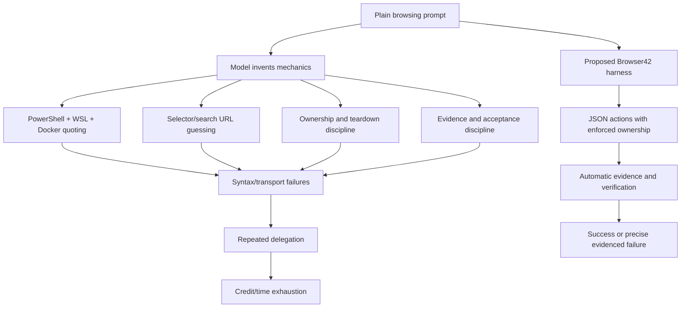

# Browser42 agentic browsing: lifetime record and hardening plan

## Scope and evidence boundary

This report reconstructs Browser42's repository lifetime and the complete observable record of the
2026-08-03 integration/proof session. It is based on:

- the VS Code JSONL transcript for session `1927e3ab-1c5e-460b-9c06-a10838ce82ed`;
- every nested `search_subagent` and `runSubagent` event in that transcript;
- every observable terminal/tool invocation and completion status;
- Browser42 Git history and the committed implementation at `b8228da9`;
- live Chrome extension, tab-group, service, screenshot, and Mako acceptance evidence.

Private chain-of-thought is not available for export and is intentionally not reconstructed or
fabricated. The archive preserves public assistant messages, user messages, tool requests, tool
arguments, tool starts, and completion statuses. It removes private-reasoning fields and redacts
credential-shaped values.

### Record artifacts

| Artifact | Purpose |
|---|---|
| `browser42-agentic-browsing-lifetime-report.md` | Reviewed chronology, causal analysis, and plan |
| `browser42-agentic-browsing-observable-ledger.jsonl.gz` | Complete sanitized observable event ledger |
| `browser42-agentic-browsing-observable-ledger.manifest.json` | Counts, hashes, redactions, and scope |
| `scripts/browser42-session-export.py` | Deterministic exporter used to create the ledger |

The ledger is gzip-compressed JSONL. Each record retains its original timestamp, IDs, parent ID,
event data, and source line. The manifest binds source and output with SHA-256 hashes.

## Executive verdict

Browser42 now has a real shared Chromium profile and official native Chrome colored/labeled Tab
Groups. That foundation is genuine and runtime-proven. It is not yet reasonable to claim that any
cheap model will complete any arbitrary browsing prompt reliably.

The remaining weakness is no longer Chrome integration. It is the agent interface. The model still
has to translate a plain request into PowerShell/WSL/Docker/Python/Playwright code, preserve an exact
`window.name`, avoid destructive cleanup, discover selectors, handle popups, retry heavy pages,
extract structured results, capture evidence, and verify native ownership. Strong models can do
that. Weak models will predictably omit or corrupt one of those steps.

The correct next architecture is therefore:

> Keep Chrome grouping and shared-state safety in the extension/broker, but move all routine browser
> mechanics into a small JSON CLI/SDK with ownership enforced on every action. Let the model choose
> intent and page actions, never transport, quoting, teardown, or evidence mechanics.

No system can guarantee success on literally every site or prompt: authentication challenges,
CAPTCHAs, inaccessible content, ambiguous requests, hostile anti-bot systems, and external outages
remain real. The attainable contract is deterministic success or a precise, evidenced failure for
every supported operation.

## Quantified session record

Snapshot represented by the attached manifest:

| Measure | Count |
|---|---:|
| Observable transcript events | 9,678 |
| User messages | 110 |
| Assistant messages, including nested agents | 1,547 |
| Tool execution starts | 2,422 |
| Tool execution completions | 2,425 |
| Terminal executions | 1,111 |
| `runSubagent` invocations | 30 |
| `search_subagent` invocations | 13 |
| Delegated invocations total | 43 |
| Invalid transcript lines | 0 |
| Credential-shaped values redacted | 18 |
| Private-reasoning fields omitted | 1,256 |
| Residual credential-shaped values found after export | 0 |

Tool activity was dominated by terminal work, file reads, searches, patches, image inspection, and
diagnostics. Forty-two tool calls had failed completion status in the earlier snapshot. The largest
failure class was nested-agent `read_file` calls using wrong path forms; terminal failures were
mainly Windows/WSL quoting, interrupted builds, heavy-page timeouts, and lifecycle races.

## Repository lifetime

### 2026-06-17: service foundation

Commit `65124b10` introduced Browser42 as a headed browser stack with shared profile state,
Playwright MCP, noVNC, Caddy/Traefik routing, and Authentik protection. This established the one
browser visible to both humans and automation.

### 2026-08-03 15:12: console stabilization

Commit `173b06ad` stabilized Browser42's Console integration. Later work made websocket passthrough
declarative in the app manifest and corrected the doubled `/a/browser42/` mount path.

### 2026-08-03 15:31: browser navigation control

Commit `ea1da027` added the noVNC navigation/fullscreen toggle so the live browser could maximize
page area while retaining access to native browser chrome when needed.

### 2026-08-03 16:55: logical session groups

Commit `60c2596c` added the group manager, persistent group manifests, `window.name=b42g:<slug>`
ownership, CLI hooks, reaper exemptions, and reconnect behavior. This provided logical ownership but
not yet official Chrome Tab Groups.

### 2026-08-03 17:18: visible extension bridge

Commit `323505a8` added native Chrome Tab Groups through an extension bridge. It proved the Chrome
API worked, but visible `data:`/extension/helper tabs and bridge lifecycle behavior violated the
required product experience.

### 2026-08-03 21:23: invisible native groups

Commit `b8228da9` replaced the visible bridge with:

- versioned MV3 worker `worker-1.1.js`;
- invisible offscreen document and runtime Port;
- loopback websocket broker;
- broker-backed group allocation and close;
- direct HTTP(S) URL validation;
- ownership restoration after navigation;
- `Browser.close` filtering in Cloakserve;
- renderer-process cap and CDP attach retries;
- dedicated Browser42 custom agent with no web tool;
- focused group-manager tests and concise CLI documentation.

The obsolete bridge, helper page, and old worker were deleted.

## Requirement evolution

The user's requirements became progressively stricter as false substitutes were exposed:

1. Integrate Browser42 into the Console and maximize the live browser viewport.
2. Preserve one private browser/profile and shared cookies.
3. Add real Chrome Tab Groups, not CSS labels or filesystem-only grouping.
4. Give every delegated task its own native colored/labeled group.
5. Prove two tasks in parallel using only simple prompts.
6. Do not use fetch, search engines, helper pages, extension pages, or fabricated evidence.
7. Keep task tabs grouped and owned; do not touch another agent's tabs.
8. Make it fast, minimal, automatic on install, and usable by cheap models.
9. Preserve the complete session/subagent record and derive cleanup/hardening from evidence.

Each correction was justified. Earlier implementations met only a subset of the real contract.

## Delegation ledger

All exact prompts, arguments, timestamps, parent relationships, and completion events are in the
compressed ledger. This timeline uses local time (UTC+3). Duration is measured between correlated
tool start and completion events. "Returned" means the tool call completed; "accepted" means the
requested browsing evidence passed the task criteria.

| # | Start | Duration | Tool/agent | Purpose | Observed result |
|---:|---|---:|---|---|---|
| 1 | 10:34:15 | 40.1 s | search | Find Console/gallery integration points | Useful discovery |
| 2 | 11:49:34 | 25.1 s | search | Locate active redirect source | Useful discovery |
| 3 | 11:50:05 | 25.5 s | search | Find Console build source | Useful discovery |
| 4 | 12:54:04 | 25.4 s | search | Find routing and script issues | Useful discovery |
| 5 | 13:37:16 | 32.4 s | search | Compare app integration patterns | Useful discovery |
| 6 | 13:43:53 | 29.3 s | search | Locate routing compiler path | Useful discovery |
| 7 | 14:56:59 | 60.5 s | search | Trace Browser42 integration | Useful discovery |
| 8 | 15:00:04 | 28.6 s | search | Trace module registry | Useful discovery |
| 9 | 15:08:12 | 29.0 s | search | Find manifest validator | Useful discovery |
| 10 | 15:16:15 | 25.8 s | search | Find Browser42 control patterns | Useful discovery |
| 11 | 17:51:55 | 92.1 s | Explore | Mako AI research | Wrong toolset; not accepted |
| 12 | 17:51:55 | 17.0 s | Explore | Mako medical research | Wrong toolset; not accepted |
| 13 | 18:01:45 | 67.8 s | Explore | AI articles and screenshot | No terminal; not accepted |
| 14 | 18:01:45 | 84.3 s | Explore | Medical articles and screenshot | No terminal; not accepted |
| 15 | 18:03:30 | 61.9 s | default | AI via Browser42 | No accepted evidence |
| 16 | 18:03:30 | 217.6 s | default | Medical via Browser42 | No accepted evidence |
| 17 | 18:07:25 | 941.5 s | default | AI via Browser42 CDP | Long failed operative attempt |
| 18 | 18:07:25 | 1,203.9 s | default | Medical via Browser42 CDP | Long failed operative attempt |
| 19 | 18:47:06 | 29.8 s | Explore | Probe terminal/Browser42 capability | Useful capability diagnosis |
| 20 | 18:47:43 | 16.4 s | default | Probe default-agent tools | Useful capability diagnosis |
| 21 | 18:48:31 | 127.9 s | default | Simple Mako AI prompt | No accepted evidence |
| 22 | 18:48:31 | 69.0 s | default | Simple Mako medical prompt | No accepted evidence |
| 23 | 18:52:00 | 18.7 s | Browser42 | Validate custom-agent restriction | Useful policy diagnosis |
| 24 | 18:52:24 | 162.6 s | Browser42 | Simple Mako AI prompt | No accepted evidence |
| 25 | 18:52:24 | 162.6 s | Browser42 | Simple Mako medical prompt | No accepted evidence |
| 26 | 19:00:16 | 72.0 s | Browser42 | Retry Mako AI prompt | No accepted evidence |
| 27 | 19:00:16 | 75.1 s | Browser42 | Retry Mako medical prompt | No accepted evidence |
| 28 | 19:04:03 | 242.3 s | Explore | Audit Browser42 architecture | Useful architecture audit |
| 29 | 19:08:05 | 32.1 s | search | Map Browser42 runtime | Useful discovery |
| 30 | 19:44:17 | 15.5 s | Browser42 | Browse latest Mako AI | Fast failure; not accepted |
| 31 | 19:44:17 | 537.3 s | Browser42 | Browse latest Mako medical | Long failed operative attempt |
| 32 | 19:55:34 | 326.9 s | Browser42 | Retry latest Mako AI | Long failed operative attempt |
| 33 | 19:55:34 | 314.3 s | Browser42 | Retry latest Mako medical | Long failed operative attempt |
| 34 | 20:15:43 | 221.5 s | Browser42 | Retry latest Mako AI | Long failed operative attempt |
| 35 | 20:15:43 | 81.1 s | Browser42 | Retry latest Mako medical | No accepted evidence |
| 36 | 20:22:44 | 53.0 s | Browser42 | Final delegated Mako AI attempt | No accepted evidence |
| 37 | 20:22:44 | 56.0 s | Browser42 | Final delegated Mako medical attempt | No accepted evidence |
| 38 | 21:46:46 | 56.5 s | search | Trace Fluxbox `xmessage` path | Useful diagnosis |
| 39 | 21:51:32 | 14m 04s | Browser42 | Parallel Mako AI v2 | Returned pending; not accepted |
| 40 | 21:51:32 | 26m 39s | Browser42 | Parallel Mako medical v2 | Accepted: five results and evidence |
| 41 | 21:57:10 | 39.7 s | search | Locate Browser42 allocator | Useful diagnosis |
| 42 | 22:21:00 | 36.1 s | Browser42 | Monitored Mako AI v3 | Failed closed before allocation |
| 43 | 22:21:00 | 1m 12s | Browser42 | Monitored Mako medical v3 | Failed closed before allocation |

Tool completion `success=true` means the delegation mechanism returned, not that the browsing task
met acceptance. This distinction caused several false positives in the session.

## Delegation timing analysis

### Aggregate latency

| Class | Calls | Agent time | Median | Mean | Maximum |
|---|---:|---:|---:|---:|---:|
| Search reconnaissance | 11 | 5m 54s | 29.0 s | 32.2 s | 60.5 s |
| Explore | 6 | 8m 53s | 76.0 s | 88.9 s | 4m 02s |
| Default operative agent | 7 | 43m 58s | 2m 08s | 6m 17s | 20m 04s |
| Browser42 custom agent | 17 | 77m 28s | 1m 21s | 4m 33s | 26m 39s |
| All delegations | 43 | 2h 17m 50s | 1m 02s | 3m 12s | 26m 39s |
| Operative browsing subset | 27 | 2h 05m 31s | 1m 24s | 4m 39s | 26m 39s |

The search agents were predictable and useful. Operative browsing dominated cost: 27 calls
consumed 91.1% of all delegated agent time. The v2 medical task is the first fully accepted
delegated Mako result, but its parallel AI sibling was not accepted. Every tool call still returned
`success=true`, proving that transport success was not a usable performance or completion signal.

### Parallel waves

AI and medical tasks were launched as pairs. Parallel execution saved 30m 56s compared with running
the same calls serially, but each wave still waited for its slowest member.

| Calls | Wave purpose | Parallel wall | Serial work | Time saved | Accepted |
|---|---|---:|---:|---:|---|
| 11-12 | Explore research | 1m 32s | 1m 49s | 17s | No |
| 13-14 | Explore screenshot attempt | 1m 24s | 2m 32s | 1m 08s | No |
| 15-16 | Default Browser42 attempt | 3m 38s | 4m 39s | 1m 02s | No |
| 17-18 | Default raw-CDP attempt | 20m 04s | 35m 45s | 15m 42s | No |
| 21-22 | Default simple prompt | 2m 08s | 3m 17s | 1m 09s | No |
| 24-25 | First custom-agent attempt | 2m 43s | 5m 25s | 2m 43s | No |
| 26-27 | Custom-agent retry | 1m 15s | 2m 27s | 1m 12s | No |
| 30-31 | Later custom-agent attempt | 8m 57s | 9m 13s | 15s | No |
| 32-33 | Later custom-agent retry | 5m 27s | 10m 41s | 5m 14s | No |
| 34-35 | Later custom-agent retry | 3m 42s | 5m 03s | 1m 21s | No |
| 36-37 | Final delegated attempt | 56s | 1m 49s | 53s | No |
| 39-40 | Parallel Mako proof v2 | 26m 39s | 40m 43s | 14m 04s | Medical only |
| 42-43 | Monitored Mako proof v3 | 1m 12s | 1m 49s | 36s | No: allocation collision |

The lesson is not to avoid parallelism. Parallelism worked mechanically. The error was scaling an
unproven operative path to two tasks before one canary passed acceptance. Calls 17-18 alone occupied
a 20-minute wall-time wave while repeating the same unsupported mechanics.

### New monitored parallel Mako trials

#### v2: one genuine success, one unresolved control-flow failure

Calls 39 and 40 started at the same second. The medical Browser42 agent completed a verified
five-article result at `2026-08-03T19:17:46Z`: native group
`mako-parallel-medical-20260803-v2`, red label, group ID `651481117`, tab ID `1550185121`, exact
`window.name=b42g:mako-parallel-medical-20260803-v2`, one live owned tab, direct Mako URL, and a
nonblank 239,159-byte screenshot. Its observable sequence was allocation, rendered Health-page
inspection, ordered visible-card extraction, candidate-date inspection, final navigation, viewport
screenshot, native-group query, and live ownership/file verification.

The simultaneous AI agent returned only a pending-status message, then no accepted result. Live
inspection found its owned tab at `https://www.mako.co.il/`, `document.readyState="complete"`,
22,083 body-text characters, 250 loaded resources, 39 frames, and an 89.1-second completed
navigation. It was not loading; the agent had lost its operative state after returning from search
to the homepage. This is an agent control-flow failure, not evidence of a Mako outage.

#### v3: independent watcher, deterministic pre-browser failure

Before calls 42 and 43, a separate read-only CDP watcher sampled both new ownership tags every
five seconds. It recorded tab count, screenshot presence, URL, DOM readiness, body size, resource
count, renderer count, and automation-client count. Across 19:20:41Z through 19:22:43Z, both slugs
remained at zero tabs and zero screenshots. Renderer count fell from 17 to 13; automation clients
briefly rose from one watcher to two and returned to one. Neither task reached Browser42 allocation.

Both agents independently attempted `bbox.cmd`/WSL allocation through the shared VS Code terminal
channel. Their input collided with pre-existing terminal state. The AI agent failed closed at 36.1s;
the medical agent failed closed at 72.4s. This is valuable evidence: correct fail-closed behavior
prevented fabricated results and browser mutation, but a parallel browsing system cannot depend on
a shared interactive terminal.

#### Resource assessment

At investigation, Browser42 used 21% CPU and 968.7 MiB of its 2 GiB limit. Chromium had a
configured 12-renderer cap; observed renderer processes varied from 13 to 17 because browser
utility, extension, and renderer lifecycle work overlap. The v3 watcher showed no correlation
between resource pressure and allocation failure. Increasing CPU or memory would not fix a terminal
input collision or restart an exited subagent, so no resource increase was applied.

### Small-model readiness: NOT READY

The system is **not ready** for a smaller-model acceptance run. One v2 medical agent proved that a
full Browser42 task can succeed, but the parallel pair did not both pass, and the monitored v3 pair
could not even allocate independently. A smaller model would be exposed to the same raw shell,
PowerShell/WSL quoting, terminal ownership, selector, and evidence mechanics, with less capacity to
recover. Testing it now would measure accidental terminal scheduling, not browsing competence.

The minimum gate before a small-model trial is:

1. Browser42 allocation, inspection, action, verification, and finish are JSON task commands,
  never agent-generated PowerShell/WSL snippets.
2. Each delegated agent receives an isolated non-interactive execution request with a unique ID;
  no command may reuse the VS Code terminal input buffer.
3. The task runner publishes a heartbeat after every stage and a watchdog cancels/stamps a task as
  `STALLED` after 15 seconds without a state transition.
4. The parent accepts a result only from `task verify` after native ownership, direct URL, extracted
  records, screenshot hash, and sibling-isolation checks pass.
5. A canary task must pass before two or more same-site siblings fan out. Then run 10 consecutive
  two-task Mako pairs, with at least 9/10 pairs fully accepted and zero cross-task mutations.

### Required monitoring and execution hardening

1. **Move task execution out of the shared terminal.** `bbox b42 task` should send one structured
  request to the broker or a dedicated task-runner service. It must return a task ID immediately,
  write no interactive prompt, and never depend on terminal focus or queued stdin.
2. **Use a task state machine.** Persist `ALLOCATING`, `NAVIGATING`, `INSPECTING`, `ACTING`,
  `EXTRACTING`, `CAPTURING`, `VERIFYING`, `ACCEPTED`, `FAILED`, and `STALLED`, with enter/exit
  timestamps and a machine-readable error code for every terminal state.
3. **Make the watcher platform-owned.** Start a per-task monitor at `task start`, not as a separate
  ad hoc agent command. Journal tab count, ownership generation, URL, DOM/resource progress,
  screenshot state, CDP health, renderer count, and task heartbeat at a fixed interval.
4. **Enforce stage budgets in the runner.** Allocation 15s cold, inspection/action 30s, and whole
  task 90s unless the journal shows forward stage progress. The runner, not the model, cancels a
  stalled operation and preserves a diagnostic screenshot/trace.
5. **Give progress a contract.** A model action must return `progress=true` only when it advances a
  state or changes an expected page signature. A fully loaded homepage after an intended search is
  a classified `WRONG_FINAL_STATE`, not progress.
6. **Separate browser capacity from orchestration capacity.** Track CPU, memory, renderer count,
  tabs, CDP latency, and queue depth, but scale resources only when those metrics cross a measured
  threshold. Never use a resource increase to hide protocol, ownership, or scheduling failure.

### Timeline bottlenecks

1. **Capability routing happened after execution.** Four Explore browsing calls consumed 4m 22s
  before the later 30-second probe established that Explore had no terminal.
2. **No bounded stage timeout existed.** Eleven operative calls exceeded 90 seconds; the worst took
  20m 04s. A 90-second unclassified-attempt cap would have removed more than 36 minutes from these
  parallel waves even before eliminating retries.
3. **Failure did not stop fan-out.** Both topics repeatedly ran through the same broken transport or
  selector strategy. One accepted canary should have been required before starting its sibling.
4. **Retries had no machine-readable cause.** New prompts repeated old mechanics because results did
  not classify capability, navigation, selector, ownership, evidence, or acceptance failure.
5. **Fast return was confused with success.** Call 30 returned in 15.5 seconds but did not satisfy
  the task. Latency metrics without acceptance metrics reward premature failure.
6. **Tail latency controlled each pair.** Parallel waves saved work time, but a single 8-20 minute
  outlier held the whole result. Sibling cancellation and per-stage deadlines were absent.
7. **Observation payloads were expensive and unstable.** Raw generated Playwright, broad DOM dumps,
  full-page screenshots, and nested PowerShell/WSL quoting consumed time that a compact task API
  can remove.

## General agentic-browsing speed optimizations

Apply these controls in order; each removes a measured source of waste rather than merely making
the browser faster.

1. **Preflight capabilities in <= 5 seconds.** Before delegation, assert access to the required
  Browser42 task tool, shared profile, direct site, screenshot path, and native-group API. Reject
  incompatible agents without spending a model turn on the operative prompt.
2. **One accepted canary, then fan out.** Run one representative task through allocation, action,
  extraction, screenshot, and acceptance. Only after it passes should independent siblings run in
  parallel. Cache the proven site strategy for the fan-out generation.
3. **Use stage deadlines, not one large task timeout.** Budget allocation 3s warm, inspect 1s,
  action 15s, extraction 10s, and viewport capture 3s. Abort an unclassified operative attempt at
  90s; permit a longer task only when progress events identify the active stage.
4. **Make acceptance the completion signal.** `success=true` must require schema-valid records,
  direct-site URLs, native ownership, nonblank evidence, and unchanged sibling groups. Transport
  completion should be named `returned`, never `success`.
5. **Retry by error code with a strict budget.** Retry transient CDP/navigation failures internally
  with bounded backoff. Do not retry capability, policy, invalid URL, or acceptance failures with
  the same strategy. Allow at most one model-level recovery per classified failure.
6. **Cancel tails and siblings intelligently.** If a shared prerequisite fails, cancel the pair. If
  one independent sibling passes while another stalls, preserve the accepted result and diagnose
  only the stalled task; never rerun both blindly.
7. **Return compact observations.** Expose visible roles, names, labels, placeholders, URLs, and
  stable handles. Cap observation size and diff it between actions instead of sending full DOM or
  body text on every turn.
8. **Prefer viewport evidence.** Capture a viewport first; use raw CDP fallback automatically. Take
  full-page screenshots only when acceptance explicitly requires them.
9. **Cache site-local discoveries safely.** Reuse confirmed search entry points, accessibility
  handles, popup policy, and extraction schema by domain plus page signature. Invalidate on DOM
  signature mismatch rather than rediscovering everything each run.
10. **Journal latency per stage.** Record queue, model, allocation, navigation, inspect, action,
   extraction, screenshot, verification, retries, and total wall time. Report p50/p90/p99 and
   accepted-results-per-minute, not just tool-call duration.

### Proposed operative latency SLO

| Metric | Warm target | Cold/fault target | Enforcement |
|---|---:|---:|---|
| Capability preflight | <= 5 s | <= 5 s | Reject incompatible agent |
| First useful inspection | <= 5 s | <= 15 s | Classify startup failure |
| First accepted canary | <= 45 s | <= 90 s | No fan-out before pass |
| Additional parallel sibling | <= 30 s | <= 60 s | Reuse canary strategy |
| Unclassified attempt | Never > 90 s | Never > 90 s | Cancel and journal |
| Classified transient recovery | <= 1 retry | <= 2 internal retries | No model retry loop |
| Task acceptance | 100% of reported successes | 100% | Fail closed |

The primary throughput metric should be **accepted operative tasks per wall-clock minute**. Agent
tokens, tool calls, and parallel workers are secondary; they are useful only when acceptance rises
faster than resource consumption.

## What the delegated attempts actually proved

### Read-only reconnaissance

The first ten search agents successfully located routing, Console, manifest, and Browser42 control
surfaces. They were useful for code discovery, not operative browsing.

### Explore-agent mismatch

The explicitly selected `Explore` agent had file/search tools but no tool capable of launching a
terminal command. It could read the Browser42 guide but could not execute `bbox`, Docker, or CDP.
When asked to browse, it either failed or chose other web capabilities. This was a routing error:
the agent type could not satisfy the task.

### Default-agent inconsistency

Default subagents sometimes had terminal access, but their behavior varied. They guessed Mako
search URLs/selectors, used forbidden alternatives in some attempts, or produced scripts that were
not equivalent to a successful delegated run. Tool availability alone did not create compliance.

### Visible bridge failure

The initial native-group bridge opened a visible `data:text/html` helper tab. The group existed, but
the task tab experience was wrong and parallel ownership was unclear. This was not acceptable proof.

### Mako-specific failures

- guessed search endpoint redirected to `/not-found`;
- guessed selector `input[name=searchStr]` did not match the live site;
- clicking Mako's Digital link opened a new unowned tab;
- heavy ad rendering caused transient CDP `502` and screenshot stabilization timeouts;
- full-page screenshots exceeded timeouts even after fonts loaded;
- one Python date regex was accidentally double-escaped through PowerShell/WSL quoting;
- multiple delegated retries exhausted available model credits before both tasks succeeded.

### Main-agent fallback proof

The final acceptance was completed through direct Playwright control in the live shared Chromium:

- medical group: `mako-medical-latest-20260803-a4n8`, native purple, one owned tab;
- AI group: `mako-ai-latest-20260803-u4n8`, native green, one owned tab;
- exact `window.name` ownership matched both groups;
- AI results came from Mako's visible native search UI and rendered `li.articleins` cards;
- medical results came from Mako's Health page;
- screenshots were nonempty;
- the versioned extension worker and native Chrome APIs reported the groups directly.

This proved the infrastructure. It did not prove cheap-model autonomy because the main agent had to
diagnose and drive the final steps.

## Root-cause model



The retries were not random. Too many invariants were represented only as prose. Cheap models fail
when correctness depends on remembering prose across many generated commands.

## Site-neutrality invariant

Mako is an incident fixture in this report, not product knowledge. Browser42 runtime, broker,
extension, CLI, custom agent, schemas, retries, monitoring, acceptance, and tests must contain no
publisher-specific URL, selector, text, workflow, timeout, or extraction rule. The same prohibition
applies to every other website.

All operative behavior must be derived at runtime from:

- the user's task and direct starting URL;
- compact accessibility/DOM inspection issued by Browser42;
- opaque element handles returned by that inspection;
- generic navigation, action, extraction, evidence, ownership, and timeout policies;
- optional task-supplied requirements treated as data, never compiled-in adapters.

Historical site names, prompts, selectors, and outcomes may remain only in the immutable incident
report and observable ledger. They must not be imported, parsed, copied, or referenced by runtime
code or generic acceptance tests. The release gate must search executable Browser42 surfaces for
known incident-fixture domains/selectors and fail on any match.

## Current architecture: strengths

1. One real headed Chromium and one persistent profile.
2. Official `chrome.tabs.group` and `chrome.tabGroups.update` usage.
3. Invisible offscreen/broker command path.
4. Exact `window.name` ownership restored on navigation.
5. Direct-site URL requirement at allocation.
6. Shared browser cannot be terminated by CDP `Browser.close`.
7. Reaper spares owned groups and gives new tabs a grace period.
8. Renderer cap and CDP retries address heavy-site contention.
9. Custom agent excludes the VS Code `web` tool alias.
10. Native group/API, screenshot, service, unit, manifest, Compose, and repository gates passed.

## Current architecture: unresolved risks

### P0: agent interface still requires code generation

`bbox b42 group` prints a Playwright snippet. The model must copy, extend, quote, transport, execute,
and terminate that code correctly. This is the largest source of cheap-model failure.

### P0: delegated agents share an interactive terminal channel

The monitored v3 Mako pair never reached Browser42 because concurrent `bbox.cmd`/WSL commands
collided with shared VS Code terminal input. This is an orchestration boundary violation: each task
needs a non-interactive request/response channel and independent lifecycle, not a shared shell.

### P0: no platform-owned task heartbeat or stall handling

The v2 AI tab was fully loaded on Mako's homepage after its agent stopped making progress. A separate
watcher found this only after the fact. Task state, heartbeat, progress classification, timeout,
diagnostic capture, and cancellation must be runner-owned rather than prompt-owned.

### P0: no machine-readable action/result contract

Allocation prints human-oriented text. There is no stable JSON response containing slug, tab ID,
group ID, URL, color, ownership state, screenshot path, retry state, and suggested recovery.

### P0: popup/new-tab ownership is not inherited

Sites can open `target=_blank` or popup tabs. The extension tracks one `tabId` per session and does
not automatically adopt descendants into the native group. This caused the unowned Nexter tab.

### P0: implicit global session state is unsafe

`groups/.current` is global. `session` without a name can race between concurrent agents. The custom
agent says to use an explicit unique slug, but the invariant is not enforced everywhere.

### P0: operative success is not automatically accepted

A subagent can return successfully while producing zero articles, the wrong site, an empty
screenshot, an ungrouped tab, or forbidden-fetch evidence. Tool success and task success are not
the same signal.

### P1: extension and filesystem state can drift

`cmd_gc` closes pages directly and removes manifests without asking the extension to clear its
`session_*`/`owner_*` keys. Reuse eventually self-cleans missing tabs, but state is stale until then.

### P1: browser-process protection is narrow

The proxy blocks `Browser.close`. Other shared-context/process-destructive CDP methods need an
explicit allow/deny analysis and tests, particularly context disposal and target shutdown paths.

### P1: broker protocol lacks schema and health semantics

The broker accepts arbitrary command dictionaries, has no version negotiation, no lease/heartbeat,
no status operation, and no structured error codes. Retry behavior can take a long time before
returning an unclassified string error.

### P1: native-group tests are too shallow

The four tests cover broker success/error and invalid inputs. They do not test native allocation,
concurrency, ownership restoration, popup adoption, close/GC state, worker suspension, broker
restart, browser restart, renderer crash, screenshot evidence, or destructive-CDP filtering.

### P1: product identity contradicts runtime mode

The app describes a stealth browser, but native extension groups currently use Debian Chromium via
`BROWSER42_CHROME=/usr/bin/chromium`. The documented stealth switch loses extension support. The
product must either support extensions in the patched browser or state clearly that native-group
mode is standard Chromium. Silent mode degradation is unacceptable.

### P2: image build cache is unnecessarily fragile

The volatile `guard-shared-browser.py` COPY/RUN occurs before the expensive apt install. Editing the
guard invalidates the apt layer and caused a multi-minute rebuild. Stable package installation must
precede volatile first-party copies.

### P2: stale comments and versions remain

Dockerfile comments still call the old mechanism a bridge; app version remains `1.0.0` while the
extension is `1.1.0`; `TAB_TAG` is unused; CLI doc/help indentation is inconsistent; the group hook
mentions implicit current-session behavior that `cmd_open` rejects.

### P2: custom-agent privileges are broader than needed

The Browser42 agent includes `edit` and `search`. Operative browsing should generally need only
execution plus narrow reading. Repository editing should not be part of a browsing-only persona.

## Target architecture

### 1. Browser42 task CLI

Add a stable, machine-readable interface:

```text
bbox b42 task start --slug <slug> --url <direct-url> --json
bbox b42 task inspect --slug <slug> --interactive --json
bbox b42 task act --slug <slug> --json '<action>'
bbox b42 task verify --slug <slug> --requirements <file> --json
bbox b42 task finish --slug <slug> --json
```

Every command must:

- resolve the tab/group by extension-owned IDs, not page index;
- verify ownership before and after the action;
- retry bounded transient CDP/navigation failures internally;
- emit one JSON object with stable error codes;
- never call browser/context close;
- journal the action and evidence automatically.

Suggested action vocabulary:

```json
{"op":"goto","url":"https://example.com"}
{"op":"inspect","mode":"interactive"}
{"op":"click","handle":"element-17"}
{"op":"fill","handle":"element-4","value":"release notes"}
{"op":"press","key":"Enter"}
{"op":"wait","for":"results","timeout_ms":15000}
{"op":"extract","container_handle":"element-23","fields":{"title":"heading","url":"link@href"}}
{"op":"screenshot","name":"final","full_page":false}
```

The compact `inspect` result should return visible roles, accessible names, labels, placeholders,
URLs, and stable DOM handles. This removes selector guessing and giant DOM dumps.

### 2. Ownership as an extension-enforced capability

Replace single-tab session storage with a session record containing anchor tab, owned tab set,
group ID, lease, and generation. On `chrome.tabs.onCreated`, inherit ownership from `openerTabId`,
group the child immediately, and report it to the task journal. Support policy modes:

- `single`: adopt the child and close/park the old anchor after successful load;
- `group`: retain all descendant tabs in the same native group;
- `deny-popup`: close unexpected descendants and return a structured event.

No task-created tab may remain ungrouped beyond a short allocation window.

### 3. Lease, heartbeat, and reconciliation

- `start` creates a lease with expiry and generation ID.
- Every action refreshes the lease.
- Extension startup reconciles storage against live tabs/groups.
- Broker restart reconnects without losing pending state classification.
- GC uses broker `close` so extension storage and filesystem state converge together.
- Browser restart recreates only active leased sessions and marks old evidence as interrupted.

### 4. Evidence-first task journal

Create `/data/tasks/<slug>/` containing:

```text
task.json            immutable request + policy
events.jsonl         actions, timings, retries, URLs, ownership checks
result.json          structured final result
screenshots/         named evidence
downloads/           task-owned downloads
trace.zip            optional failure trace
```

Each result records direct final URL, native group ID/title/color, owned tab IDs, screenshot hashes,
extracted records, warnings, and acceptance checks. Completion is impossible while required checks
are false.

### 5. Deterministic teardown protection

Create an explicit CDP command policy at the proxy boundary. Permit page-local operations and block
shared-browser/context destruction. Unit-test each blocked method by asserting the browser PID,
profile, other groups, and tabs survive. Return protocol-success only when compatibility requires
it; otherwise return a documented Browser42 error.

### 6. Minimal custom agent

After the task CLI exists, reduce `.github/agents/browser42.agent.md` to:

- tools: `execute`, `read` only;
- one command to start the task;
- iterative `inspect`/`act` JSON loop;
- one command to verify/finish;
- no raw Playwright snippets;
- no permission to edit repository files;
- a pre-tool hook rejecting fetch/search-engine clients, browser launch, bare Docker Compose, and
  destructive shared-browser commands.

The hook is enforcement, not prose. It should allow `./bbox b42 ...` and `./scripts/dc ...` only for
the narrow diagnostic commands the agent requires.

## Phased implementation plan

### Phase 0: freeze the acceptance contract

1. Add a versioned `BrowserTaskResult` JSON schema.
2. Define supported operations, error codes, timeout classes, and popup policy.
3. Define “success” mechanically: expected result count/shape, direct-site URLs, nonempty evidence,
   native ownership, no forbidden network tools, and no effect on other groups.
4. Build a 20-prompt corpus spanning unrelated domains, interaction types, content structures,
   languages, and authenticated/anonymous states before changing runtime code.

Exit gate: current implementation must fail the new corpus in the known ways. This proves the tests
can detect the defects rather than merely confirm the eventual implementation.

### Phase 1: JSON start/status/verify

1. Add broker protocol version and command validation.
2. Add `task start/status/verify/finish --json` around existing allocation.
3. Remove implicit `.current` usage from operative flows.
4. Add automatic screenshot and native API verification.
5. Keep raw Playwright available only as an advanced escape hatch.

Exit gate: a weak scripted agent can allocate and verify without generating Python.

### Phase 2: inspect/action CLI

1. Add compact accessibility/DOM inspection.
2. Add `goto`, `click`, `fill`, `press`, `wait`, `extract`, `scroll`, and screenshot actions.
3. Centralize retries for CDP `502`, commit-vs-load timeouts, detached elements, and screenshot
   stabilization. Use raw `Page.captureScreenshot` fallback automatically.
4. Return errors with current URL, ownership, screenshot, and suggested next legal actions.

Exit gate: unrelated direct-site tasks from the multi-domain corpus pass from simple prompts without
model-generated Playwright or any site-specific runtime adapter.

### Phase 3: multi-tab ownership and state convergence

1. Track owned tab sets and opener inheritance.
2. Add popup policy modes.
3. Add lease/heartbeat/reconciliation.
4. Route close and GC through one extension-owned path.
5. Remove stale manifests/storage automatically.

Exit gate: target-blank, popup, browser restart, broker restart, and worker suspension tests pass
without ungrouped task tabs.

### Phase 4: safety and least privilege

1. Expand/test CDP destructive-command policy.
2. Add custom-agent pre-tool enforcement.
3. Remove `edit` and unnecessary search permissions.
4. Bind every broker request to a session capability and generation.
5. Add URL scheme/domain policy and download containment.

Exit gate: adversarial prompts cannot fetch outside Browser42, launch another browser, close shared
state, operate another session, or write outside the task artifact directory.

### Phase 5: product cleanup and install proof

1. Decide and document standard Chromium versus patched stealth Chromium.
2. Move apt install before volatile guard/source layers.
3. Update app/extension versions together.
4. Remove stale comments, unused constants, implicit-session docs, stale group manifests, and old
   proof artifacts after preserving this report.
5. Run a fresh `bbox run` install and automatic Browser42 acceptance.

Exit gate: fresh clone/install reaches a passing task corpus without manual browser repair.

## Required test matrix

### Functional prompts

- latest N topical articles from a direct news site;
- native site search with delayed results;
- pagination and infinite scroll;
- form fill and submit;
- login-required flow using existing shared cookies;
- target-blank and popup navigation;
- structured table/list extraction;
- file download with artifact verification;
- screenshot of final state;
- multilingual/RTL content.

### Parallelism

- 2, 5, and 10 simultaneous tasks;
- same domain and different domains;
- same prompt with unique slugs;
- one renderer crash while other groups continue;
- one task closes while another navigates;
- no cross-group URL, screenshot, cursor, result, or tab leakage.

### Lifecycle fault injection

- MV3 worker suspension and restart;
- offscreen document recreation;
- broker disconnect/reconnect;
- browser container restart;
- stale tab IDs and stale group IDs;
- transient CDP `502`;
- navigation commit without `DOMContentLoaded`;
- screenshot timeout after fonts load;
- noVNC viewer resize;
- reaper sweep during allocation.

### Security

- `Browser.close` and context-disposal attempts;
- another slug's tab ID supplied to an action;
- `file:`, `data:`, `chrome:`, and extension URL allocation;
- fetch/curl/search-engine attempts from the custom agent;
- prompt injection asking to disable ownership checks;
- path traversal in screenshot/download names;
- broker command with missing/unknown fields;
- secret values absent from journals and screenshots metadata.

### Acceptance assertions

For every successful task:

1. Native Chrome API reports the expected group label/color.
2. Every task-owned tab is in that group.
3. Every owned page has the expected ownership generation.
4. No unrelated tab changed URL/title/group.
5. Result schema validates.
6. Required record count and fields are present.
7. URLs are direct-site URLs.
8. Screenshot exists, is nonblank, and hashes match the journal.
9. Browser PID and profile remain alive.
10. Task duration and retry counts stay within budget.

## Performance budgets

Initial budgets should be measured and then ratcheted:

| Operation | Warm target | Cold target |
|---|---:|---:|
| Task allocation and native ownership | <= 3 s | <= 15 s |
| JSON inspect | <= 1 s | <= 3 s |
| Ownership verification | <= 500 ms | <= 2 s |
| Viewport screenshot | <= 3 s | <= 10 s with CDP fallback |
| Broker reconnect | <= 2 s | <= 5 s |
| Failure classification | <= 5 s after bounded timeout | same |

Build changes that only touch Browser42 first-party scripts must not invalidate the expensive apt
layer. Cached rebuild should remain seconds, not minutes.

## Cleanup inventory

Do only after the new acceptance harness preserves evidence:

- remove stale zero-tab manifests under `data/browser42/groups/` via broker-aware GC;
- remove old screenshots/probes not referenced by this report or an acceptance fixture;
- retain the final AI, medical, and native-group screenshots;
- remove unused `TAB_TAG` and unused Playwright variables;
- make CLI help, hook comments, and guide agree on mandatory explicit slugs;
- rename all remaining “bridge” comments to broker/offscreen terminology;
- align app and extension versions;
- resolve the stealth-versus-native-extension product contract;
- reduce custom-agent tools;
- add generated task artifacts to the correct ignore/retention policy;
- keep this ledger/report as the immutable incident and design record.

## Immediate next slice

The smallest high-leverage implementation is Phase 1 plus the first half of Phase 2:

1. Broker-backed JSON `task start/status/verify/finish` with explicit slug only and no terminal
  stdin dependency.
2. Task journal/state machine plus platform-owned heartbeat, 15-second stall detection, and
  diagnostic screenshot/trace capture.
3. Compact `inspect --interactive` output.
4. JSON `goto/click/fill/press/extract/screenshot` actions.
5. Automatic ownership and screenshot verification.
6. Canary acceptance, then two unrelated direct-site tasks in parallel driven by the real Browser42
  custom agent using only simple prompts and isolated task requests.

This slice directly removes the command-generation and selector-discovery failures that consumed the
session. Popup adoption, leases, and deeper fault injection should follow immediately, but they do
not need to block proving that a cheap model can operate the basic harness.

## Final truth statement

The native Chrome group feature is real and integrated. The session did not prove cheap-model
autonomy. One real delegated medical task passed, but its AI sibling did not, and the next monitored
pair failed at the shared-terminal allocation boundary before browser work began. The hardening plan
above turns the discovered failure modes into code, protocol, task isolation, monitoring, and gates.
Completion should be claimed only when the simple-prompt corpus passes through actual delegated
Browser42 agents, repeatedly and in parallel, from a fresh install.