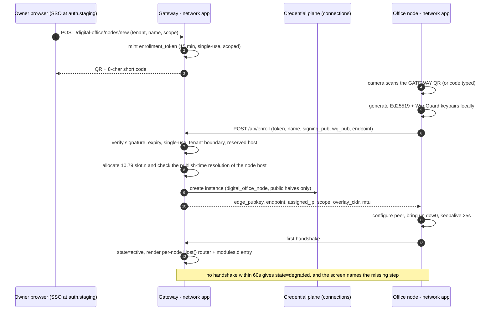
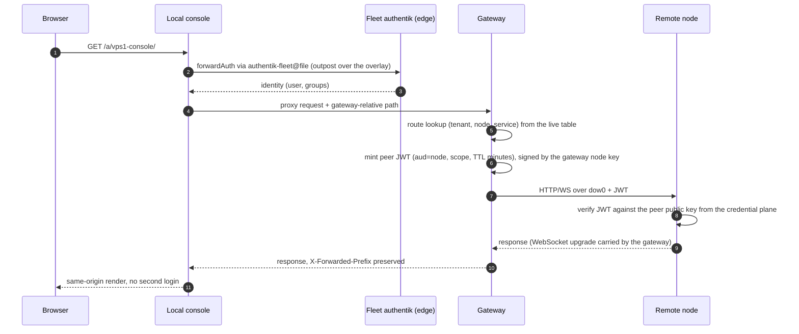
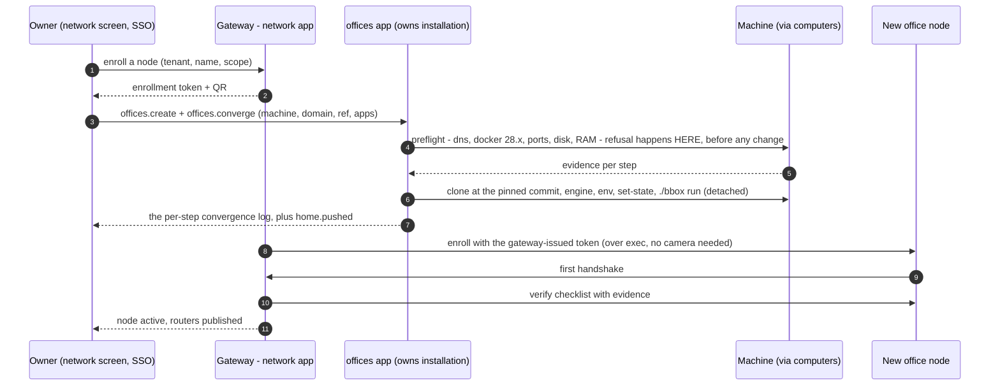
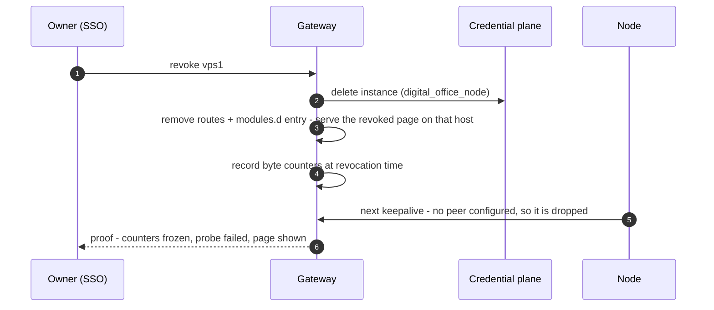
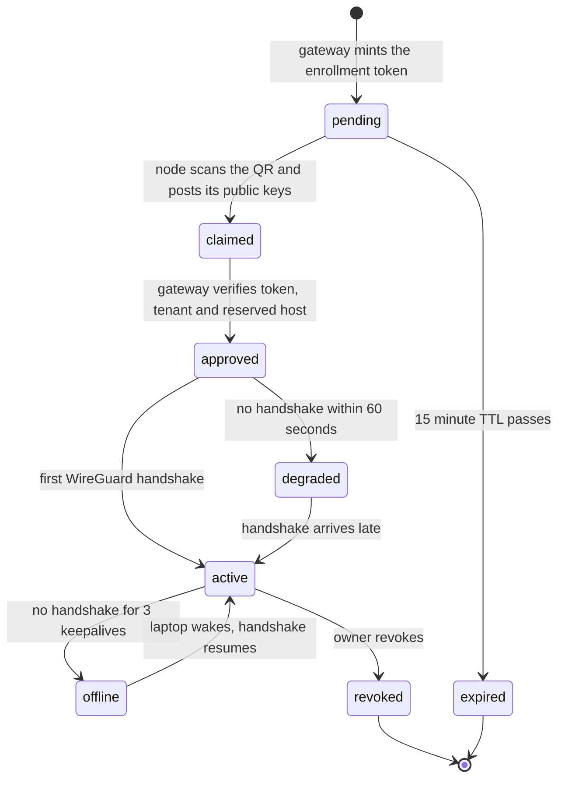
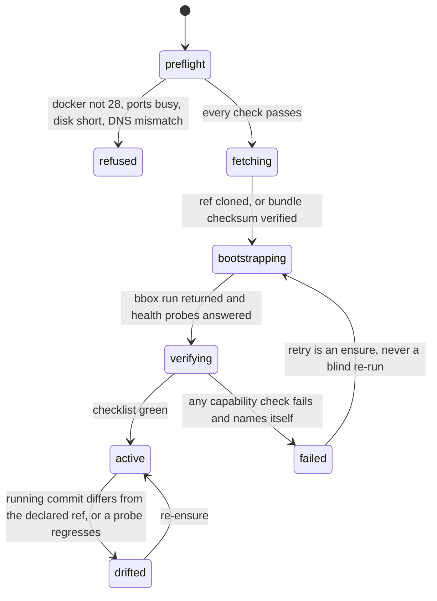
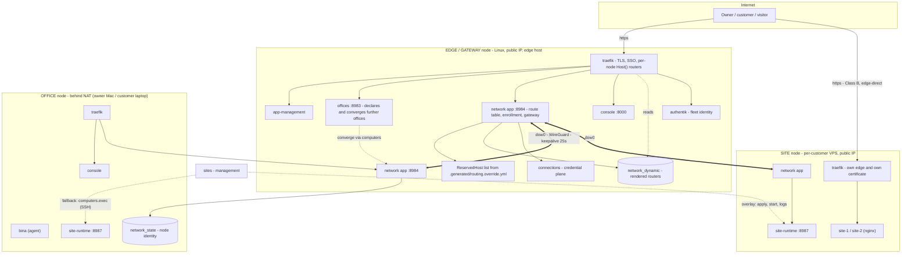
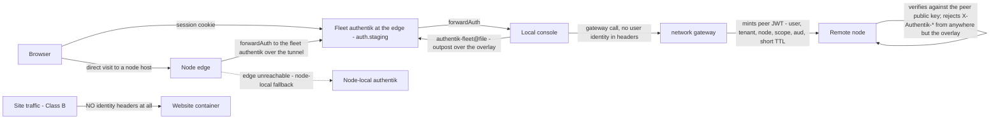
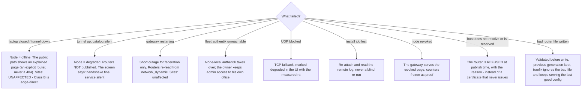

# Digital Office Network — Architecture Review, Final User Stories, Orchestration

**Artifacts under review:** `ai/context/digital-office-network-plan.md` (Hebrew, **rev 2**, 2026-09-29) — the
plan for a `network` app that federates digital offices across machines, exposes an office behind NAT at a
public domain through a QR enrollment flow, and splits `sites` into a serving runtime and a management app.

**This document:** the independent review of that plan, the amendments it forces, the final user stories
with acceptance criteria, the full orchestration (sequences, state machines, ownership), and the
architecture as diagrams (Mermaid, each also rendered to SVG under `ai/context/diagrams/`).

**Revision:** rev 2, **2026-09-29**. A second review round added findings **F-15 … F-24**, which is where
the plan's own rev 2 came from. Nothing here is a question for me to answer; the six decisions that are
genuinely the owner's are collected in **§6 Open decisions**.

**Findings: 24 total — 6 high, 13 medium, 5 low. Every finding closes with an adopted amendment.**
Not one of them required a redesign; the two high-severity gaps in round one and the three in round two
are all closed by *narrowing* scope (per-node routers instead of a catch-all, gateway-issued authorization
instead of node-issued, one writer instead of two).

---

# 0. Review verdict at a glance

| # | Decision | Verdict | Amendment (the finding that forced it) |
|---|---|---|---|
| **D1** | No second product (`digital-office-server`); the office installs itself in a *profile* | ✅ Sound | Boot-seed only, one writer (`platform.state.yaml`), same pattern as `indox.bootstrap_seed`. |
| **D2** | WireGuard overlay owned by the `network` app | ✅ Sound | Userspace/TCP fallback is a **declared, visible degraded mode**, proven in P2 acceptance (F-07). |
| **D3** | `network` is the L7 gateway; traefik holds a stable router | ⚠️ **Amended** | **No catch-all `HostRegexp`** — one exact `Host()` router per published service, with reserved-host enforcement (F-16). Gateway is a *federation-only* hop (F-02); addressing moves to per-gateway `/24` slots (F-01). |
| **D4** | Two-tier addressing (path = door, hostname = mount) | ✅ Sound, one claim wrong | Prefix support must be enumerated before it is tightened (F-03); peer modules get a namespaced identity (F-04); **root-path apps get their own host, not `/a/<alias>/`** (F-21). |
| **D5** | One identity plane, sites outside SSO | ⚠️ **Amended** | Identity lives at the **edge** (`auth.staging.digital-office.co.il` — already live, F-19); node-local authentik is fallback only; identity crossing the tunnel is a peer-bound short-lived JWT (F-14). |
| **D6** | `sites` → `site-runtime` (serving) + `sites` (management), ids unchanged | ✅ Sound | Enumerate the callers of the moved ops first (F-08); `verify` must be capability-based (F-09). |
| **D7** | *(new)* The **gateway** authorizes enrollment, behind its own SSO | ✅ Adopted | A joining node may not mint its own authorization (F-15). |

---

# 1. Architecture review

## 1.1 What the design gets right (and should not be re-litigated)

| Strength | The evidence behind it |
|---|---|
| **No sessions, no port map.** Cryptokey routing has no half-open state for a dropped WiFi to strand. | Seven measured incidents in one day of the hand-rolled `ssh -R` version: 1,334 ssh spawn/exit cycles in 10 min, orphaned `sshd-session` holding listener ports 19001–19021, and a 6-hour silent split-brain where a watchdog rebuilt one forwarding leg and dropped another. |
| **Routes reference a *service*, never an IP.** | The same incident: a partially rebuilt leg set produced a green health check over a broken path. An address that can be reallocated must never be a stored fact. |
| **The gateway owns live routing; traefik owns stable routing.** | Routes change when a laptop opens (`reconcile` cannot be in that path); TLS and platform routers must not change at all. |
| **One owner per fact** (identity → authentik, secrets → `connections`, fleet → `computers`, serving → `site-runtime`). | The platform's own rule (gate G9): a second owner is how a fact drifts. |
| **Declared capability instead of assumed capability.** | `project-pln` is the worked example: root-absolute paths, `VITE_*` baked at image build time, `embed: false` by necessity, upstream bug #8168 still open. |

## 1.2 Findings

Severity is impact if shipped as-is. Each finding ends in an amendment that is now the design.

### Round 1

#### F-01 · HIGH · Overlay address authority does not survive a second gateway

**Problem.** A single `10.79.0.0/16` with no global allocator: two gateways hand out the same overlay
address, and the symptom is not an error — it is traffic reaching the *wrong node*, because
`AllowedIPs = /32` on each side routes a duplicate happily.

**Amendment (adopted).** The gateway, not the network, owns address space:

```
10.79.<gateway_slot>.0/24   gateway_slot ∈ 1..254, per gateway
10.79.<gateway_slot>.1      the gateway itself
10.79.<gateway_slot>.<n>    node n, assigned by THAT gateway (2..254)
```

`gateway_slot` is derived from the gateway's identity, checked against every other registered gateway, and
**refused with both slots named** on collision — the same discipline `reconcile` uses for host/tile
collisions. A node joined to two gateways gets two peers on one interface, which is legal precisely
because the slots are disjoint. A node's local routes are checked at enrollment (F-05); a collision is a
refusal, never a silent override.

#### F-02 · HIGH · The gateway is a single hop for traffic that must not cross it

**Problem.** "Gateway as the L7 data plane" was written as if everything federated. Left that way, all
customer **website** traffic traverses the owner's VPS even when the site's node has a public IP of its
own — an extra hop, a bandwidth bill, and a single point of failure.

**Amendment (adopted).** Two traffic classes, one rule:

| Class | Path | Why |
|---|---|---|
| **A — Office federation** (console, apps, control, enrollment) | browser → edge → **gateway** → tunnel → node | Low volume; needs live routing decisions, an offline page, and a route table. |
| **B — Site traffic** | DNS → the site node's own edge → local container. **The gateway is not in the path.** | Serving must survive the laptop closing, the gateway restarting, or the tunnel dropping. |
| **B′ — Site traffic, node behind NAT** | browser → gateway → tunnel → node | Permitted, and **declared in the UI as a degraded topology**, because it makes the gateway a serving dependency. The remedy is on screen: give the node a public IP. |

Corollary, and it is a rule rather than a test: **a serving component is never `after` a managing
component** in the boot graph.

#### F-03 · HIGH · The console's prefix support is a tightening with unenumerated callers

**Problem.** The console must serve itself under an arbitrary prefix (`X-Forwarded-Prefix`, `<base href>`,
relative asset URLs, API base, WS base, cookie `Path`). Per `AGENTS.md` §8, tightening a contract without
mechanically enumerating its callers turns every omitted caller into a production break — and the console
is the one surface **every** app is reached through.

**Amendment (adopted).** (1) Name the enumerator first: a crawl-and-assert test that fetches the console at
`/a/<peer>/` under a non-trivial prefix and fails on any generated URL that is not prefix-relative.
(2) Prove it finds breakage on the **pre-fix** code, then zero after. (3) Roll out **warn → refuse**.

#### F-04 · MEDIUM · Dynamic modules widen the console's trust surface

**Amendment (adopted).** Peer modules live in a namespaced identity (`peer:<node_id>:<alias>`); a peer can
never express a bare local tile id. Catalogs are **signed by the peer's node key**. A tile's `url` is always
a gateway-relative path — a peer that wants to send the user elsewhere declares `external: true` and the
console renders a link-out with the host shown. A revoked or offline peer has its `modules.d` file
**removed**, not greyed.

#### F-05 · MEDIUM · The overlay CIDR can collide with the customer's own LAN

**Amendment (adopted).** Preflight on **both** sides at enrollment: read the local route table, refuse with
the colliding route printed, keep the CIDR configurable, and store the working CIDR in the node's peer
record so a later change is a visible migration rather than a mystery.

#### F-06 · MEDIUM · Enrollment is a bearer credential on an unauthenticated surface

**Amendment (adopted).** Single use, 15-minute expiry, `consumed_at` recorded, second use refused **and
surfaced as a warning**. Rate limits per IP and per token; constant-time signature verification; the same
sentence for "unknown token" and "expired token" so it is not an oracle; scope default-deny; a gateway
refuses a token issued for a different tenant. *(Round 2 found the deeper problem with the same flow — see
F-15: the token itself was minted by the wrong side.)*

#### F-07 · MEDIUM · UDP-only transport fails in real customer networks

**Amendment (adopted).** The TCP fallback is a **first-class, declared, visible mode**, stored per link so
"why is this office slow today" has an answer. P2 acceptance proves it by blocking 51820/udp and requiring
the node to connect anyway, marked degraded.

#### F-08 · MEDIUM · The `sites` split moves ops with callers nobody enumerated

**Amendment (adopted).** Run the caller enumerator **before** the move, report the scanned **file count**
and not only the findings, prove findings pre-move and zero after, then move. This document does not get to
demand of the console change a rule it skips itself.

#### F-09 · MEDIUM · "Verified" can be a `pgrep` in disguise

**Problem.** A container can be `healthy` while the thing it exists to serve is broken — the platform
already paid for this: a worker consumed **zero jobs for two hours** while Docker reported `healthy`,
because its healthcheck was `pgrep -f 'n8n worker'`.

**Amendment (adopted).** Every verify check asserts a **user-visible capability**, with the evidence in the
response:

| Check | The assertion (not the process) |
|---|---|
| edge | fetch `https://<node-host>/` and assert status + the expected app's markup |
| TLS | read the served chain and report days-to-expiry |
| version | the running commit equals the declared ref |
| federation | fetch the node's console **through the tunnel** and assert 200 after auth |
| site | fetch each site's own URL and assert status + title |
| DNS | resolve `<node>.<edge-host>` and assert it points at the edge |
| headroom | free disk and RAM against named thresholds, not a boolean |

#### F-10 · MEDIUM · Install jobs must survive the gateway

**Amendment (adopted).** The remote log (`/var/log/dobox-install.log`) is authoritative; the gateway's job
row is an index into it. Resume means **re-attach and read**, never "run it again". Install is `ensure`:
an existing `.generated/` plus a matching ref reports "already installed, untouched" with the evidence.

#### F-11 · LOW · Certificate strategy for a growing fleet

**Amendment (adopted, then corrected in round 2).** Round 1 proposed a DNS-01 wildcard at Cloudflare.
**That provider is not ours** (F-17). The working answer today is per-exact-host HTTP-01; the wildcard
becomes an owner decision (§6.2) and the gateway's screen shows rate-limit headroom so the failure mode is
visible before it bites.

#### F-12 · LOW · A product name baked into routing

**Amendment (adopted).** `NETWORK_PUBLIC_PREFIX` (default `digital-office`) plus `NETWORK_URL_SHAPE`
(`node` | `tenant-node`, default `node`). A single-tenant gateway with an empty prefix serves
`<edge-host>/<node>/…` — exactly the URL the owner asked for. Round 1 had silently changed it to
`/digital-office/<tenant>/<node>/`; that is now the multi-tenant mode, not the default (F-22).

#### F-13 · LOW · Overlay observability stops at the link

**Amendment (adopted).** Per-route request counts, error counts and latency percentiles attributed to
(tenant, node, service) — this is what turns "the office feels slow" into a route name.

#### F-14 · MEDIUM · Identity crossing the tunnel must not be trusted headers

**Amendment (adopted).** The gateway mints a **short-lived JWT** signed by its node key, bound to
(`user`, `tenant`, `node`, `scope`, `aud`). The target node validates it against the peer's public key from
the credential plane and rejects `X-Authentik-*` arriving from anywhere but the overlay **and** without a
valid JWT. Site traffic (Class B) carries no identity headers at all.

### Round 2 — added in rev 2

#### F-15 · HIGH · The enrollment approval had no authority at the gateway

**Problem.** The plan let the **joining** office mint and sign its own enrollment ticket, and left both
`/digital-office/connect` and the "approve" step unauthenticated. The consequence is not a subtle one:
**anyone running an office could join the gateway, choose their own name, and receive
`<name>.digital-office.co.il`** — with no authorization on the gateway side at all. It also contradicts the
platform's own rule that any action with fleet-wide effect passes through the credential plane.

**Amendment (adopted).** The authorization is created **at the gateway, behind the gateway's SSO**:

```
gateway (owner's browser, already SSO'd at auth.staging…)
  1. authorize  POST /digital-office/nodes/new   {tenant, node_name, scope}
                → enrollment_token {id, tenant, node_name, scope, expires 15 min, single-use}
  2. display    QR + 8-character short code

node (office screen "רשת > הצטרף לשער")
  3. scan       the NODE's camera reads the GATEWAY's QR (or the code is typed)
  4. keygen     node generates Ed25519 + WireGuard keypairs locally
  5. post       POST /api/enroll {token, node_name, signing_pub, wg_pub, endpoint}
  6. verify     gateway: signature, expiry, single-use, tenant boundary, reserved-host list
  7. assign     10.79.<slot>.<n>; instance recorded in the credential plane
  8. respond    same response: {edge_pubkey, endpoint, assigned_ip, scope, overlay_cidr, mtu}
  9. up         node configures the peer, brings up dow0, keepalive 25 s
 10. active     first handshake → routers + modules.d entry published
```

Three things fall out: the authorization decision sits with whoever owns the public name; **there is no
unauthenticated surface left** (the enroll POST is useless without a token); and polling disappears — the
answer returns on the node's own request, so a NAT'd office needs no inbound reachability even to enroll.

**The owner's original direction is kept as a second option** (office displays, `/connect` scans), with the
one required change: the **approval** step — the moment the instance is created — requires a gateway
session, so `POST /api/pair/approve` redirects to the gateway's SSO. Scanning alone never enrolls a node.
In both variants the only unauthenticated page is static: it reads a QR and says "waiting for approval".

#### F-16 · HIGH · A catch-all `HostRegexp` router would have taken over the live edge

**Problem.** Round 1's rule was `` HostRegexp(`^[a-z0-9-]+\.<edge-domain>$`) `` with no priority. Two failures
in one label:

- **Priority.** Traefik v3 derives default priority from rule length; a long regexp outranks a short
  `Host()`. On the live VPS that means `console.staging…` and `auth.staging…` — real, running routers —
  would be swallowed by the gateway's catch-all. Not hypothetical: both are served from `31.97.196.82`
  right now (evidence in §1.4).
- **ACME cannot issue for a regexp.** Traefik issues per exact `Host()`; a catch-all falls back to the
  edge's default certificate — which "works" in a browser with a warning, exactly the kind of failure that
  gets reported as success.

**Amendment (adopted).** One **exact** router per published service, written into the file provider:

```
rule      = Host(`macbook1.<edge-host>`)     # exact; no regexp anywhere
priority  = 10..90                           # below 100 (console) and below every reserved host
service   = network:8984                     # the gateway forwards from there onto dow0
tls       = true + certresolver=myresolver   # HTTP-01 on that exact host
```

and a **reserved-host list**, derived mechanically from `.generated/routing.override.yml` (25 compiled
`Host(...)` rules, resolved against `.env`) + `AUTH_EXTERNAL_URL` + the edge host itself. The app **refuses**
to render a router for any of those names, naming the host and its owner in the refusal. No schema field and
no compiler change is needed — round 1's proposed `routing[].extra_rules` was **withdrawn**, because
everything that depends on which nodes exist is written to the file provider instead.

#### F-17 · HIGH · The DNS and TLS assumptions were wrong

**Problem.** Round 1 assumed a Cloudflare-hosted zone and a wildcard certificate via DNS-01. Measured on
2026-09-29 (DoH + `getent` + `curl`; raw output in the plan's appendix ב):

| Round-1 claim | What was measured |
|---|---|
| "nameservers at Cloudflare" | **No.** `NS digital-office.co.il` → `ns1.sitesdepot.com`, `ns2.sitesdepot.com`; SOA `ns1.sitesdepot.com admin.intervision.co.il` (InterVision's Plesk). Cloudflare DNS-01 is unavailable without moving delegation. |
| "a one-label wildcard" | `*.staging.digital-office.co.il` exists and **answers at any depth on this nameserver**: `macbook1.staging…`, `plane.macbook1.staging…`, `a.b.c.d.e.staging…` all → `31.97.196.82`. But `x.digital-office.co.il` → NXDOMAIN, so `*.digital-office.co.il` does **not** exist and the platform's documented one-label rule for `*.<slug>` still holds. |
| "`staging.digital-office.co.il` is the entry point" | **It has no A record.** NODATA; `curl https://staging…` → `000`. An entry host must be a name that resolves. |
| — | The live edge on `31.97.196.82` **already** serves `console.staging.digital-office.co.il` (302 → `auth.staging…/application/o/authorize/`) and `auth.staging.digital-office.co.il` (302 → the authentik flow). `edge.staging…` and `macbook1.staging…` return **traefik 404** (wildcard resolves; no router). |
| — | `31.97.196.82` is **already in the fleet** as `computer_ssh-b154fa0c` ("שרת פיתוח בינה סלושנס"). |

**Amendment (adopted).**

1. **A certificate per exact host, ordinary HTTP-01.** No wildcard, no DNS API. Every
   `<node>.<edge-host>` already resolves to the edge (the wildcard), so `myresolver` issues without
   touching DNS at all.
2. **`NETWORK_EDGE_HOST` must be a name that resolves** — default `console.staging.digital-office.co.il`,
   the one live host that already has a certificate and a router. The owner's literal URL
   (`staging.digital-office.co.il/macbook1`) needs **one A record** for `staging` in the Plesk panel, which
   this plan does not assume (§6.3).
3. **Publish-time resolution check.** Before publishing a router for host H, the gateway resolves H and
   **refuses to publish** unless H points at the edge. This catches the record-less apex, a customer domain
   without a wildcard, and a typo — mechanically, instead of as a certificate that silently never issues.
4. **The wildcard certificate remains an owner decision** (§6.2): needed only at fleet scale (Let's
   Encrypt's 50 certificates/week/domain), and requiring either delegation to Cloudflare or a Plesk API key
   plus our IP on their allowlist (the panel refuses by IP: `403 Access to API is disabled for <ip>`,
   documented in `apps/domains/AGENT.md`).

#### F-18 · MEDIUM · Two owners for routing — round 1 had a compiled catch-all *and* a live table

**Amendment (adopted).** The route table is the truth; the traefik files are its **rendering**:

```
route table (SQLite, network_state)   ← the single source of truth; owned by the network app
        │  functional rendering, same transaction, atomic (temp + rename), validated before write
        ▼
network_dynamic/*.yml   (traefik file provider; a volume traefik reads, nobody else writes)
```

`reconcile` emits **no federated route at all** — only the app's own private router and its console tile,
like every other app. The files are not a second owner for the same reason `.generated/` is not one for
`app.json`: they are derived output. What enforces it: a round-trip test (same table → byte-identical
files), no code path that writes a router without first writing the table, schema + reserved-host +
resolution validation before any write, and a kept previous generation so a bad render cannot strip the
edge.

#### F-19 · MEDIUM · Identity location contradicted itself, and a changed file was missing from the list

**Problem.** The plan put the primary authentik on the Mac (D5) while the architecture document moved it to
the gateway without saying so; §4.3 never said where the JWT's user comes from; and
`platform-base/traefik/config/authentik-forwardauth.yaml` — which must change — was absent from the changes
list.

**Amendment (adopted).** Identity lives at the **edge**, and this is not a new decision but the observation
of the current state: `auth.staging.digital-office.co.il` is live and is what guards `console.staging…`.
The Mac closes at night; the VPS does not. So:

- **One identity plane — the edge's.** A node's local authentik remains, with one role: **fallback** when
  the edge is unreachable, so the owner can still get into his own office.
- **Where the JWT's user comes from:** the edge's authentik. On a federated path (`/a/<peer>/…`) the local
  traefik uses the middleware **`authentik-fleet@file`**, whose address is `http://<edge-overlay>:9000/…`,
  rather than the local `authentik@file`. The gateway mints the JWT from that session.
- **The change list gains the file:** `platform-base/traefik/config/authentik-forwardauth.yaml` gets the
  second middleware, its address from env (`BBOX_FLEET_AUTH_URL`). It names no app, so gate G9 (layering)
  stays green.

#### F-20 · MEDIUM · `module.passthrough` with `mount: root` cannot serve the enrollment page

**Problem.** That mechanism requires `auth: sso` (`reconcile.py:794` refuses otherwise) **and** attaches to
the **console's** host. An enrollment page needs the opposite of both: it must work before the node is
enrolled (so it cannot be SSO-gated on the far side), and it must live on `NETWORK_EDGE_HOST`, not the
console host.

**Amendment (adopted).** Drop the passthrough. Every public router of the `network` app is written to the
file provider (one owner, F-18); the compiler emits only the app's console tile.

#### F-21 · MEDIUM · The claim that root-path apps work under `/a/<alias>/` was wrong

**Problem.** Round 1 asserted `<node>.<edge>/a/<alias>/` reaches every app "including Plane". It does not:
`apps/project-pln/app.json` routes by **hostname** (`"host": "plane"`, root paths, `auth: "none"`,
`embed: false`), so Plane never enters a console prefix — attempting `/a/plane/` is exactly the failure
`AGENTS.md` documents (upstream bug #8168). The second wrong claim that followed from it — "wildcard at one
label" — is also false for the `staging` subtree (F-17).

**Amendment (adopted).** Declared, per app:

| App kind | How it is reached on a node |
|---|---|
| `subpath: true` (our console, `bina`, `sites`, `drive`, `mail`) | both `<node>.<edge-host>/a/<alias>/` and the prefix door |
| root-path (`project-pln`, `n8n`, `supabase`) | **its own host**: `plane.<node>.<edge-host>` — consistent with the `auth: none` / `embed: false` it already declares |
| anything else | a "opens on its own host" button instead of a broken frame |

`plane.macbook1.staging.digital-office.co.il` **resolves today** (measured), so such a host can be published
with an HTTP-01 certificate. But that is this nameserver's behaviour and must not be generalised to a
customer's domain — which is exactly why the resolution check in F-17 is part of publishing itself.

#### F-22 · LOW · The phase map and the canonical URL had both drifted

**Amendment (adopted).**

```
P1 (identity + token + enrollment screen) ─┐
P2 (data plane + gateway)                 ├─► R2, R3, R8
P3 (remote node install)                  ───  R1, R4 (partial), R5 (baseline)
P4 (console federation)                   ───  R7, and R5 in full
P5 (sites split)                          ───  R6
P6 (multi-tenant)                         ───  R4 at scale
```

**R7 (`console.localhost:8080/vps1`) needs P4**, not P1+P2 — remote tiles inside the local console require
`modules.d` and the same-origin proxy. And the **canonical public URL is `<edge-host>/<node>/…`**: round 1
had silently replaced the owner's `staging.digital-office.co.il/macbook1` with
`/digital-office/<tenant>/<node>/`. The tenant segment is now the *optional* multi-tenant shape
(`NETWORK_URL_SHAPE=tenant-node`); the owner's URL is the default (`NETWORK_PUBLIC_PREFIX=""`,
`NETWORK_URL_SHAPE=node`), subject to the record-less apex in F-17.

#### F-23 · LOW · Five smaller corrections

**Amendment (adopted).** (1) **Port 8981 is taken** by `sites-render` (`apps/sites/docker-compose.yml`) —
the `network` app is on **8984** and `site-runtime` on **8987** (re-checked against the live manifests: 8985 is `digital-assets`, 8986 is `social-list`). (2) The header's finding/amendment counts
now match the body (this file: 23 findings, 6 high / 12 medium / 5 low, one amendment each). (3)
`NETWORK-APP-AND-NATIVE-SCALING-PLAN.md` is now marked **partially superseded** in its own header, naming
which parts stand (the transport analysis) and which are replaced. (4) The **Lima/macOS facts** are written
down: the office runs in the Lima/vz guest (Docker CE 28.5.2 pinned), so WireGuard runs on that kernel —
the container needs `cap_add: [NET_ADMIN]` and `devices: ["/dev/net/tun"]`, with `wireguard-go` as a
reported fallback; and the Mac edge listens on `:8080`, so **a Mac can never be the public edge** (no :80,
and ACME HTTP-01 needs :80). (5) **P2 acceptance moved to the real path** — the owner's Mac ↔
`31.97.196.82` over the internet, with handshake/rtt/MTU/UDP-blocked evidence; the local two-container sim
is a fast pre-check, not the acceptance.

#### F-24 · MEDIUM · The plan re-implemented installation that the `offices` app already owns

**Problem.** The plan gave the `network` app a `remote.py` with `POST /api/nodes/install` — preflight,
`git clone` at a pinned ref, `.env` generation, a detached `./bbox run`, verify. That is already an app:
**`offices`** (capability `offices.v1`, `http://offices:8983`, ops `list/create/delete/converge/status`),
which converges a *declared* office onto a machine from `computers` in fixed idempotent steps
(`machine → dns → code → engine → env → state → run → health`): it pins Docker 28.5.2, discards the
derived `platform.state.yaml` while stashing any other hand edit, passes the git token as a one-shot
`http.extraHeader` (never into `.git/config`), extends an existing `.env` instead of regenerating its
secrets, refuses a `.env` whose `DEPLOYMENT_DOMAIN` differs from the declaration, and reports
`home.pushed` for the commit the remote machine must fetch. Two owners for "install an office on a
machine" is exactly the duplication this platform refuses everywhere else.

**Amendment (adopted).** `network` **consumes** it and owns only what `offices` cannot do:

```
use: [{ capability: "offices", strength: "requires", after: true }]
  create   → declare the office (machine, domain, path, source ref, apps)
  converge → install OR upgrade OR repair (the same operation)
  network adds: the enrollment token, the peer, dow0, the routes, the modules
```

The plan's `remote.py` is **deleted** from the app tree. The "install profiles" recommendation is
re-pointed with it: the per-office app set is the `offices` declaration's `apps:` list — **one owner**;
a named profile, if one is wanted, is a preset that fills that list, never a second mechanism. The
install half of P3 is therefore `offices`' work; P3 in this plan is the enrollment on top of a converged
office. Evidence: `apps/offices/app.json`, `apps/offices/converge.py`, and its `AGENT.md`.

## 1.3 Alternative stacks considered

| Option | What it buys | Why it is not the foundation |
|---|---|---|
| **Own WireGuard + own gateway** (chosen) | Full ownership, no third party in the customer's path, one control plane | Cost: we own key and address management — which *is* the `network` app |
| **Tailscale / Headscale** | NAT traversal, DERP relays, MagicDNS | A second control plane and a second identity provider. Headscale stays a documented **drop-in underneath the same app UI** if a double-NAT topology appears (§6.6) |
| **Cloudflare Tunnel** | Fastest route to "a laptop behind NAT at a public hostname" | Ties the front door to a third party's ToS; no per-tenant address authority; site traffic would terminate in someone else's network. A weekend demo, not the architecture |
| **frp / rathole / bore** | Simple reverse tunnelling | Repeats the per-port model that caused the seven incidents |
| **Docker Swarm / plain VXLAN** | Native container networking | Forces Swarm; poor NAT traversal; L2 semantics unnecessary |

## 1.4 Complexity budget, and the corrected requirement→phase map

Only three phases are load-bearing for what was asked; the rest are the federation and the business.

**Do not start P4 before F-03's enumerator is green. Do not start P6 before F-01's address slots exist** —
multi-tenant is exactly when duplicate addresses appear. **P2's acceptance runs on the real path**
(F-23.5).

## 1.5 One owner per fact

| Fact | Owner | Where it lives |
|---|---|---|
| Node identity (signing + transport keys) | the node itself | `network_state`, one per node |
| Which nodes exist, public keys, overlay addresses, scopes | the credential plane | `digital_office_node` instances |
| Which machines the office can reach at all | `computers` | `computer_ssh` instances |
| Routes (what leads where) | the gateway — **single writer** | `network_state` → the traefik dynamic volume (rendering) |
| Reserved hostnames | the compiler's output, mechanically derived | `.generated/routing.override.yml` → `ReservedHost` |
| Which apps a node runs | that node | its `platform.state.yaml` |
| Installing, upgrading or repairing an office on a machine | **`offices`** | its declaration YAML + the convergence log |
| Who the user is | authentik **at the edge** | identity plane; node-local as fallback only |
| Secrets | `connections` | credential plane; **the gateway holds no customer secrets** |
| What is being served right now | `site-runtime` | on the serving machine |
| Whether it is served *correctly* | `sites` (management) | the manager's store |

---

# 2. Final user stories

Every story is checkable: the acceptance criteria name the observable, and the Definition of Done names the
command or screen that shows it. No story is done on a report of "works".

## US-1 — Enroll my Mac with my public gateway (R2, R3)

> **As the owner**, I open the fleet screen on `console.staging.digital-office.co.il` (behind SSO), ask for
> a new node called `macbook1`, get a QR, and scan it with the camera on my Mac's office screen. My Mac's
> office is now reachable at a public address **while my Mac is open**.

**Given** the office is running on the Mac and the edge node is running with a domain,
**when** the token is consumed and the tunnel handshakes,
**then**
- the gateway shows `macbook1` as `active` with a handshake time and rtt;
- `https://macbook1.<edge-host>/` serves the Mac's console with a valid certificate;
- `https://<edge-host>/macbook1/` serves the same console under the prefix;
- the Mac shows the same peer with the gateway's rtt and a `revoke` action.

**Definition of Done:** an enroll POST **without** a token is refused; a token already consumed is refused
**and logged as a warning**; a token issued for another tenant is refused; a second scan of the same QR
enrolls nothing. All four shown on screen.

## US-2 — The remote office appears in my own console (R7, phase P4)

> **As the owner**, I open `http://console.localhost:8080`, see a group for my remote node with its apps,
> and click one — **without a second login**.

**Given** a paired, active node with a signed catalog,
**when** I open the local console,
**then** the rail carries a group named after the node whose tiles come from that node's catalog; a tile
opens `/a/vps1-<alias>/` same-origin, authenticated by the **fleet's** authentik (via
`authentik-fleet@file`, F-19); a root-path app renders as a link-out naming its host.

**Definition of Done:** a WebSocket-bearing app works through the federation; no request goes to an external
origin; `/<peer>/` redirects to `/a/<peer>/` and cannot shadow a console route; revoking the node removes
its tiles. **This story is not in P1+P2** — it is P4 (F-22).

## US-3 — Install the server for my sites from a screen (R1, R5)

> **As the owner**, I pick a machine from *מחשבים*, choose the `site-host` profile, and press install. Ten
> minutes later the node is a fleet member. Installing again changes nothing.

**Given** a machine reachable through `computers` with Docker 28.x and free ports 80/443 (the install
itself is `offices.create` + `offices.converge` — F-24 — and `network` only adds enrollment),
**when** I run the install,
**then** the screen shows a job with a live log; a second install reports "already installed" **with the
running commit**; on Docker 29 the job fails **before** touching the machine, naming the reason.

**Definition of Done:** `POST /api/nodes/<id>/verify` returns the full evidence checklist (F-09), and the
installed app set matches the profile.

## US-4 — Know, with evidence, whether a node is healthy (F-09)

**Given** a node in the fleet, **when** I verify it, **then** the response carries the site URL fetched with
status and title, the certificate's days-to-expiry, the running commit against the declared ref, disk/RAM
headroom, and the DNS answer; every failing check names itself.

**Definition of Done:** stopping the node's traefik fails at least one check **by name**; stopping only a
child container fails a *different* check. A verify that goes green with the edge down is a bug in the verify.

## US-5 — My two websites keep serving, at the same address, throughout (R6)

**Given** the sites are live on a machine, **when** the migration runs (adopt → verify → fixed pattern),
**then** the visitor-facing URL, the certificate and the content are unchanged at each step; the `adopted`
stage is non-invasive; the move is one explicit action and the only step that touches the container.

**Definition of Done:** a polling probe over the whole migration records **zero non-200s**; after the move,
stopping the *management* app leaves both sites serving.

## US-6 — Manage sites on every machine from one place (R6, R7)

**Given** a machine running `site-runtime` and joined to the fleet, **when** I deploy a site to it, **then**
the manager talks to the runtime **over the overlay**, and SSH is used only for machines with no runtime.

**Definition of Done:** the screen reports which transport it used per machine; removing the machine's SSH
instance does not break management of a machine that has a runtime.

## US-7 — My laptop sleeps at night; nothing else notices (D5, F-02)

**Given** sites on a node with a public IP, **when** the Mac's tunnel drops, **then** site checks stay
green; the local console shows the node as `offline` with the reason; the public path shows an explained
page, **not** a 502 or a 404; when the Mac wakes the state returns to `active` with no manual step.

**Definition of Done:** the scenario executed once, with the observed states recorded — they are the
acceptance. (The live edge answers **404** for a host with no router — measured on `macbook1.staging…` — so
an explained offline page has to be an explicit router, never an assumption about traefik's default.)

## US-8 — Revoking a node actually stops traffic, and proves it (F-06)

**Given** an `active` node, **when** I revoke it, **then** the credential-plane instance is deleted, the
gateway removes its routes and its `modules.d` entry, and the screen shows frozen byte counters plus a
failed probe — evidence, not a deleted row.

**Definition of Done:** a request to the revoked node's public host returns the gateway's "revoked" page;
the node's peer list no longer contains the gateway after its next handshake attempt.

## US-9 — Operate the fleet as the agent

**Given** the `network` app's brief (`AGENT.md`) and the live endpoints, **when** I am asked about the
fleet, **then** I answer from `/api/nodes`, `/api/links`, `/api/routes` and `/api/nodes/<id>/verify`, quote
real evidence, and never construct a hostname or an address from memory.

**Definition of Done:** the brief stays under the compiler's `MAX_BRIEF_BYTES` limit and every endpoint it
names exists and answers.

---

# 3. Orchestration

## 3.1 Services, ports, volumes

| Service | App | Port | Network | Notes |
|---|---|---|---|---|
| `network` (API + gateway) | `network` | **8984** | `traefik-network` + `dow0` | 8981 is taken by `sites-render`; the proxy listener is the same port, reached only via the edge |
| `site-runtime` | `site-runtime` | **8987** | `traefik-network` | One per serving machine; publishes `/api/*`, `subpath: true` |
| `traefik` (edge) | `traefik` | 80/443 | host + `traefik-network` | Unchanged except: dynamic-routes volume, and the `authentik-fleet@file` middleware |
| authentik | `authentik` | 9000 | `traefik-network` | The fleet's identity on the edge; node-local instance is fallback |

| Volume | Owner | Contents |
|---|---|---|
| `network_state` | `network` | node identity, route table, catalogs, tokens, job rows, `ReservedHost` |
| `network_dynamic` | `network`, **mounted** into `traefik` at `/etc/traefik/dynamic` | rendered routers (declared via `contributes.volumes`; the app never writes into another app's directory) |
| `sites_state` | `sites` | the manager's store |
| `sites_runtime` | `site-runtime` | rendered stacks, logs, local state |

## 3.2 Ownership of writes

```
network      ──writes──► network_state        (its own volume)
network      ──writes──► network_dynamic      (its own volume; traefik reads it read-only)
network      ──writes──► modules.d/*.json     (its own volume; console reads it read-only)
network      ──never───► another app's directory, another app's volume, another node's vault
console      ──reads───► /app/generated (compiled) + modules.d (runtime)
traefik      ──reads───► /etc/traefik (static, incl. authentik@file + authentik-fleet@file)
                         + /etc/traefik/dynamic (rendered by network, F-18) + docker labels
sites        ──writes──► sites_state; orders──► site-runtime (apply) over the overlay
site-runtime ──writes──► the rendered stack on its machine + its own volume
```

**Single writer for routes.** The table is written first, always; the files are its rendering.

## 3.3 Boot graph

```
postgres/redis (sql, kv)
   └─ authentik ─────────────┐
   └─ connections ───────────┤
computers ───────────────────┤
   └─ network (identity minted; no peers yet)
        └─ traefik (dynamic dir mounted; routers appear as peers appear)
        └─ console (reads modules.d; tolerates absence)
   └─ site-runtime ──► sites (management)     [manager last: the served thing never waits on the manager]
```

## 3.4 Sequence — enrollment (F-15)

<!-- diagram: 02-pairing -->


## 3.5 Sequence — a federated request (US-2)

<!-- diagram: 03-federated -->


## 3.6 Sequence — remote install (US-3)

<!-- diagram: 04-install -->


## 3.7 Sequence — revocation (US-8)

<!-- diagram: 05-revoke -->


## 3.8 State machines

<!-- diagram: 06-state-node -->


<!-- diagram: 07-state-install -->


## 3.9 Concurrency, idempotency, backpressure

| Concern | Rule |
|---|---|
| Two installs on one machine | Serialized per `machine_id`; the second joins the running job (key = `machine_id + profile + ref`) |
| Two installs on two machines | Allowed, bounded by a small fixed parallelism — the bottleneck is the target's CPU, not the gateway |
| Token claiming | Single-use enforced by a conditional write; a losing race returns the same refusal as a duplicate |
| Route rendering | Atomic (temp + rename); traefik reads a whole file, never a half-written one; previous generation kept |
| Publish decision | A router is only written when the host resolves to the edge and is not reserved (F-16, F-17) |
| Gateway request path | Streaming proxy with upstream timeouts; WS upgrade forwarded; no buffering of large bodies |
| Sites vs federation | Independent: a busy gateway never slows a site served edge-direct (F-02) |

---

# 4. Architecture, visualized

*(Every Mermaid diagram below is rendered to SVG under `ai/context/diagrams/` and validated — 9/9 parse as
XML with a real `<svg>` root. Mermaid sources live beside them in `diagrams/src/*.mmd`; regenerate with
mermaid-cli, `-b white --size 1600 -p <puppeteer config>` (the renderer must run as a **linux/arm64**
Chromium — the `minlag/mermaid-cli` image ships no arm64 browser, so the working recipe is a
`node:*-bookworm-slim` container + `apt-get install chromium` + `npm i -g @mermaid-js/mermaid-cli` with
`PUPPETEER_EXECUTABLE_PATH=/usr/bin/chromium`). The ASCII fallbacks are authoritative when a viewer cannot
render Mermaid. Avoid unquoted `;` inside sequence-diagram messages — it is a statement separator and is
what failed the first render of §3.6/§3.7.)*

| § | Diagram | Mermaid source | SVG |
|---|---|---|---|
| 4.1 | Topology | `diagrams/src/01-topology.mmd` | [01-topology.svg](diagrams/01-topology.svg) |
| 3.4 | Enrollment sequence | `diagrams/src/02-pairing.mmd` | [02-pairing.svg](diagrams/02-pairing.svg) |
| 3.5 | Federated request | `diagrams/src/03-federated.mmd` | [03-federated.svg](diagrams/03-federated.svg) |
| 3.6 | Remote install | `diagrams/src/04-install.mmd` | [04-install.svg](diagrams/04-install.svg) |
| 3.7 | Revocation | `diagrams/src/05-revoke.mmd` | [05-revoke.svg](diagrams/05-revoke.svg) |
| 3.8 | Node state machine | `diagrams/src/06-state-node.mmd` | [06-state-node.svg](diagrams/06-state-node.svg) |
| 3.8 | Install job state machine | `diagrams/src/07-state-install.mmd` | [07-state-install.svg](diagrams/07-state-install.svg) |
| 4.3 | Identity flow | `diagrams/src/08-identity.mmd` | [08-identity.svg](diagrams/08-identity.svg) |
| 4.5 | Failure map | `diagrams/src/09-failures.mmd` | [09-failures.svg](diagrams/09-failures.svg) |

## 4.1 Topology

<!-- diagram: 01-topology -->


```
                            ┌──────────────── EDGE / GATEWAY (Linux, public IP, edge host) ────────────┐
   visitor ──https──► :443 ─┤ traefik ──► network:8984 ──┬─► console and local apps (traefik-network)  │
   owner   ──https──►       │  · one exact Host() router per node (written to the file provider)       │
                            │  · /digital-office/…  (enrollment + fleet index, behind SSO)             │
                            │  · route table · catalog · enrollment tokens · reserved hosts            │
                            │  · offices:8983 declares and converges further offices (via computers)    │
                            │ authentik (fleet identity) · connections (credential plane)              │
                            └───────────┬────────────────────────────────────────────┬─────────────────┘
                                        │  dow0 · WireGuard · keepalive 25s           │  dow0
                  ┌─────────────────────┴──────────────────────┐                     │
                  ▼                                            ▼                     ▼
   OFFICE NODE (behind NAT, Mac)                  SITE NODE (customer VPS, public IP)
   traefik · console · bina · site-runtime         traefik (own edge + cert) · site-runtime · nginx sites
   network_state (node identity)                   network app
                  ▲                                            ▲
                  │  fallback: computers.exec (SSH)             │  overlay: apply / start / logs
                  └──────────── sites (management) ────────────┘
   Class B site traffic: visitor ──► SITE NODE edge (never through the gateway)
```

## 4.2 The URL map

```
https://<edge-host>/                        (a name that RESOLVES — console.staging.digital-office.co.il)
├── <node>/                                 → that node's console (the door + fleet index)
│   └── <node>/<app>/                       → an app on that node, if it declares subpath: true
├── digital-office/                         (NETWORK_PUBLIC_PREFIX, empty on a single-tenant gateway)
│   ├── nodes/new                           ← enrollment, BEHIND THE GATEWAY'S SSO
│   ├── connect                             static QR scanner (the secondary flow; approval still needs SSO)
│   └──                                     fleet index (SSO)
└── a/                                      the gateway's own deployment, unchanged

https://<node>.<edge-host>/                 ← THE REAL MOUNT (wildcard DNS + HTTP-01 cert per host)
├── /                                       the node's console, root paths, zero rewriting
├── /a/<alias>/                             subpath-safe apps of that node
└── https://plane.<node>.<edge-host>/       ROOT-PATH apps get their OWN host, never /a/<alias>/

http://console.localhost:8080/              (the local office)
├── /vps1/                                  302 → /a/vps1/   (namespaced; cannot shadow the console)
├── /a/vps1/                                the remote console, same-origin, prefix-aware (P4)
├── /a/vps1-<alias>/                        a remote app as a first-class tile (P4)
└── /a/network/                             the fleet screen: nodes, links, routes, jobs

NOT PUBLISHED, BY DESIGN
├── https://staging.digital-office.co.il     no A record (measured) → nothing to route
└── any host that does not resolve to the edge   the publish-time resolution check refuses it
```

## 4.3 Identity flow — one plane at the edge, three doors

<!-- diagram: 08-identity -->


## 4.4 The `sites` split

```
BEFORE                                    AFTER
apps/sites                                apps/sites (management)        apps/site-runtime (serving, :8987)
├─ store.py        ───────────────────►   ├─ store.py                    ├─ app.py   (site-runtime.v1)
├─ app.py (UI/API) ───────────────────►   ├─ app.py (UI/API)             ├─ runtime.py (render/deploy)
├─ checks/         ───────────────────►   ├─ checks/ (+ beauty renderer) ├─ probe/collect (local logs)
├─ scheduler.py    ───────────────────►   ├─ scheduler.py (aggregates)   ├─ scheduler.py (collects)
├─ machines.py     ───────────────────►   ├─ machines.py (overlay first) └─ compose + volume
│                                         └─ calls site-runtime over the overlay
├─ runtime.py      ──────────────────────────────────────────────────────► moved
└─ render_server.py ────────────────────────────────────────────────────► stays (management-side scan)

Contract:  POST /apply {rendered files} · /start · /stop · /reload · /logs · /probe · /listLocal
Invariant: stopping /sites leaves every site serving.  The manager is never in the serving path.
```

## 4.5 Failure map — what the user sees

<!-- diagram: 09-failures -->


---

# 5. Review conclusion

**Ship order.** P1 (identity + gateway-issued enrollment) → P2 (data plane + gateway, proven on the real
Mac↔VPS path, including the UDP-blocked case) → P3 (remote install with evidence-based verify). These three
close the requirement as stated. P4 (console federation) and P5 (sites split) follow, each gated on its
enumerator existing first. P6 (multi-tenant) waits for F-01's per-gateway address slots.

**The three things most likely to be underestimated.**

1. **The console's prefix support looks small and is not** — it is a contract tightening with the largest
   caller surface in the platform, and this platform has already paid once for landing such a guard without
   an enumerator.
2. **`verify` is where trust is earned or lost** — a verify that checks containers is a `pgrep` wearing a
   checklist, and the fleet's whole value proposition is "you can see what is actually true".
3. **Authority, not cryptography, is the security boundary here** — round 1's flow was cryptographically
   sound and still let anyone join, because the wrong side minted the authorization. The camera is not the
   security control; the SSO session at the gateway is.

---

# 6. Open decisions for the owner

Six decisions that are genuinely the owner's. Each: options, the evidence already measured, what it blocks,
and a recommendation — so a decision needs no further research.

| # | Decision | Options | Evidence / recommendation | Blocks |
|---|---|---|---|---|
| **1** | **Where the fleet's identity lives** | (a) at the edge — `auth.staging.digital-office.co.il`; (b) on the Mac | (a) is **already the live state**: `console.staging…` redirects there (302 → `application/o/authorize/`). The Mac closes at night; the VPS does not. Recommendation: (a), which is a no-op | nothing |
| **2** | **DNS and certificates** | (a) HTTP-01 per exact host (works today); (b) a wildcard via DNS-01 — requires moving delegation to Cloudflare **or** a Plesk API key plus our IP on their allowlist | Nameservers are `sitesdepot.com` (InterVision Plesk); its API refuses by IP (`403 Access to API is disabled for <ip>`). (a) suffices to roughly 50 nodes/week; (b) is a fleet-scale need | P6 at scale only |
| **3** | **The canonical public URL** | (a) `<edge-host>/<node>/…` (what was asked); (b) `staging.digital-office.co.il/<node>/…` — requires **one A record** for `staging` in the Plesk panel; (c) `/digital-office/<tenant>/<node>/…` for multi-tenant | `staging` has no A record (measured) ⇒ (a) works immediately with `NETWORK_EDGE_HOST=console.staging.digital-office.co.il`; (b) is one click on your side | P1 (fixing `NETWORK_EDGE_HOST`) |
| **4** | **The enrollment approval model** | (a) gateway issues the token behind SSO, the node scans (this plan's default); (b) the node displays, the gateway scans, and approval requires SSO | (a) leaves zero unauthenticated surfaces; (b) is nicer on a phone but adds a scan plus a login | P1 (which flow to implement) |
| **5** | **Which VPS is the edge** | (a) `31.97.196.82` — already in the fleet as `computer_ssh-b154fa0c`, already serving `console.staging` and `auth.staging`; (b) a new machine | (a) recommended: the wildcard, the console and the identity already point there | P2 (the acceptance path's target) |
| **6** | **Own WireGuard vs Headscale** | (a) own (this plan); (b) Headscale — NAT traversal and DERP relays included, but a second control plane | (a) recommended for P1–P3 (two nodes, one of them public). If a node appears with **no** reachable edge, (b) can be swapped **underneath the same app UI** | P6 (topologies without a public edge) |

**Not an open decision, because it is already answered:** the per-office app set (what the plan called an
install *profile*) is the `offices` declaration's `apps:` list, and installing or repairing an office on a
machine is `offices`' job (F-24). `network` declares `use: offices` and adds only enrollment and routing.
