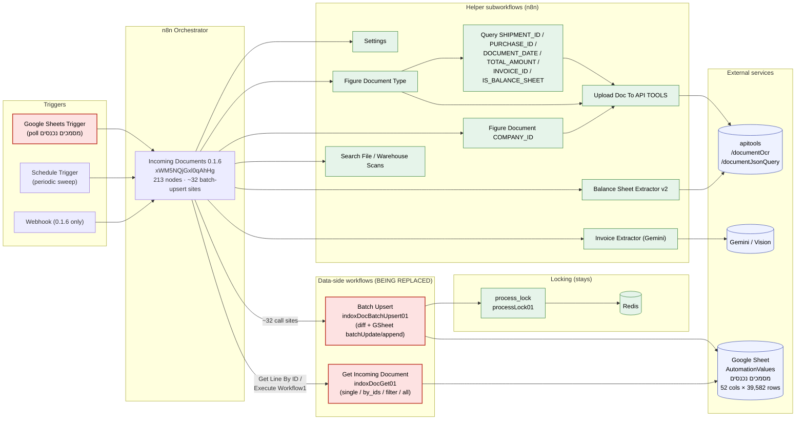
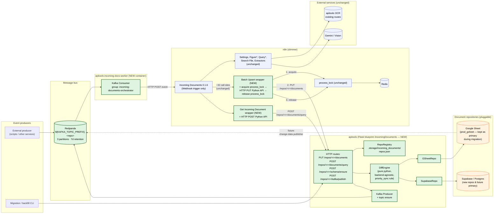

# Incoming Documents — System Architecture (Old vs New)

> Companion to [plan.txt](plan.txt) · [IMPLEMENTATION-PLAN.md](IMPLEMENTATION-PLAN.md) · [TESTING-STRATEGY.md](TESTING-STRATEGY.md).
>
> Visual side-by-side of the **current n8n-only system** and the **target Python+Kafka+multi-backend system**.

---

## 1. OLD system (today, in production)



**Legend (old):**
- 🟥 red = removed / replaced in the new system (`Batch Upsert`, `Get Incoming Document`, GSheet trigger).
- 🟩 green = stays exactly as-is (`process_lock`, all helper/extraction subworkflows).
- 🟦 blue = external services.

**Pain points of the old system:**
1. `Batch Upsert` and `Get Incoming Document` are bound to a **single** GSheet — no abstraction, no Supabase path.
2. The GSheet trigger does row-level polling (high latency, sheet-quota pressure, cannot replay).
3. ~32 call sites × diff-engine logic embedded in n8n Code nodes → hard to test, hard to evolve.
4. No durable event log of "what was processed when".

---

## 2. NEW system (target, after phase 6)



**Legend (new):**
- 🟩 green = newly built in this project (Python module + Redpanda + Kafka worker + 2 thin n8n wrappers).
- 🟦 blue = unchanged n8n / external services.
- 🟧 orange = data stores (one or many; selectable per repo).

---

## 3. Side-by-side mapping

| Concern | OLD | NEW |
|---|---|---|
| Trigger | Google Sheets polling trigger inside `0.1.6` | **Kafka topic** `${prefix}.<repo>` → consumer worker → existing Webhook of `0.1.6` |
| Batch upsert (data side) | `Batch Upsert` workflow: GSheet read → Code-node diff → `googleapis batchUpdate` + `append` | `PUT /incomingDocuments/repos/<r>/documents` → `DiffEngine` → `GSheetRepo` **or** `SupabaseRepo` |
| Batch get | `Get Incoming Document` workflow: switch (single/all/complex/custom-filter) → `googleapis values.get` | `POST /incomingDocuments/repos/<r>/documents/query` → unified `Query` translated per-backend |
| Locking | `process_lock` (Redis) inside n8n | **Unchanged** — wrappers acquire/release around the HTTP call. Python API never locks. |
| Schema mgmt | implicit (sheet header is the schema) | `POST /repos/<r>/schema/ensure` (no-op for GSheet, real DDL for Supabase, modeled on the Supabase reference workflow) |
| Backend choice | Hard-coded to one Google Sheet | `RepoConfig.backend ∈ {gsheet, supabase}` per repo, in registry JSON |
| Concurrency model | Per-row Redis lock + sequential GSheet writes | Same per-row lock + per-batch atomic upsert (Supabase) / batchUpdate (GSheet) |
| Observability | n8n executions UI | Sentry (existing) + Redpanda console + structured logs in apitools |
| Replay | Not possible | Re-consume from Kafka offset |
| Helper workflows (Settings/Figure*/Query*/Extractors) | n8n | **Unchanged** — still in n8n, called from `0.1.6` exactly as today |

---

## 4. Migration boundary (zoom)

```mermaid
sequenceDiagram
    autonumber
    participant T as 0.1.6 trigger node<br/>(call site, e.g. "STATUS COMPLETED")
    participant W as Batch Upsert wrapper (NEW)
    participant L as process_lock (Redis)
    participant A as apitools<br/>PUT /repos/&lt;r&gt;/documents
    participant D as DiffEngine
    participant R as GSheetRepo / SupabaseRepo
    participant S as Sheet / Supabase

    T->>W: { rows: [...] }
    W->>L: lock(IDs)
    L-->>W: ok
    W->>A: PUT body=rows
    A->>D: diff(current, incoming)
    D->>R: fetch_by_ids(IDs)
    R->>S: read
    S-->>R: current rows
    R-->>D: current
    D-->>A: { updates, creates, noops }
    A->>R: batch_update(updates)
    R->>S: batchUpdate / upsert
    A->>R: batch_create(creates)
    R->>S: append / upsert
    A-->>W: { success, updated, created, stats }
    W->>L: unlock(IDs)
    L-->>W: ok
    W-->>T: response
```

This sequence is the **only** place the system shape changes. Every other arrow in section 1's diagram is preserved verbatim in section 2.

---

## 5. Phased cut-over view

```mermaid
gantt
    title Cut-over timeline (per phase)
    dateFormat  X
    axisFormat  P%d

    section Phase 1
    Context collection           :done, p1, 0, 1
    section Phase 2
    Implementation + Test plan   :done, p2, after p1, 1
    section Phase 3
    Build & test (both backends) :active, p3, after p2, 4
    section Phase 4
    New n8n wrappers + Kafka swap :p4, after p3, 2
    Parity capture (n8n tee)     :p4b, after p3, 1
    section Phase 5
    Review + improvements        :p5, after p4, 1
    section Phase 6
    Human verification & migration :p6, after p5, 1
```



Throughout phases 3–5 the **old system stays primary** (feature flag `INCOMING_DOCS_ENABLED=false` for production traffic). Phase 6 is the only phase that changes which workflow ID `0.1.6`'s `executeWorkflow` nodes target.
